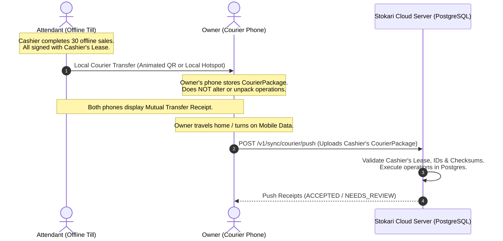

# Stokari Future Features Roadmap (`docs/FUTURE_FEATURES.md`)

This document specifies approved and proposed future capabilities for Stokari scheduled for **Phase 2 and beyond**. These features build on the foundational offline-first architecture without altering the core MVP invariants.

---

## 1. Feature Proposal: Portable Sync Gateway & QR Courier

- **Target Phase:** Phase 2 (Flagship Post-MVP Capability)
- **Status:** Approved Architectural Proposal
- **Category:** Offline Synchronization / Zero-Data Transport
- **Target Audience:** Micro-retailers, rural shops, and kiosks where cashiers lack mobile data / SIM cards.

---

### 1.1 Problem Statement & Retail Reality

In Ethiopian retail environments (neighborhood kiosks, _souqs_, rural pharmacies):

1. **No Cashier Connectivity:** Attendants' phones often do not have SIM cards, mobile data packages, or in-store broadband Wi-Fi.
2. **Owner Mobility:** Store owners visit the shop periodically (e.g. morning/evening) and carry personal smartphones with active cellular data (Ethio Telecom / Safaricom).
3. **Sync Deadlock:** Unsynced sales accumulate on the cashier's phone for days until they find a Wi-Fi connection, delaying business inventory visibility and owner financial auditing.

---

### 1.2 Architectural Concept: The Portable Sync Gateway (Courier Model)

Instead of turning the owner's phone into a complex local database server, **the owner's phone acts as a secure physical courier** carrying signed operation packages.



#### Core Invariants Preserved

1. **Owner Device is Non-Authoritative:** The owner's phone never validates or mutates the cashier's operations; it acts purely as a store-and-forward relay.
2. **End-to-End Audit Trail:** Operations remain cryptographically bound to the cashier's `membershipId`, `deviceId`, and `leaseId`.
3. **Zero Double-Counting:** The server enforces idempotency via unique `opId` deduplication. If the cashier later connects to Wi-Fi and pushes the same operations, the server detects the duplicate `opId` and returns the cached result without double-deducting stock.

---

### 1.3 Three-Tier Transfer Strategy

| Tier       | Transfer Transport | Target Phase               | Environmental Requirements                          | Role                                              |
| :--------- | :----------------- | :------------------------- | :-------------------------------------------------- | :------------------------------------------------ |
| **Tier 1** | **Cloud Sync**     | **MVP (Current)**          | Cellular Data or Wi-Fi on device                    | Standard online push/pull protocol                |
| **Tier 2** | **QR Courier**     | **Phase 2 (Primary)**      | **Zero Network.** Screen-to-camera optical transfer | **Universal Fallback** (Works on 100% of devices) |
| **Tier 3** | **Nearby Sync**    | **Phase 3 (Optimization)** | Same Wi-Fi / Hotspot (WebRTC DataChannel)           | High-speed transfer for large batches (>100 ops)  |

---

### 1.4 Tier 2 Specification: QR Courier (Air-Gapped Sync)

The primary transport relies on **animated / chunked QR codes** (similar to air-gapped hardware cryptocurrency wallets).

#### Why Animated QR?

A standard QR code comfortably encodes ~1.5–2.5 KB of data. A batch of 50 sales (with multiple lines and UUIDs) compresses to roughly 8–15 KB with Brotli/Gzip. By cycling through 4–8 frames at 5 frames per second, the transfer completes in **less than 3 seconds** across two screens.

#### Optical Transfer Protocol

1. Cashier taps `More` ➔ `Transfer to Owner`.
2. The PWA bundles unsynced `WAITING_TO_SYNC` outbox rows into a `CourierPackage`.
3. The screen renders an animated QR loop with a visual progress indicator:
   ```
   ┌─────────────────────────────────────────┐
   │ Transfer to Owner (24 Sales)           │
   │                                         │
   │            [ ANIMATED QR ]              │
   │                                         │
   │ Frame 3 of 6   [████████░░░░] 50%       │
   │ Hold owner's camera facing this screen  │
   └─────────────────────────────────────────┘
   ```
4. Owner opens Stokari scanner: point-and-scan camera captures all frames, reassembles the byte stream, and verifies the SHA-256 checksum.

---

### 1.5 Domain Entity: `CourierPackage`

In Phase 2, a new domain entity will be introduced into local Dexie storage and the backend ingest pipeline:

```typescript
interface CourierPackage {
  packageId: string; // UUIDv7
  shopId: string; // Target tenant
  senderUserId: string; // Cashier User ID
  senderDeviceId: string; // Cashier Device ID
  leaseId: string; // Cashier's Active Lease JWT ID
  createdAt: string; // ISO UTC Timestamp
  operationCount: number; // e.g. 24
  compressedPayload: string; // Gzip/Brotli base64-encoded JSON array of OperationEnvelopes
  payloadChecksum: string; // SHA-256 hash of uncompressed payload
  signature: string; // Cashier device signature / HMAC
  status: "PACKAGED" | "TRANSFERRED" | "COURIER_HOLD" | "COMMITTED";
}
```

---

### 1.6 The Transfer Receipt (Mutual Accountability)

Upon successful transfer, **both devices display an immutable Transfer Receipt**:

```
┌─────────────────────────────────────────┐
│        COURIER TRANSFER RECEIPT         │
│                                         │
│ Status:       Transferred to Courier    │
│ Package ID:   PKG-2026-8819             │
│ From:         Hana (Till 1 · Pixel A12) │
│ To:           Abebe (Owner · Galaxy S21)│
│ Operations:   24 Sales                  │
│ Total Volume: ETB 6,420.00              │
│ Timestamp:    2026-10-20 18:42 EAT      │
│ Cloud Sync:   Pending Owner Internet    │
│                                         │
│ [ Done ]         [ Share SMS Summary ]  │
└─────────────────────────────────────────┘
```

#### Why This Matters:

- **Cashier Protection:** Proves the attendant handed over the day's transactions and did not pocket money or lose records.
- **Owner Visibility:** Owner immediately sees the total sales count and birr volume before even reaching an internet connection.
- **Audit Duplicate Guard:** Package ID prevents the owner from importing the same batch twice.

---

### 1.7 Tier 3 Specification: Nearby Sync (Local Hotspot / WebRTC)

When devices are connected to the same personal Wi-Fi hotspot (without mobile data):

1. **Local Discovery & Handshake:** Devices exchange a short WebRTC session handshake via a single QR code scan (replacing public STUN/TURN servers).
2. **Direct DataChannel Pipe:** A high-speed binary DataChannel opens over local IP (`192.168.43.x`).
3. **Dynamic Fallback:** The UI simply displays `"Receive from Nearby"`. The app attempts WebRTC first; if the network environment blocks UDP, it seamlessly falls back to the **QR Courier**.

---

### 1.8 Rollout Roadmap

1. **Phase 1 (MVP — Current Focus):**
   - Direct HTTP `/v1/sync/push` and `/v1/sync/pull`.
   - Complete core POS till, local Dexie persistence, stock ledger, and conflict review.
2. **Phase 2 (QR Courier Gateway):**
   - Implement `CourierPackage` serialization.
   - Implement animated QR encoder/decoder (`qr-scanner` + `pako` compression).
   - Implement `POST /v1/sync/courier/push` proxy endpoint on the backend.
   - Implement mutual Transfer Receipts.
3. **Phase 3 (Nearby Hotspot WebRTC):**
   - WebRTC DataChannel transport with local-network signaling.
