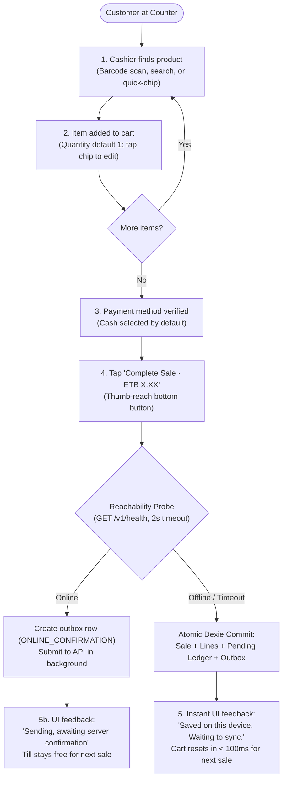
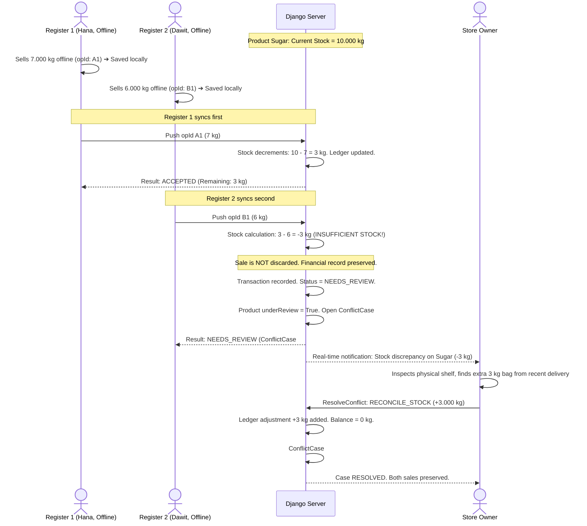

# Stokari User Experience & Interaction Flows (`docs/UX-FLOWS.md`)

**Companion Document to:** [docs/DESIGN.md](file:///home/abelmekonen/Desktop/INSA/backend/docs/DESIGN.md) & [docs/SCREENS.md](file:///home/abelmekonen/Desktop/INSA/backend/docs/SCREENS.md)  
**Target:** Google Stitch, UX Designers, Frontend & Full-Stack Engineers

---

## 1. Flow 1: High-Speed POS Checkout Flow (≤ 10s, ≤ 3 taps)



### Key Interaction Rules:

1. **The Cart Never Freezes:** Even if the network drops halfway through or the server cold-starts on Render, the cashier's till remains 100% responsive.
2. **Atomic Commit Precedes Confirmation:** The green success state is displayed ONLY after Dexie confirms the write to disk (INV-01).

---

## 2. Flow 2: Offline-to-Online Synchronization Lifecycle

```mermaid
sequenceDiagram
  actor C as Cashier (Device 1)
  participant UI as PWA UI
  participant IDB as Dexie (IndexedDB)
  participant SE as Sync Engine
  participant API as Django API
  participant DB as PostgreSQL

  Note over C,IDB: Device is offline
  C->>UI: Completes sale #104 (opId: 0191-A)
  UI->>IDB: Commit sale + outbox (status: WAITING_TO_SYNC)
  UI-->>C: "Saved on this device" (🟡 Offline · 1 waiting)

  Note over C,API: Wi-Fi reconnects
  SE->>SE: Online event fires; acquire Web Lock
  SE->>IDB: Fetch oldest outbox operations (batch ≤ 50)
  SE->>API: POST /v1/sync/push { ops: [opId: 0191-A, ...] }

  API->>DB: Shop lock FOR UPDATE ➔ Check processed ➔ Apply ledger
  DB-->>API: Commit successful (serverSeq: 4821)
  API-->>SE: Push response: { opId: 0191-A, status: ACCEPTED, serverSeq: 4821 }

  SE->>IDB: Single Dexie Tx: update sale to SYNCED, delete outbox item
  IDB-->>UI: LiveQuery updates header: 🟢 Synced just now
```

### Timeout & Interruption Handling:

- If Wi-Fi drops while the server is processing the request, the client receives no response.
- **Rule:** The client retains the item in the outbox and resends the **exact same `opId`**.
- Upon receiving the retry, the server's unique constraint returns the cached result (`DUPLICATE`) without double-charging or re-decrementing stock.

---

## 3. Flow 3: Concurrent Offline Overselling & Owner Review (AT-06)



---

## 4. Flow 4: Attendant Deactivation, Lease Expiry & Drain Flow

```mermaid
sequenceDiagram
  actor O as Store Owner
  participant S as Server
  actor A as Attendant (Offline Device)

  O->>S: Deactivate Attendant "Dawit"
  S->>S: Membership status = DEACTIVATED. Revoke refresh token & leases.

  Note over A: Dawit is still offline; device works until lease expires
  A->>A: Dawit completes 2 sales offline (saved locally in Dexie)

  Note over A,S: Dawit reconnects to Wi-Fi
  A->>S: Attempts sync refresh
  S-->>A: HTTP 403 ACCOUNT_DEACTIVATED + drainToken (10m JWT)

  Note over A: PWA switches to Drain Mode
  A->>S: POST /v1/sync/push with drainToken
  S->>S: Every operation forced to QUARANTINED (Zero ledger effect!)
  S->>S: QuarantinedOperation records created. Case opened.
  S-->>A: Result: QUARANTINED (Local sales marked NEEDS_REVIEW)

  S-->>O: Notification: "2 operations from deactivated attendant await review"
  O->>S: Owner reviews: Option to ACCEPT or REJECT operations.
```
