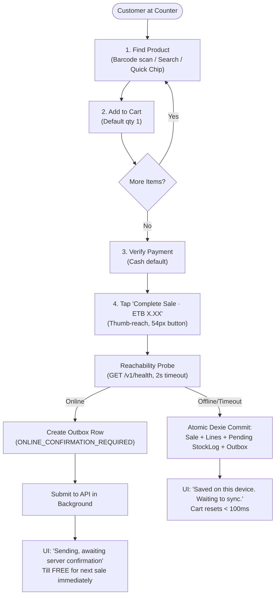
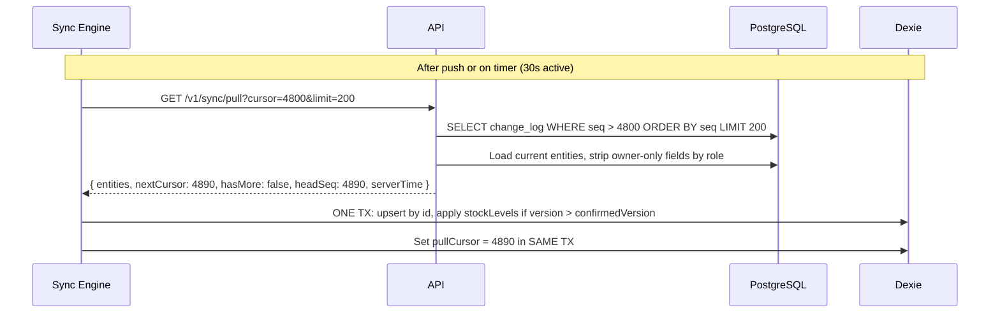
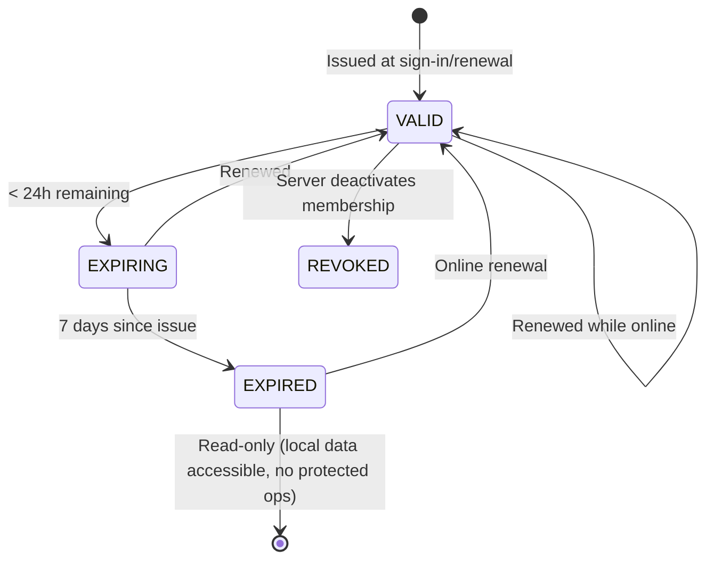
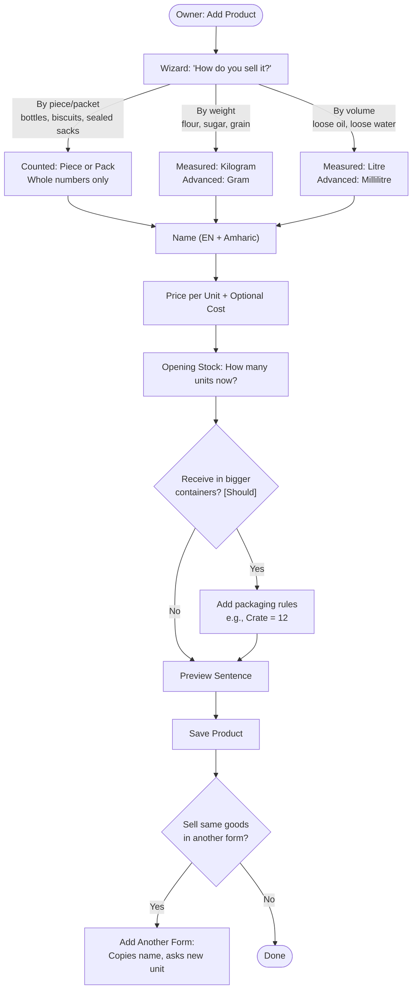
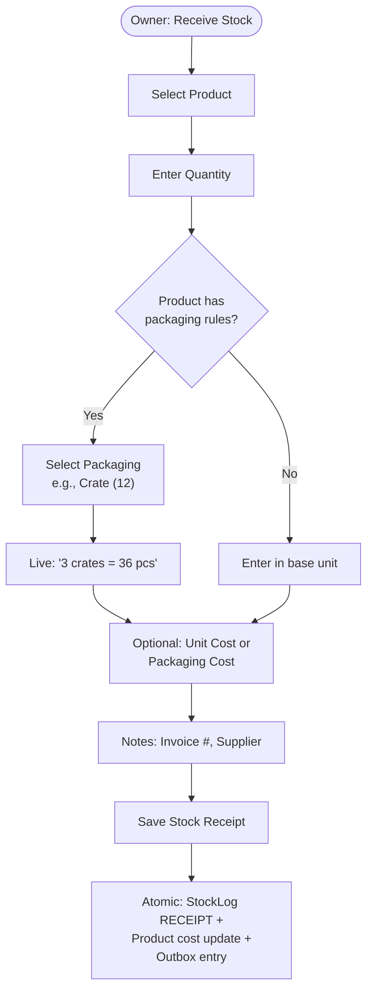
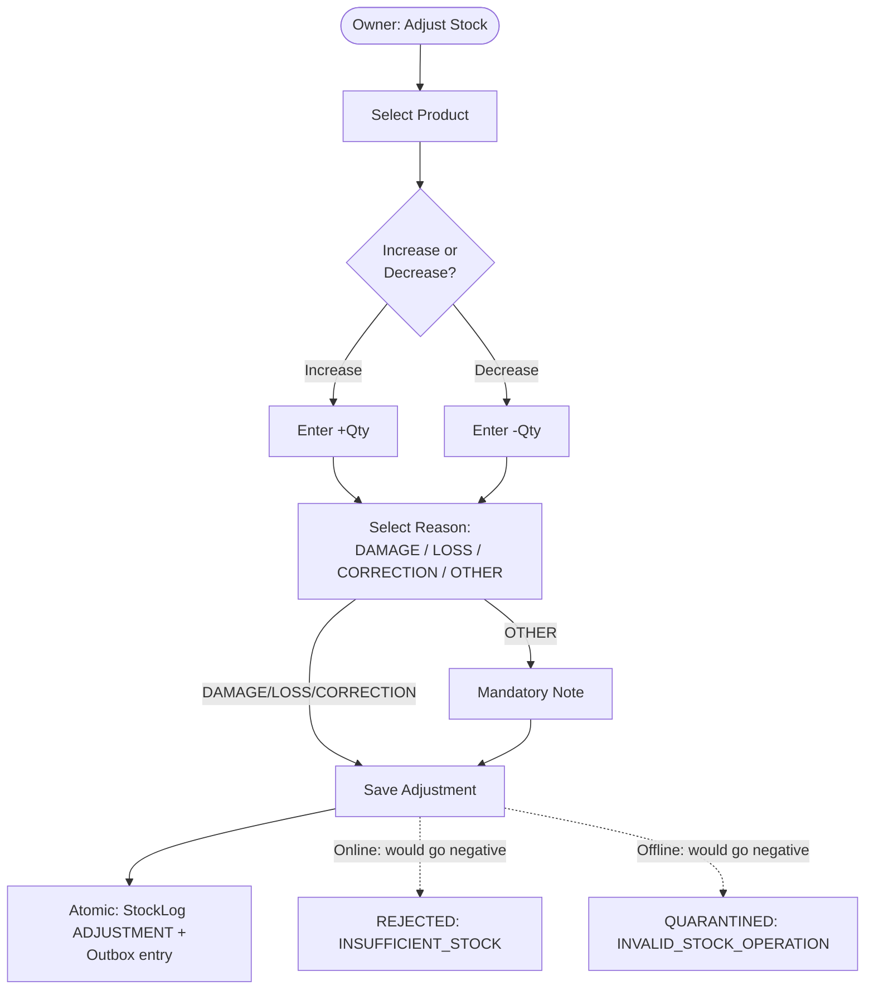
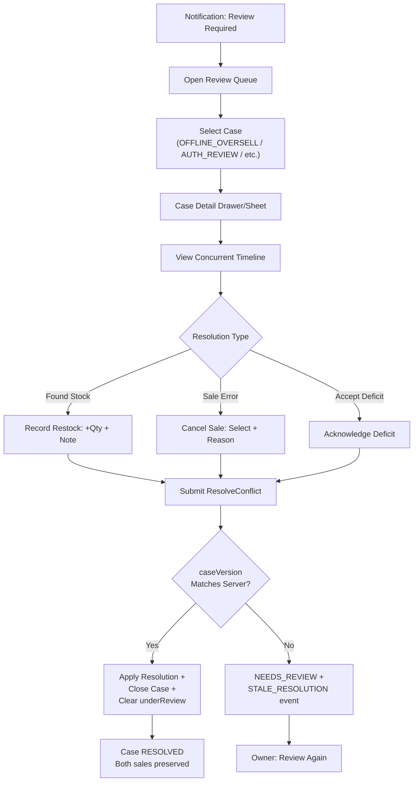
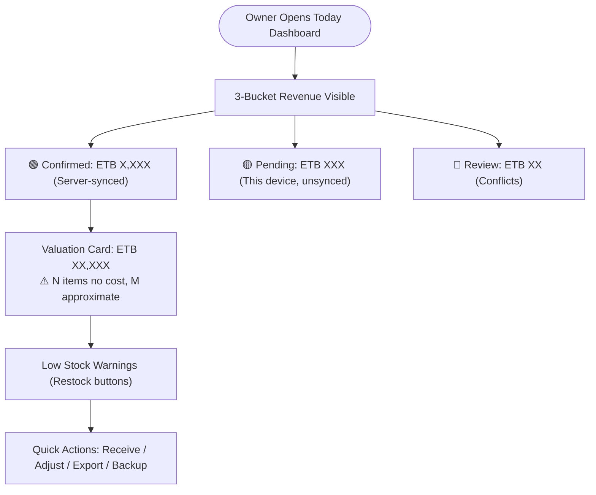
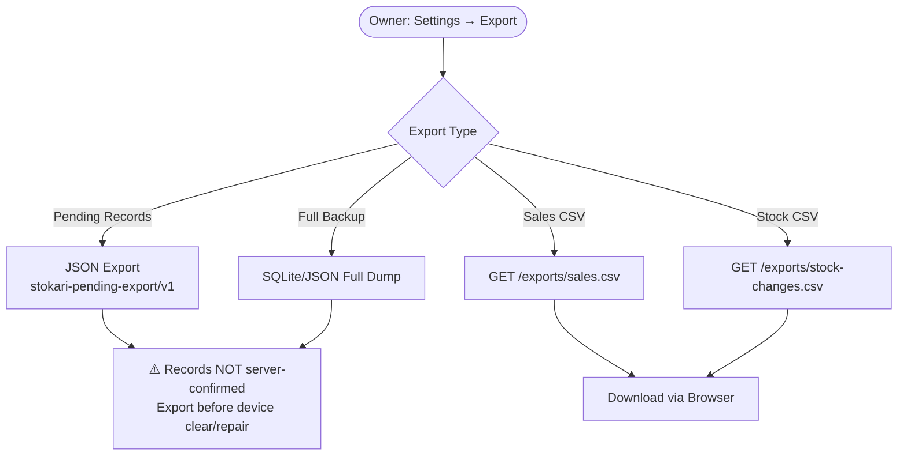
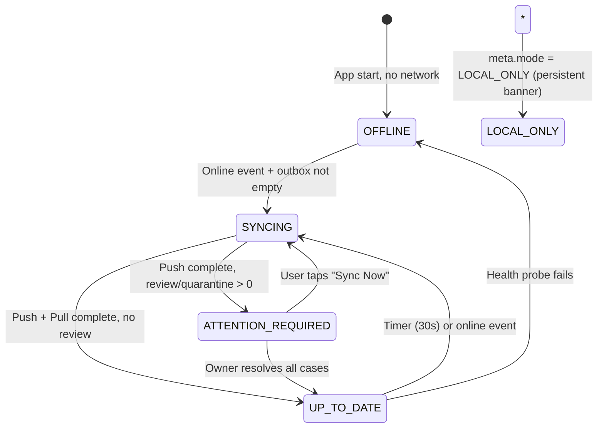

# Stokari User Experience & Interaction Flows (`docs/UX-FLOWS.md`)

**Companion Document to:** [docs/DESIGN.md](file:///home/abelmekonen/Desktop/INSA/web/docs/DESIGN.md) & [docs/SCREENS.md](file:///home/abelmekonen/Desktop/INSA/web/docs/SCREENS.md)
**Target:** Frontend Engineers, UX Reviewers, QA

---

## 1. Flow 1: High-Speed POS Checkout (≤ 10s, ≤ 3 Taps)

### 1.1 Happy Path (Online)



### 1.2 Key Interaction Rules (Non-Negotiable)

| Rule | Rationale |
|---|---|
| **Cart Never Freezes** | Network drops, server cold-starts — till stays 100% responsive |
| **Atomic Commit Precedes UI Success** | Green "Saved" shows ONLY after Dexie confirms write to disk (INV-01) |
| **Reachability Probe Decides Mode** | `GET /health` (2s) NOT `navigator.onLine` — avoids phantom online state |
| **Online = Non-Blocking** | Outbox row inserted, API called in background, UI shows "Sending…" |
| **Offline = Blocking Commit** | Full Dexie transaction before ANY UI success feedback |
| **Quantity Keypad = Sheet** | Slides from bottom, 40% height, live total preview, quick chips from unit config |
| **Sell Anyway = Alert Sheet** | Warns about projected stock, flags for review, NEVER blocks sale |

### 1.3 Edge Cases Handled Inline (No Modals)

| Scenario | UI Response |
|---|---|
| Qty > Projected Stock | "Sell Anyway" sheet with confirmed/projected comparison |
| Product Inactive | Inline error on line: "Product unavailable" — remove or swap |
| Duplicate Tap | Idempotent `opId` — second tap no-op, shows "Already processing" |
| Network Loss Mid-Submit | Retry same `opId` automatically, no user action |
| Server Rejects (Price Mismatch) | Line marked `REJECTED`, inline reason, "Re-enter" action |

---

## 2. Flow 2: Offline-to-Online Synchronization Lifecycle

```mermaid
sequenceDiagram
    actor C as Cashier (Device 1)
    participant UI as PWA UI
    participant IDB as Dexie (IndexedDB)
    participant SE as Sync Engine
    participant API as Django API
    participant DB as PostgreSQL

    Note over C,IDB: Device is offline
    C->>UI: Completes sale #104 (opId: 0191-A)
    UI->>IDB: Commit sale + outbox (status: WAITING_TO_SYNC)
    UI-->>C: "Saved on this device" (🟡 Offline · 1 waiting)

    Note over C,API: Wi-Fi reconnects
    SE->>SE: Online event fires; acquire Web Lock (stokari-sync-shopId)
    SE->>IDB: Fetch oldest outbox operations (batch ≤ 50, deviceSeq order)
    SE->>API: POST /v1/sync/push { ops: [opId: 0191-A, ...] }

    API->>DB: Shop lock FOR UPDATE → Check ProcessedOperation → Apply StockLog
    DB-->>API: Commit successful (serverSeq: 4821)
    API-->>SE: Push response: { opId: 0191-A, status: ACCEPTED, serverSeq: 4821, stockAfter: [...] }

    SE->>IDB: Single Dexie Tx: update sale to SYNCED, delete outbox item, apply stockAfter
    IDB-->>UI: LiveQuery updates header: 🟢 Synced just now
```

### 2.1 Timeout & Interruption Handling

| Failure Point | Client Behavior | Server Behavior |
|---|---|---|
| Wi-Fi drops during push | Retain in outbox, resend **exact same `opId`** | Unique constraint returns cached result (`replayed: true`) |
| Server 5xx / Timeout | Exponential backoff (2s, 4s, 8s… max 5min, full jitter) | No duplicate effect — `ProcessedOperation` prevents it |
| Server 429 Rate Limited | Honor `Retry-After` header | Throttle window |
| App Killed (SIGKILL) | On restart: outbox intact, `SyncPill` shows pending | No server state change |
| `opId` Reuse Different Payload | Never happens (client generates UUIDv7) | Returns `IDEMPOTENCY_KEY_REUSE`, audit log |

### 2.2 Pull & Bootstrap



**New Device Bootstrap:** `cursor=0` → pull pages until `hasMore=false` → integrity check → ready.

---

## 3. Flow 3: Concurrent Offline Overselling & Owner Review (AT-06)


### 3.1 Conflict Resolution Rules

| Resolution Type | When Used | StockLog Effect | Case Outcome |
|---|---|---|---|
| `RECONCILE_STOCK` | Found missing stock | `RECEIPT` entry (+qty) | Closed, `underReview` cleared |
| `CANCEL_SALE` | Sale was error | `SALE_CANCELLATION` (-qty) | Closed, `underReview` cleared |
| `ACKNOWLEDGE` | Accept deficit | None | Closed, `underReview` cleared, negative balance stays |

**Stale Resolution Protection:** Owner submits `caseVersion`. If server version > submitted → `NEEDS_REVIEW` + `STALE_RESOLUTION` event, case stays `OPEN`.

---

## 4. Flow 4: Attendant Deactivation, Lease Expiry & Drain Flow

```mermaid
sequenceDiagram
    actor O as Store Owner
    participant S as Server
    actor A as Attendant (Offline Device)

    O->>S: Deactivate Attendant "Dawit"
    S->>S: Membership = DEACTIVATED. Revoke refresh token & leases.

    Note over A: Dawit still offline; device works until lease expires (7 days max)
    A->>A: Dawit completes 2 sales offline (saved in Dexie)

    Note over A,S: Dawit reconnects to Wi-Fi
    A->>S: Attempts token refresh
    S-->>A: HTTP 403 ACCOUNT_DEACTIVATED + drainToken (10m JWT, scope: sync:drain)

    Note over A: PWA switches to Drain Mode
    A->>S: POST /v1/sync/push with drainToken
    S->>S: Every operation forced to QUARANTINED (ZERO StockLog effect!)
    S->>S: QuarantinedOperation records created. AUTHORIZATION_REVIEW case opened.
    S-->>A: Result: QUARANTINED (Local sales marked NEEDS_REVIEW)

    S-->>O: Notification: "2 operations from deactivated attendant await review"
    O->>S: Owner reviews: ACCEPT (applies movements) or REJECT (archives with reason)
```

### 4.1 Lease Expiry (No Deactivation)



**Client UX:**
- `EXPIRING` (24h): Banner "Offline access ends in N days" + SyncPill warning
- `EXPIRED`: Read-only banner, protected ops blocked, export still works
- `REVOKED`: Immediate 403 on next request, drain flow if pending ops

---

## 5. Flow 5: Product Creation & Unit Selection



### 5.1 Preview Sentence (Catches Unit Errors)

> "You sell **Cooking oil, loose (per L)** by the **litre**. Price **ETB 189.99** per litre. Stock: **20 L**."

**Unit Immutable After Save:** Changing unit later would reinterpret all history. "Create another form instead."

---

## 6. Flow 6: Stock Receive & Adjust (Owner Only)

### 6.1 Receive Stock



### 6.2 Adjust Stock



---

## 7. Flow 7: Conflict Review (Owner)



---

## 8. Flow 8: End-of-Day / Dashboard Review



**Critical Rule:** Buckets are **mutually exclusive**. A sale appears in exactly ONE bucket. Never sum them for "total revenue".

---

## 9. Flow 9: Data Export & Backup



**Pending Export Structure:**
```json
{
  "version": "stokari-pending-export/v1",
  "exportedAt": "2026-10-12T14:30:00.000Z",
  "shopId": "0190f3a1-...",
  "deviceId": "0190f3a1-00a1-...",
  "pendingOperations": [
    { "opId": "...", "type": "RecordSale", "state": "WAITING_TO_SYNC", "payload": {...}, "createdAt": "..." }
  ],
  "unsyncedSales": [...],
  "unsyncedStockChanges": [...]
}
```

---

## 10. Error & Recovery Flows

| Error | User-Facing Message | Recovery Action |
|---|---|---|
| `INSUFFICIENT_STOCK` (online) | "Not enough stock. Available: 3.000 kg" | Reduce qty or "Sell Anyway" |
| `PRODUCT_UNDER_REVIEW` | "This item needs owner review. Ask manager." | Block sale, navigate to Review |
| `ACCOUNT_DEACTIVATED` | "Your access was revoked. Pending sales saved for owner review." | Drain flow auto-starts |
| `UPGRADE_REQUIRED` | "App update required. Tap to update." | Hard block, link to store |
| `CURSOR_RESET` | "Sync reset. Re-downloading data…" | Auto restart pull from 0 |
| `QUOTA_EXCEEDED` | "Storage full. Export data, then clear space." | Export button + storage settings |
| `LEASE_EXPIRED` | "Offline access expired. Connect to internet to renew." | Block protected ops, allow export |

---

## 11. Accessibility Flow Annotations

| Flow | `aria-live` | Focus Management | Screen Reader Announcement |
|---|---|---|---|
| Sale Complete | `polite` | Stay on Sell screen | "Sale saved. Waiting to sync." |
| Sync State Change | `assertive` | None | "Synced 3 operations. Up to date." |
| Conflict Opened | `assertive` | Move to Review tab | "Stock conflict opened. Review required." |
| Lease Expiring | `polite` | None | "Offline access ends in 2 days." |
| Error Toast | `assertive` | None | "Error: Insufficient stock. Retry available." |
| Modal Open | — | Trap focus, restore on close | "Dialog opened. Create Product." |

---

## 12. Performance Flow Targets

| Interaction | Target | Measurement Point |
|---|---|---|
| Tap Product → Cart Add | < 50ms | Touch → Cart re-render |
| Quantity Keypad Open | < 100ms | Tap qty → Sheet visible |
| Complete Sale (Offline) | < 200ms | Tap → "Saved" toast |
| Complete Sale (Online) | < 300ms | Tap → "Sending" toast |
| Search Keystroke → Results | < 16ms (60fps) | Input → Filtered list |
| Sync Push (50 ops) | < 5s (cold start) | Push start → All ACCEPTED |
| Pull Page (200 changes) | < 1s | Request → Dexie commit |
| Dashboard Mount | < 200ms | Route → Buckets visible |
| Review Case Open | < 150ms | Tap → Drawer/Sheet visible |

---

## 13. State Machine Summary (SyncPill)



---

## 14. Testing Checklist per Flow

| Flow | Unit Tests | Integration | E2E (Playwright) | Device |
|---|---|---|---|---|
| POS Checkout | ✅ Cart logic, qty math | ✅ Dexie commit, outbox | ✅ 2 devices, offline→online | ✅ Low-end Android |
| Sync Lifecycle | ✅ Backoff, cursor | ✅ Push/pull, idempotency | ✅ Cold start, timeout | ✅ 320px width |
| Oversell Conflict | ✅ Case creation | ✅ AT-06 scenario | ✅ 2 registers, owner resolve | ✅ Real device |
| Deactivation/Drain | ✅ Token revoke | ✅ 403 + drainToken | ✅ Offline sales → quarantine | ✅ Lease expiry |
| Product Wizard | ✅ Unit selection | ✅ Create + opening stock | ✅ Amharic names | ✅ RTL-aware |
| Receive/Adjust | ✅ Packaging math | ✅ Atomic StockLog | ✅ Cost update | ✅ Quick chips |
| Dashboard | ✅ Bucket math | ✅ Dexie query | ✅ Offline buckets | ✅ Valuation accuracy |
| Export/Backup | ✅ JSON structure | ✅ Pending export | ✅ Restore test | ✅ File download |

---

## 15. Anti-Patterns (What NOT to Build)

| Anti-Pattern | Correct Approach |
|---|---|
| Modal for quantity input | Bottom sheet (mobile) / inline stepper (desktop) |
| Spinner for data loading | Skeleton matching exact layout |
| "Sync failed" toast with no action | "Retry" button + auto-retry |
| Color-only status badges | Icon + Text (always) |
| Separate "Review" modal | Slide-out drawer (desktop) / Full sheet (mobile) |
| Confirmation dialog for "Sell Anyway" | Alert sheet with destructive button |
| Separate "Cost" field visible to attendants | Server strips — client never receives |
| Floating "Sync" button | SyncPill in header + "Sync Now" in popover |
| "Total Revenue" summing buckets | Show 3 buckets separately, NEVER summed |