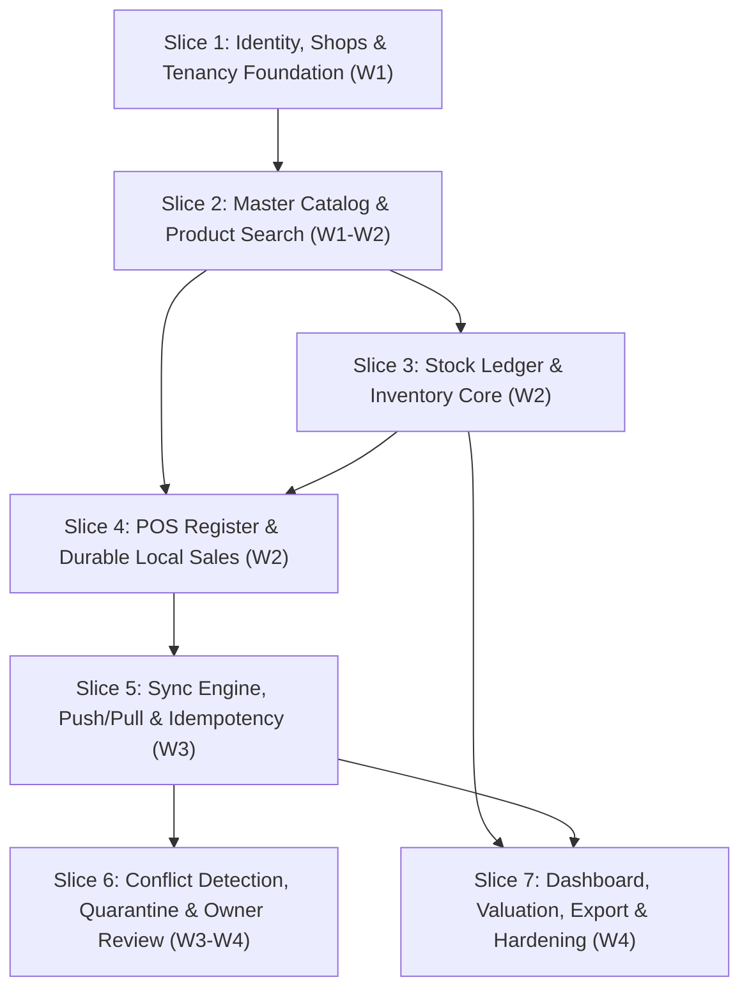

# Stokari Implementation Plan & Vertical Slices (SDD v0.4 / SRS v0.5)

**Document Baseline:** SDD v0.4 (October 16, 2026) & SRS v0.5 (October 13, 2026)  
**Timeline:** 4 Weeks (Planned) · 3-Week Contingency  
**Team Structure (4 Developers):**

- **Developer A (Server Core & Sync):** `ledger`, `sync`, `conflicts`
- **Developer B (Web Data & Sync Engine):** Dexie storage, `sync/` engine, local outbox, projection algorithm, recovery
- **Developer C (Web Features & UI):** `features/*`, design system `ui/`, `i18n`, sales cart, conflict review screen, dashboard
- **Developer D (Infrastructure, Identity & Shops):** `identity`, `shops`, `common/`, contract bundle export, CI/CD, backups

---

## 1. Vertical Slice Architecture

In Stokari, every vertical slice delivers a functional, testable capability through the entire stack:

```
┌────────────────────────────────────────────────────────┐
│ 1. Contract Bundle (OpenAPI spec + Fixtures)          │
├────────────────────────────────────────────────────────┤
│ 2. Backend App (Domain rules ➔ Ports ➔ Repos ➔ Views)  │
├────────────────────────────────────────────────────────┤
│ 3. Client Data & Sync (Dexie Tables ➔ UnitOfWork)      │
├────────────────────────────────────────────────────────┤
│ 4. Web Feature Slice (Components ➔ Hooks ➔ Routes)     │
├────────────────────────────────────────────────────────┤
│ 5. Automated Tests (Tagged AT-xx, T-xx, Unit, E2E)     │
└────────────────────────────────────────────────────────┘
```

---

## 2. Master Implementation Roadmap



---

## 3. Detailed Vertical Slice Breakdown

### Slice 1: Identity, Shops & Multi-Tenancy Foundation (Week 1)

> **Goal:** Secure user access, Google OIDC validation, store registration, membership limits, and strict tenant isolation via `ShopScopedRepository`.

- **Team Division:**
  - **Dev D (Backend):**
    - Setup `common/kernel` (Result, DomainError, typed IDs) and `common/persistence` (`ShopScopedRepository`, `transaction.py`).
    - Implement `apps/shops` (`Shop`, `Membership`, invite system with 5-attendant limit, closure logic).
    - Implement `apps/identity` (Google ID token verification with `google-auth`, PyJWT access/refresh tokens, `OfflineLease` model).
    - Replace DRF auth with `ActorAuthentication` (request.user is `Actor` dataclass; no `django.contrib.auth` in production).
  - **Dev B (Web Core):**
    - Scaffold `stokari-web` layout, `src/session/` (token storage, refresh interceptor, lease expiry checks).
    - Initialize Dexie schema for multi-tenant database isolation: `stokari:{shopId}:{userId}`.
  - **Dev C (Web UI):**
    - Build Google Sign-in flow, Auth context (`useAuth`), and authenticated route guards.
    - Build Staff management screen for owners (invite attendants, list members, deactivate attendant).
  - **Dev A (Contract & Review):**
    - Export first contract bundle (`permissions.json`, `error-codes.json`).
    - Verify composite primary key spike (`CompositePrimaryKey("shop", "id")`) in migration `0001`.
- **Traceability & Verification:**
  - **AT-09:** Deactivate attendant takes effect immediately.
  - **AT-10 / T-20:** Cross-shop access attempt on every endpoint returns 404.
  - **T-19:** Attendant attempting owner-only actions is 100% denied.
  - **T-35:** Sixth attendant invitation fails under race conditions.

---

### Slice 2: Master Catalog & Search (Week 1–Week 2)

> **Goal:** Create, browse, search, and manage products and variants with exact numeric constraints and Latin+Ethiopic search.

- **Team Division:**
  - **Dev D (Backend):**
    - Implement `apps/catalog` (`Product` model with `CompositePrimaryKey("shop", "id")`).
    - Add constraints for integer santim (`price_santim`, `cost_santim`) and milli-units (`low_stock_milli`).
    - Configure `ProductViewSet` (read endpoints) and `StrictIntegerField` in DRF serializers.
  - **Dev A (Domain Math):**
    - Implement `money.py` and `quantity.py` with shared test vectors (`fixtures/money-vectors.json`).
    - Enforce money overflow cap ($2^{53} - 1$) and half-up rounding.
  - **Dev B (Web Data):**
    - Implement `core/domain/money.ts` using `BigInt` for intermediate products.
    - Implement `core/search/normalize.ts` (Latin + Ethiopic homophone folding: ሀ/ሐ/ኀ, ሰ/ሠ).
    - Build in-memory search index for active products.
  - **Dev C (Web UI):**
    - Build Products screen: Product list, search input, category filters, and product details.
    - Build Create/Edit Product modal with Zod validation mirroring backend serializers.
    - Implement context-sensitive UI states (Loading skeleton, Error, Empty state, Populated list).
- **Traceability & Verification:**
  - **AT-16 / T-24:** Numeric rules: half-up rounding, integer santim, and milli-units pass across both Python and TypeScript.
  - **T-22:** Product edit/deactivation preserves price snapshots for historical sales.
  - **T-27:** Search latency < 1.0 s for 2,000 products on mobile.

---

### Slice 3: The Stock Ledger & Core Movements (Week 2)

> **Goal:** Build the append-only `StockChange` ledger, `StockLevel` projection, DB immutability triggers, and stock adjustment/receipt workflows.

- **Team Division:**
  - **Dev A (Backend Core):**
    - Implement `apps/ledger` (`StockChange` and `StockLevel` models with composite keys).
    - Add PostgreSQL trigger `forbid_mutation()` on `stock_change` table to prevent UPDATE/DELETE.
    - Implement `LedgerService.append()`: acquires row locks in ascending `product_id` order under the shop lock.
    - Implement `ReceiveStockHandler` and `AdjustStockHandler` (DAMAGE, LOSS, CORRECTION, OTHER).
  - **Dev D (Database & Tooling):**
    - Add composite foreign keys via `RunSQL` migrations (`fk_stock_change_product`).
    - Implement `reconcile_ledger` management command (`StockLevel.qty == SUM(delta_milli)`).
  - **Dev B (Web Data):**
    - Implement Dexie tables: `stockChanges` and `stockLevels`.
    - Implement **Stock Projection Algorithm** (§5.10): `projectedQty = confirmedQty + pendingDelta` with zero double-counting.
  - **Dev C (Web UI):**
    - Build Stock tab: View current stock, Receive Stock modal (owner), Adjust Stock modal (owner with mandatory reason).
    - Build Product Stock History view (attendant view strips cost fields per NFR-12).
- **Traceability & Verification:**
  - **AT-12 / T-21:** Attendants requesting stock history never receive cost fields.
  - **T-12:** Direct SQL `UPDATE` or `DELETE` on `stock_change` fails via trigger.
  - **T-14:** Ledger reconciliation script passes across all products.

---

### Slice 4: POS Register & Durable Local Sales (Week 2)

> **Goal:** Cashiers can scan items, build a cart, and complete sales offline, committing durably to Dexie before acknowledgment.

- **Team Division:**
  - **Dev C (Web UI):**
    - Build the Sell Tab: fast product picker, recent/frequent items, cart management, quantity chip keypad.
    - Build Payment modal: Cash, Telebirr, Other labels (label only, no settlement).
    - Thumb-reach Save button; rapid flow achieving ≤ 10 s and ≤ 3 taps after finding item.
  - **Dev B (Web Data & Persistence):**
    - Implement `recordSale` use case: reachability probe decides online vs offline _before_ sending.
    - Implement **INV-01 (Durable Local Save)**: One atomic Dexie transaction commits `Sale`, `SaleLine`, pending `StockChange`, and `outbox` row before returning success.
    - Enforce offline lease permissions and clock-rollback guard (`meta.maxSeenTime`).
  - **Dev A (Backend Domain):**
    - Implement `apps/sales` (`Sale`, `SaleLine`, and `SaleCancellation` with PK `(shop_id, sale_id)`).
    - Implement `RecordSaleHandler`: recomputes totals, appends negative movements to ledger.
    - Implement `CancelSaleHandler`: appends compensating `SALE_CANCELLATION` movements.
  - **Dev D (Infrastructure):**
    - Add composite foreign keys for sales tables and immutability trigger for `sale` and `sale_line`.
- **Traceability & Verification:**
  - **AT-01 / AT-02 / AT-03:** Online sale happy path, offline sale pending, and restart after save.
  - **AT-08 / T-11:** Cancel sale produces one compensating ledger entry; second cancel is no-op.
  - **T-07:** Tab killed (SIGKILL) during save: zero data loss, verified in IndexedDB.
  - **T-08:** Local write failure (mocked quota error): displays error, never claims saved.

---

### Slice 5: Synchronization Engine, Idempotency & Two-Device Prototype (Week 3)

> **Goal:** Full push/pull pipeline, per-shop write lock, `ProcessedOperation` idempotency, gap-free change log cursors, and the two-device sync prototype (AT-06).

- **Team Division:**
  - **Dev A (Backend Sync):**
    - Implement `apps/sync`: `POST /v1/sync/push` and `GET /v1/sync/pull`.
    - Enforce shop-level write lock (`Shop.objects.select_for_update().get(pk=shop_id)`).
    - Implement `OperationDispatcher` and `IdempotencyService` with `ProcessedOperation` table.
    - Implement `ChangeLog` sequence allocation and delta pull filtering by caller role.
  - **Dev B (Web Sync Engine):**
    - Implement `sync-engine.ts`: Web Lock (`stokari-sync-shopId`) for multi-tab safety.
    - Implement Push Stage (batches of ≤ 50 ops in `deviceSeq` order) and Pull Stage (cursor-based).
    - Implement exponential backoff with jitter and 70 s timeout for cold starts.
    - Implement Result Applier (§5.10): updates Dexie rows in one atomic transaction.
  - **Dev C (Web UI):**
    - Build `SyncPill` in top bar: Offline (pending count), Syncing, Up to date (last sync time), Attention required.
    - Implement record-level status badges (Waiting to sync, Syncing, Synced, Needs review, Rejected).
    - Add manual "Sync Now" trigger.
  - **Dev D (Hardening & Tooling):**
    - Configure DRF rate throttling (60 req/min for sync, 10 req/min for auth).
    - Implement `/v1/health` endpoint for reachability probe and warm-up.
- **Traceability & Verification:**
  - **AT-04 / T-05 / T-06:** Duplicate `opId` returns stored result; response lost after commit safely recovers.
  - **AT-05 / T-01 / T-10:** Two devices synchronize 100 non-conflicting records each: 200 total, 0 lost, 0 duplicate.
  - **T-15:** Concurrent pushes while another device pulls: zero changes skipped behind cursor.
  - **AT-20 / T-25:** Status indicators accurately reflect the 5 sync states.

---

### Slice 6: Conflict Detection, Quarantine & Owner Review (Week 3–Week 4)

> **Goal:** Detect offline overselling and authorization conflicts, open `ConflictCase`, enforce quarantine with zero ledger effect, and provide owner review workflows.

- **Team Division:**
  - **Dev A (Backend Conflicts):**
    - Implement `apps/conflicts`: `ConflictCase`, `ConflictCaseItem`, `QuarantinedOperation`.
    - Subscribe to `StockBecameNegative` domain event synchronously inside the transaction: marks entries as `NEEDS_REVIEW`, sets `StockLevel.under_review = True`, opens `ConflictCase`.
    - Implement `ResolveConflictHandler`: validates case version, applies owner resolution (`RECONCILE_STOCK`, `CANCEL_SALE`, `ACKNOWLEDGE`).
    - Implement Quarantine rules: unauthorized or late operations stored with no ledger effect.
  - **Dev D (Security & Drain Flow):**
    - Implement `drainToken` generation on deactivation (10-minute JWT with `sync:drain` scope).
    - Allow deactivated devices to push pending operations into quarantine only.
  - **Dev B (Web Sync & Conflicts):**
    - Update Result Applier: handle `NEEDS_REVIEW` and `QUARANTINED` outcomes without removing records.
    - Implement Drain flow in client sync: switch to drain token on 403 `ACCOUNT_DEACTIVATED`.
    - Store conflict cases in Dexie `conflicts` table for owner devices.
  - **Dev C (Web UI):**
    - Build Owner Review Queue: list open cases with product, stock timeline, conflicting sales, and timestamps.
    - Build Case Resolution actions: Cancel Sale (mandatory reason), Record Correction, Acknowledge, or Keep Open.
    - Build Quarantine Review: Accept (runs handler) or Reject (marks rejected with audit note).
- **Traceability & Verification:**
  - **AT-06 / T-03:** Stock 10, sales 7 and 6: both preserved, ledger −3, case opened, product under review, owner notified, resolution closes case and clears underReview.
  - **AT-07 / T-02:** Multi-product sale with one conflicting line: entire sale preserved and flagged.
  - **T-16 / T-17:** Deactivated attendant pushes via drain token: operations quarantined with zero ledger effect.
  - **T-09:** Online sale on negative or under-review product is rejected (`INSUFFICIENT_STOCK`).

---

### Slice 7: Dashboard, Valuation, Export & Release Hardening (Week 4)

> **Goal:** Deliver offline dashboard, owner inventory valuation, JSON pending-records export, backup restore verification, and final deployment.

- **Team Division:**
  - **Dev C (Web UI):**
    - Build Today Dashboard reading Dexie: Three distinct buckets (Confirmed, Local Pending, Needs Review) per AT-13.
    - Build Owner Valuation Card: $\sum \max(\text{qty}, 0) \times \text{cost}$, excluding uncosted items and marking approximate if stock is negative.
    - Low-stock visual warnings (projected vs confirmed).
    - Implement 320 px responsive check and 44 px touch target validation (NFR-14, NFR-15).
  - **Dev B (Web Data & Export):**
    - Implement `recovery.ts`: rebuild projection from local ledger rows.
    - Implement pending-records export (`stokari-pending-export/v1` JSON) with warning that data is unconfirmed.
    - Request `navigator.storage.persist()` and display quota in Settings.
  - **Dev A (Reporting & Audit):**
    - Implement `apps/reporting`: server-side date-range summaries and valuation queries.
    - Implement `apps/audit`: subscriber logging membership changes, resolutions, and price changes.
  - **Dev D (Operations & CI/CD):**
    - Implement nightly logical backup script (GitHub Actions) to secondary object storage.
    - Conduct **T-28 Backup Restore Test**: full restore into staging database and verify ledger reconciliation.
    - Configure production settings: `DEBUG=False`, `ALLOWED_HOSTS`, HSTS, Sentry, UptimeRobot ping.
    - Conduct usability test with $\ge 5$ outside users (T-31).
- **Traceability & Verification:**
  - **AT-13 / T-25:** Dashboard works offline; confirmed, pending, and review buckets are mutually exclusive.
  - **AT-14 / AT-19 / T-29:** Pending export contains all unsynced operations and never labels them confirmed.
  - **AT-15 / T-28:** Disaster restore demonstrated: database restored from dump, ledger passes reconciliation.
  - **T-26:** 200 sales payload under 200 KB; compressed bundle $\le 2$ MB.

---

## 4. Team Work Lanes & Daily Parallelization

To prevent blocking and merge conflicts across the 4 developers:

| Developer       | Primary Responsibility             | Key Files Owned                                                            | Never Touches                     |
| :-------------- | :--------------------------------- | :------------------------------------------------------------------------- | :-------------------------------- |
| **Developer A** | Backend Ledger, Sync & Conflicts   | `apps/ledger/`, `apps/sync/`, `apps/conflicts/`, `apps/sales/application/` | Frontend UI, Django settings/auth |
| **Developer B** | Web Data, Outbox & Sync Engine     | `src/data/`, `src/sync/`, `src/core/`, `src/session/`                      | Django backend, UI CSS/styling    |
| **Developer C** | Web Features & Design System       | `src/features/`, `src/ui/`, `src/i18n/`, `src/app/router.tsx`              | Dexie DB directly, Backend ORM    |
| **Developer D** | Infrastructure, Identity & Tooling | `apps/identity/`, `apps/shops/`, `config/`, `common/`, `.github/`          | Client sync engine, Sales cart UI |

---

## 5. Contract Bundle Workflow (§4.6)

Because Python (backend) and TypeScript (frontend) cannot share code directly, changes to API shapes follow this contract loop:

1. **Developer A or D** modifies a serializer or command in `stokari-api`.
2. Run `python scripts/export_contract.py` to regenerate `openapi.json`, `fixtures/permissions.json`, and sample operation payloads.
3. Commit the bundle to the API repo. CI verifies that `openapi.json` is not stale.
4. **Developer B or C** runs `pnpm contract:sync` in `stokari-web` to pull the latest bundle and regenerate `src/contract/api-types.ts`.
5. Frontend CI executes contract tests against `money-vectors.json`, `quantity-vectors.json`, and sample operations.
