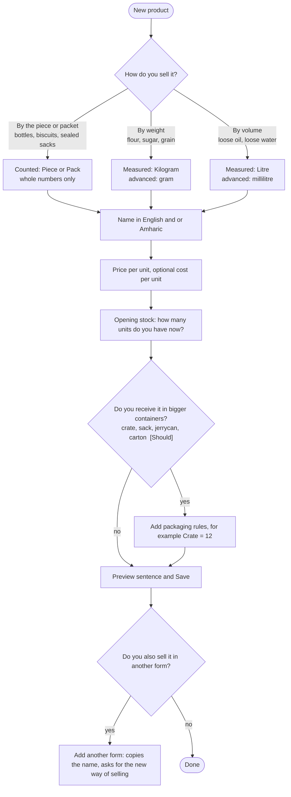
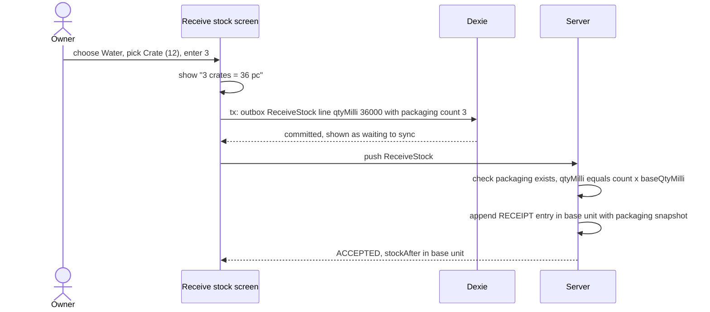

# Stokari Item Types and Units Design

**Version:** 0.1 (draft for team decision)
**Date:** October 17, 2026
**Based on:** SRS v0.5 (FR-08, FR-09, FR-11, FR-12, FR-17, §6), SDD v0.4, API Contract v0.1
**Question answered:** How does Stokari accept and handle different kinds of items: liquids (water bottles, oil), powders (flour) and solids (biscuits)?

---

## Contents

- [0. The answer in one page](#0-the-answer-in-one-page)
- [1. Requirements and constraints (from the SRS)](#1-requirements-and-constraints-from-the-srs)
- [2. How small shops really handle these items](#2-how-small-shops-really-handle-these-items)
- [3. Options considered](#3-options-considered)
- [4. Recommended design](#4-recommended-design)
- [5. The four items, end to end](#5-the-four-items-end-to-end)
- [6. Data model and contract changes](#6-data-model-and-contract-changes)
- [7. Validation and edge cases](#7-validation-and-edge-cases)
- [8. UI specification](#8-ui-specification)
- [9. Testing](#9-testing)
- [10. Impact, compliance and decisions](#10-impact-compliance-and-decisions)
- [Appendix A. Quantity vectors (`fixtures/quantity-vectors.json`)](#appendix-a-quantity-vectors-fixturesquantity-vectorsjson)

---

## 0. The answer in one page

**Stokari does not model "liquid", "powder" or "solid".** The physical form never changes the stock arithmetic. What matters is **how the shop counts the item**, and the SRS already gives us the model for that: *every product has exactly one unit of measure*, discrete units are whole numbers, and weight and volume units allow three decimals (SRS §6.1).

| Item | How the shop sells it | Stock unit | Quantity entry |
| --- | --- | --- | --- |
| Water bottle (0.5 L) | One bottle at a time | `PIECE` | Whole numbers: 1, 2, 3, 12 |
| Cooking oil, sealed 1 L bottle | One bottle at a time | `PIECE` | Whole numbers |
| Cooking oil, **loose** (poured) | By volume | `LITRE` | Up to 3 decimals: 0.25, 0.75, 1.5 |
| Flour, **loose** | By weight | `KG` | Up to 3 decimals: 0.5, 2.5 |
| Flour, 25 kg sack sold whole | One sack at a time | `PIECE` | Whole numbers |
| Biscuits (packet) | One packet at a time | `PACK` or `PIECE` | Whole numbers |

**Four design rules** (explained in §4):

1. **Counting kind decides everything.** Units are either *counted* (whole numbers) or *measured* (three decimals). The product's unit drives the keypad, validation, display and rounding, identically on the device and the server.
2. **One stock unit per product, and one product per way of selling.** Oil sold sealed and oil sold loose are two products with their own price and stock (*"Cooking oil, 1 L bottle"* and *"Cooking oil, loose, per L"*). This is the simplest model that keeps the stock log exact.
3. **Receiving in bigger containers is handled by explicit packaging rules [Should].** A product may define "Crate = 12 bottles", "Sack = 25 kg", "Jerrycan = 20 L", "Carton = 24 packets". The owner receives "3 crates"; the system stores **36 bottles**. This is the "explicit conversion rule defined for the product" that the SRS allows (§6.1). Stock, sales and history always stay in the single base unit.
4. **Opening a sack to sell loose is a separate, later feature [Could].** In the MVP it is two owner adjustments with a note; a one-step "convert" operation is designed as a sketch (§4.6).

**What we build when:**

| Stage | Scope | Priority | Changes the SDD or contract? |
| --- | --- | --- | --- |
| **1** | Unit catalogue, quantity entry and display by unit kind, product-creation wizard that asks *"How do you sell it?"*, money math with fractions, separate-products guidance | **Must** (already required by FR-08, FR-11, §6.1) | No data-model change. Adds a fixture file and UI rules. |
| **2** | Packaging rules for receiving and opening stock | **Should** | Additive and optional: `Product.packagings`, a `packaging` field on receipt lines and on stock changes (§6) |
| **3** | One-step convert (sack → loose), amount entry ("50 birr of oil") | **Could** | New operation and stock log types; designed as a sketch only |

---

## 1. Requirements and constraints (from the SRS)

| # | Constraint | Source |
| --- | --- | --- |
| C1 | A product is created with a name, **a unit of measure**, a selling price and an opening stock quantity, as one consistent operation | FR-08 |
| C2 | "The MVP shall use a unit of measure defined for each product": **one unit** per product | SRS §6.1 |
| C3 | Discrete units (pieces, packs) use whole numbers. Weight and volume units allow up to **three decimals** | SRS §6.1 |
| C4 | **Pack-to-piece conversion is not assumed unless an explicit conversion rule is defined for the product** | SRS §6.1 |
| C5 | Server and client apply the **same** validation rules | SRS §6.1, FR-11 |
| C6 | Quantity up to 999,999.999; prices and costs up to ETB 999,999,999.99; integer minor units; line totals rounded half-up to two decimals; sale total is the sum of rounded line totals | SRS §6.2, §6.3 |
| C7 | Each sale line keeps product, **unit**, quantity and the **price snapshot**, even after the product is edited | FR-09, SRS §6.4 |
| C8 | Product names work in English and Amharic independently of the interface language | FR-35 |
| C9 | A sale must be recordable in about 10 seconds with at most 3 extra taps | FR-12 |
| C10 | Out of scope: supplier procurement, multi-branch, payments | SRS §1.4 |

Not required by the SRS and therefore **not designed into the MVP**: categories, barcodes, variants, expiry dates, batches, density conversion, and automatic conversion between units.

---

## 2. How small shops really handle these items

Three questions describe every item. The design must answer each one explicitly.

| Question | Water bottle | Oil | Flour | Biscuits |
| --- | --- | --- | --- | --- |
| **How does the customer buy it?** | By the bottle | Sealed bottle, **or** poured by the litre | Loose by the kilo, **or** a whole sack | By the packet (sometimes single biscuits) |
| **How does the shop receive it?** | By the crate (6 or 12) | Bottles, or a 20 L jerrycan | 25 kg or 50 kg sacks, or a 100 kg quintal | By the carton (24, 48) |
| **How is it counted on the shelf?** | Bottles | Bottles and/or litres | Kilos | Packets |

Two situations cause most mistakes, and the design targets them:

1. **Receiving unit differs from selling unit** (crate vs bottle, sack vs kilo, jerrycan vs litre). Typing 3 when you meant 3 crates silently corrupts stock.
2. **The same goods are sold in two forms** (sealed oil and loose oil). Forcing one product to carry two units breaks the single-unit rule and makes stock ambiguous.

A third habit worth supporting later: customers ask for **an amount of money** ("50 birr of oil"), so the shop works backwards to a quantity (§4.7).

---

## 3. Options considered

| Option | Idea | Pros | Cons | Verdict |
| --- | --- | --- | --- | --- |
| **A. Unit only** | One unit per product; no containers | Exactly the SRS minimum; trivial | Receiving crates, sacks and cartons needs mental arithmetic; easy to mistype | Adopt as **Stage 1** |
| **B. Unit + explicit packaging rules** | A. plus optional containers with a fixed factor, used only to enter quantities | Fits SRS §6.1 ("explicit conversion rule defined for the product"); stock log stays in one unit; removes the main source of error | Small data and UI addition | Adopt as **Stage 2** |
| **C. Full multi-unit products** | Sell and stock in several units with conversions and per-unit prices | Most flexible | Breaks "one unit per product", rounding of derived prices, much more testing, conflict rules get ambiguous | **Reject** for the MVP |
| **D. A "physical form" field** (liquid / powder / solid) | Product type drives behavior | Familiar words | Form does not affect math; creates contradictions (a "liquid" counted in pieces); users guess wrongly | **Reject** |

---

## 4. Recommended design

### 4.1 The unit catalogue

A **unit catalogue** is the single table that defines how each unit behaves. It lives in the backend (`apps/stock-log/domain/units.py`), is exported as the fixture `contract/fixtures/units.json`, and the web reads that fixture. Nothing about units is hard-coded in the UI.

| Unit | Kind | Family | Decimals | Typical use | Step | Quick quantities |
| --- | --- | --- | --- | --- | --- | --- |
| `PIECE` | COUNT | count | 0 | Bottles, single biscuits, sealed sacks | 1 | 1, 2, 3, 6, 12 |
| `PACK` | COUNT | count | 0 | Packets as sold (biscuit packet) | 1 | 1, 2, 3, 6, 12 |
| `KG` | MEASURE | mass | 3 | Loose flour, sugar, grain | 0.25 | 0.25, 0.5, 1, 2, 5 |
| `LITRE` | MEASURE | volume | 3 | Loose oil, loose water | 0.25 | 0.25, 0.5, 1, 2, 5 |
| `GRAM` | MEASURE | mass | 3 | Small amounts (spices) | 100 | 50, 100, 250, 500 |
| `MILLILITRE` | MEASURE | volume | 3 | Small amounts | 100 | 50, 100, 250, 500 |

Notes that matter for developers:

- **Milli-units already give gram and millilitre precision.** Quantities are stored in thousandths of the unit, so `250` milli-kg is exactly **250 g** and `750` milli-litres is exactly **750 mL**. Therefore **`KG` and `LITRE` are the recommended stock units for loose goods**; the UI lets the user type grams or millilitres as a shortcut but stores kilograms or litres. `GRAM` and `MILLILITRE` stay available (SRS-compatible) under "Advanced" in the wizard.
- **`PACK` versus a container.** `PACK` is a *retail packet counted whole* (a packet of biscuits). A **container used for receiving** (crate, carton, sack) is a *packaging rule* (§4.5), not a unit.
- **Never convert between families** (kilograms to litres). Density is out of scope.
- A product's `unit` is **immutable** after creation (SDD §5.4); changing it later would reinterpret all history.

Fixture shape (`units.json`):

```json
{
  "version": 1,
  "units": {
    "PIECE":      { "kind": "COUNT",   "family": "count",  "decimals": 0, "stepMilli": 1000,   "quickQtyMilli": [1000, 2000, 3000, 6000, 12000], "symbol": { "en": "pc",  "am": "ቁራጭ" },  "wizard": "default" },
    "PACK":       { "kind": "COUNT",   "family": "count",  "decimals": 0, "stepMilli": 1000,   "quickQtyMilli": [1000, 2000, 3000, 6000, 12000], "symbol": { "en": "pack", "am": "ፓኬት" }, "wizard": "default" },
    "KG":         { "kind": "MEASURE", "family": "mass",   "decimals": 3, "stepMilli": 250,    "quickQtyMilli": [250, 500, 1000, 2000, 5000],     "symbol": { "en": "kg",  "am": "ኪ.ግ" },  "wizard": "default" },
    "LITRE":      { "kind": "MEASURE", "family": "volume", "decimals": 3, "stepMilli": 250,    "quickQtyMilli": [250, 500, 1000, 2000, 5000],     "symbol": { "en": "L",   "am": "ሊ" },    "wizard": "default" },
    "GRAM":       { "kind": "MEASURE", "family": "mass",   "decimals": 3, "stepMilli": 100000, "quickQtyMilli": [50000, 100000, 250000, 500000],  "symbol": { "en": "g",   "am": "ግ" },    "wizard": "advanced" },
    "MILLILITRE": { "kind": "MEASURE", "family": "volume", "decimals": 3, "stepMilli": 100000, "quickQtyMilli": [50000, 100000, 250000, 500000],  "symbol": { "en": "mL",  "am": "ሚ.ሊ" },  "wizard": "advanced" }
  }
}
```

Amharic symbols are a first draft and must be reviewed by a native speaker before release (D-21).

### 4.2 Modelling rule: one product per way of selling

> **Sell-form rule.** If a customer can buy the goods in a different *form* (sealed bottle vs poured litre, whole sack vs loose kilo), create a **separate product** for each form. Each has its own unit, price, stock and low-stock level.

Naming guidance shown in the wizard (examples; names are free text and can be Amharic):

| Good | Why |
| --- | --- |
| `Cooking oil, 1 L bottle` (PIECE) | Form is in the name; counted in bottles |
| `Cooking oil, loose (per L)` (LITRE) | Cashier cannot confuse it with the bottle |
| `Flour, 25 kg sack` (PIECE) and `Flour, loose (per kg)` (KG) | Two clear products |

**Product-creation wizard (answers "How do you sell it?" in plain words, not "unit").**



The preview sentence is built from the choices so the owner can catch a wrong unit before saving: *"You sell Cooking oil, loose (per L) by the **litre**. Price ETB 189.99 per litre. Stock: 20 L."*

### 4.3 Quantity entry and display (same rules on both sides)

**Entry.**

| Rule | Detail |
| --- | --- |
| Keypad | COUNT units show a whole-number keypad (no decimal key). MEASURE units show a decimal keypad. |
| Decimal separator | `.` or `,` accepted as the decimal point; no thousands separators; never `parseFloat`. |
| Precision | COUNT: whole numbers. MEASURE: at most 3 decimals. Extra digits are **rejected, never rounded** (`INVALID_PRECISION`), unless they are all zeros (`3.0` is `3`, `1.2500` is `1.25`). |
| Range | Sale and receipt quantities `0.001 … 999,999.999` (milli: `1 … 999_999_999`). |
| Quick chips | Taken from `quickQtyMilli` (§4.1), so a cashier taps `0.5` instead of typing. |
| Stepper | ± `stepMilli`. |
| Unit shown | The unit symbol is always visible next to the field; it is not editable in the sale flow. |
| Grams and millilitres | For `KG` and `LITRE`, an optional small toggle accepts `g` / `mL` and converts exactly (`250 g` → `250` milli-kg). |
| Messages | Counted-unit error: *"This item is counted in whole numbers."* Measured-unit error: *"Use at most 3 decimal places."* (i18n keys, never server text) |

**Parsing without floating point** (identical logic in `core/domain/quantity.ts` and `apps/stock-log/domain/quantity.py`):

```ts
export type ParseError = 'EMPTY' | 'INVALID' | 'PRECISION' | 'RANGE';
export declare function parseQuantity(text: string, unit: Unit): { ok: true; qtyMilli: number } | { ok: false; error: ParseError };
// "2.5"   KG    -> 2500       "0,75" LITRE -> 750       "12" PIECE -> 12000
// "1.5"   PIECE -> PRECISION  "0.0005" KG  -> PRECISION "0" KG     -> RANGE   "abc" -> INVALID
export declare function formatQuantity(qtyMilli: number, unit: Unit, lang: 'en' | 'am'): string;
```

Algorithm: trim; empty → `EMPTY`; replace `,` with `.`; require at least one digit and only digits plus at most one `.` (so `.5` and `3.` are valid), otherwise `INVALID`; split at `.`; drop trailing zeros of the fraction; if the remaining fractional digits exceed the unit's `decimals` (0 for counted units, 3 for measured units) → `PRECISION`; right-pad the fraction to 3 digits; `qtyMilli = whole × 1000 + fraction`; a result of `0` or above `999_999_999` → `RANGE`.

**Display** (`formatQuantity`): integer division by 1000, up to three decimals with trailing zeros trimmed, then the localized unit symbol. Negative values keep the sign (recorded oversell).

| `qtyMilli` | Unit | Shown |
| --- | --- | --- |
| `36000` | `PIECE` | `36 pc` |
| `2500` | `KG` | `2.5 kg` |
| `250` | `KG` | `0.25 kg` |
| `750` | `LITRE` | `0.75 L` |
| `-3000` | `KG` | `-3 kg` |

When local projected stock differs from confirmed stock, the label says it is an estimate (FR-19); the unit is always shown.

### 4.4 Money with fractional quantities (SRS §6.3)

Rule from SDD §5.8, unchanged: `lineTotal = round_half_up(qtyMilli × unitPriceSantim ÷ 1000)`; sale total = sum of rounded line totals. Prices are **per stock unit** (per kg, per L, per bottle). Verified examples:

| Line | `qtyMilli` | `unitPriceSantim` | Line total (santim) | ETB |
| --- | --- | --- | --- | --- |
| Flour loose 2.5 kg at 62.50 | 2500 | 6250 | 15625 | 156.25 |
| Oil loose 0.750 L at 189.99 | 750 | 18999 | 14249 | 142.49 (14249.25 rounds down) |
| Flour loose 0.5 kg at 33.33 | 500 | 3333 | 1667 | 16.67 (16.665 rounds **up**: half-up) |
| Water 3 bottles at 15.00 | 3000 | 1500 | 4500 | 45.00 |
| Biscuits 2 packets at 12.75 | 2000 | 1275 | 2550 | 25.50 |
| Oil loose 1.250 L at 96.40 | 1250 | 9640 | 12050 | 120.50 |

A cart of the first, second and fourth rows totals **34 374 santim = ETB 343.74** (156.25 + 142.49 + 45.00). The price on each line is a **snapshot** (FR-09): changing the product's price later never changes past sales.

### 4.5 Packaging rules for receiving [Should]

A **packaging** is an explicit, per-product conversion rule: *one container holds a fixed number of base units*. It exists only to make **data entry** safe. The stock log, stock level, sales and history are always in the **base unit**.

| Product | Base unit | Packagings the owner may define |
| --- | --- | --- |
| Water 0.5 L | `PIECE` | `Crate (12)` = 12 000 |
| Cooking oil, loose | `LITRE` | `Jerrycan (20 L)` = 20 000 |
| Flour, loose | `KG` | `Sack (25 kg)` = 25 000; `Quintal (100 kg)` = 100 000 |
| Biscuits | `PACK` | `Carton (24)` = 24 000 |

Rules:

| Rule | Detail |
| --- | --- |
| Shape | `{ id, label, baseQtyMilli }`; at most **5** per product; `label` 1–40 characters, unique within the product |
| Factor | `baseQtyMilli` is a positive integer. For COUNT units it must be a multiple of 1000 (a crate holds whole bottles). |
| Count | When receiving, the owner enters a **whole number of containers** (`count`). Half a sack is entered as `12.5 kg`, not `0.5 sack`. |
| Conversion | `qtyMilli = count × baseQtyMilli`. The **server recomputes and rejects a mismatch** (`MISMATCH`). |
| Audit | Every stock log entry created from a container stores a **snapshot** `{ label, count, baseQtyMilli }`, so history can say *"Received 3 × Crate (12) = 36 pc"* even if the packaging is edited later (FR-20). |
| Where allowed | `ReceiveStock` lines and the opening stock of `CreateProduct`. Sales and adjustments are always entered in the base unit; a cashier tap on "+1 crate" is a client shortcut that fills `12` with no wire change. |
| Price | There is **no price per container**. Selling a whole crate or sack at its own price is the job of a separate sealed product (§4.2). This avoids non-integer unit prices. |
| Cost | Owners often know the **container cost** (a crate costs ETB 425.00). The device converts to a cost per base unit with `round_half_up(packageCostSantim ÷ factor)`: 42 500 ÷ 12 = 3 541.67 → **3 542** santim (ETB 35.42). The rounding error is at most 0.5 santim per unit (about ETB 0.04 for the crate) and valuation is already labelled approximate. |

**Receiving 3 crates of water.**



### 4.6 Opening a sack to sell loose (break-bulk) [Could]

Customers may buy a whole 25 kg sack (`Flour, 25 kg sack`, `PIECE`) or a loose kilo (`Flour, loose`, `KG`). When the shop opens a sack, stock moves from one product to the other.

- **MVP workaround (no new feature).** Two owner operations: `AdjustStock` on the sack product `-1 pc` with reason `OTHER` and note "opened for loose sale", and `ReceiveStock` on the loose product `+25 kg`. Both are visible in history. Spillage later is an `AdjustStock` with reason `LOSS`.
- **Stage 3 sketch.** One atomic `ConvertStock` operation: `{ conversionId, fromProductId, fromQtyMilli, toProductId, toQtyMilli, fromChangeId, toChangeId, note }` producing two linked stock log entries (`CONVERSION_OUT`, `CONVERSION_IN`) in one transaction. It needs a new `StockChangeType` pair, an owner-defined rule on the source product (the "explicit conversion rule"), conflict handling when the source goes negative, and contract and SDD updates. It is **not** required by the SRS and is deferred until the workaround proves too clumsy.

### 4.7 Amount entry: "50 birr of oil" [Could]

Customers ask for a money amount. This is a **pure client convenience** with no wire change: the cashier types an amount, the app computes the quantity, and the normal sale rules apply.

```text
qtyMilli = floor(amountSantim × 1000 ÷ unitPriceSantim)         (round down)
lineTotal = round_half_up(qtyMilli × unitPriceSantim ÷ 1000)    (the normal rule)
```

Example: ETB 50.00 of oil at 189.99 → `floor(5000 × 1000 ÷ 18999)` = **263** milli-litres = 0.263 L → line total **4997 santim = ETB 49.97**. The screen must show the **actual total** ("0.263 L = ETB 49.97") and never claim ETB 50.00. Rounding down means the shop never gives more than was paid for; the cashier can adjust the quantity by one step if the customer insists on a round figure.

### 4.8 What we deliberately do not model

| Not modelled | Reason |
| --- | --- |
| Physical form (liquid / powder / solid) | Does not change any calculation; invites wrong choices (D option) |
| Categories and filters | Not in the SRS; a free-text tag is a post-MVP idea |
| Barcodes, SKUs | Not in the SRS |
| Expiry dates, batches (biscuits, oil) | Not in the SRS; would change the stock log model |
| Density (litres ↔ kilograms) | Families never convert |
| Returnable crates and bottle deposits | Not in the SRS |
| Several selling prices for one product (retail vs wholesale) | Separate products if needed |
| Automatic conversion at sale time | Violates "one unit per product" and SRS §6.1 |

---

## 5. The four items, end to end

Cast for the examples: shop and owner from API Contract §1.9. Product IDs below are new. `CreateProduct` payloads follow API Contract §6.7.1 plus the Stage 2 fields (§6). Prices are per **stock unit**.

### 5.1 Water bottles (0.5 L)

Counted, received by the crate.

| Step | What the user does | What is stored |
| --- | --- | --- |
| Create | Wizard: "By the piece" → name `Water 0.5 L` / `ውሃ 0.5 ሊ` → price ETB 15.00 → opening 24 bottles. Stage 2: adds `Crate (12)`. | unit `PIECE`, price 1500, opening `24000` (or `openingPackaging` 2 × Crate) |
| Receive | Picks `Crate (12)`, enters `3`, cost ETB 425.00 per crate | one `RECEIPT` of `36000` milli-pieces, cost per bottle 3542 santim, snapshot `3 × Crate (12)` |
| Sell | Taps the product, quantity chip `3`, Save | sale line `3000` × 1500 = 4500 santim (ETB 45.00) |
| Stock shows | `60 pc` (24 + 36) | |

```json
{
  "productId": "0190f3a1-1003-7000-8000-000000001003",
  "name": "Water 0.5 L", "nameAlt": "ውሃ 0.5 ሊ", "unit": "PIECE",
  "priceSantim": 1500, "costSantim": 3542, "lowStockMilli": 12000,
  "packagings": [{ "id": "0190f3a1-2001-7000-8000-000000002001", "label": "Crate (12)", "baseQtyMilli": 12000 }],
  "openingQtyMilli": 24000,
  "openingPackaging": { "packagingId": "0190f3a1-2001-7000-8000-000000002001", "count": 2 },
  "openingChangeId": "0191a2f0-c101-7000-8000-00000000c101"
}
```

### 5.2 Cooking oil: two forms, two products

| | Sealed bottle | Loose (poured) |
| --- | --- | --- |
| Name | `Cooking oil, 1 L bottle` | `Cooking oil, loose (per L)` |
| Unit | `PIECE` | `LITRE` |
| Price | ETB 195.00 per bottle | ETB 189.99 per litre |
| Receive | Bottles, or cartons if defined | `Jerrycan (20 L)` = 20 000: "2 jerrycans" = `40000` (40 L) |
| Sell | 2 bottles = 39 000 santim (ETB 390.00) | 0.750 L = 14 249 santim (ETB 142.49) |
| Stock shows | `48 pc` | `40 L` → after the sale `39.25 L` |
| Why separate | The cashier never confuses a bottle with a litre; each form has its own low-stock alert | |

```json
{
  "productId": "0190f3a1-1005-7000-8000-000000001005",
  "name": "Cooking oil, loose (per L)", "nameAlt": "ዘይት (በሊትር)", "unit": "LITRE",
  "priceSantim": 18999, "costSantim": 15500, "lowStockMilli": 5000,
  "packagings": [{ "id": "0190f3a1-2002-7000-8000-000000002002", "label": "Jerrycan (20 L)", "baseQtyMilli": 20000 }],
  "openingQtyMilli": 40000,
  "openingPackaging": { "packagingId": "0190f3a1-2002-7000-8000-000000002002", "count": 2 },
  "openingChangeId": "0191a2f0-c102-7000-8000-00000000c102"
}
```

### 5.3 Flour: loose and sack

| | Loose | Sack sold whole |
| --- | --- | --- |
| Name | `Flour, loose (per kg)` | `Flour, 25 kg sack` |
| Unit | `KG` | `PIECE` |
| Price | ETB 62.50 per kg | ETB 1 450.00 per sack |
| Receive | `Sack (25 kg)` or `Quintal (100 kg)` | Whole sacks |
| Sell | 2.5 kg = 15 625 santim (ETB 156.25); 0.5 kg = ETB 31.25 | 1 sack |
| Opening a sack | MVP: two adjustments (sack `-1`, loose `+25 kg`), reason `OTHER`, note "opened sack" | |

```json
{
  "productId": "0190f3a1-1006-7000-8000-000000001006",
  "name": "Flour, loose (per kg)", "nameAlt": "ዱቄት (በኪሎ)", "unit": "KG",
  "priceSantim": 6250, "costSantim": 5400, "lowStockMilli": 10000,
  "packagings": [
    { "id": "0190f3a1-2003-7000-8000-000000002003", "label": "Sack (25 kg)", "baseQtyMilli": 25000 },
    { "id": "0190f3a1-2005-7000-8000-000000002005", "label": "Quintal (100 kg)", "baseQtyMilli": 100000 }
  ],
  "openingQtyMilli": 50000,
  "openingPackaging": { "packagingId": "0190f3a1-2003-7000-8000-000000002003", "count": 2 },
  "openingChangeId": "0191a2f0-c103-7000-8000-00000000c103"
}
```

### 5.4 Biscuits

| Step | Detail |
| --- | --- |
| Create | Wizard: "By the piece or packet" → `PACK` → name `Biscuits (packet)` → price ETB 12.75 → stock 48 packets. Stage 2: `Carton (24)` = 24 000. |
| Receive | `5` cartons = `120000` milli-packs = 120 packets |
| Sell | 2 packets = 2 550 santim (ETB 25.50). A shop that sells **single biscuits** creates a second product `Biscuit (single)` with unit `PIECE` and its own price. |
| Not supported | Half a packet (counted unit), expiry tracking |

```json
{
  "productId": "0190f3a1-1008-7000-8000-000000001008",
  "name": "Biscuits (packet)", "nameAlt": "ብስኩት (ፓኬት)", "unit": "PACK",
  "priceSantim": 1275, "costSantim": 950, "lowStockMilli": 12000,
  "packagings": [{ "id": "0190f3a1-2004-7000-8000-000000002004", "label": "Carton (24)", "baseQtyMilli": 24000 }],
  "openingQtyMilli": 48000,
  "openingPackaging": { "packagingId": "0190f3a1-2004-7000-8000-000000002004", "count": 2 },
  "openingChangeId": "0191a2f0-c104-7000-8000-00000000c104"
}
```

### 5.5 A receipt by container (Stage 2) and what history shows

`ReceiveStock` line for 3 crates of water (cost ETB 425.00 per crate → 3542 santim per bottle):

```json
{
  "note": "Delivery from market",
  "lines": [{
    "changeId": "0191a2f0-c106-7000-8000-00000000c106",
    "productId": "0190f3a1-1003-7000-8000-000000001003",
    "qtyMilli": 36000, "unitCostSantim": 3542, "baseVersion": 1,
    "packaging": { "packagingId": "0190f3a1-2001-7000-8000-000000002001", "count": 3 }
  }]
}
```

The resulting `StockChange` is in base units with an immutable snapshot, and the stock history screen renders it from the snapshot:

```json
{ "type": "RECEIPT", "deltaMilli": 36000, "unitCostSantim": 3542,
  "packaging": { "label": "Crate (12)", "count": 3, "baseQtyMilli": 12000 } }
```

> History line: **Received 3 × Crate (12) = 36 pc**

---

## 6. Data model and contract changes

### 6.1 Stage 1: no schema change

Everything in Stage 1 is already in SDD v0.4 / Contract v0.1: the `Unit` enum, precision rules, integer milli-units, rounding and `unit` immutability. Stage 1 adds:

| Addition | Where |
| --- | --- |
| `contract/fixtures/units.json` (§4.1) | Backend exports from `apps/stock-log/domain/units.py`; web reads it |
| `apps/stock-log/domain/units.py`, `quantity.py`; `core/domain/quantity.ts` | `parseQuantity`, `formatQuantity`, `validate_qty` |
| `contract/fixtures/quantity-vectors.json` (Appendix A) | Run by pytest and Vitest |
| UI: wizard, `QuantityInput`, chips, formatting | §8 |

```python
# apps/stock-log/domain/units.py  (pure Python)
@dataclass(frozen=True)
class UnitInfo:
    code: str; kind: str; family: str; decimals: int; step_milli: int; quick_qty_milli: tuple[int, ...]

UNITS: dict[str, UnitInfo] = {...}      # exported to contract/fixtures/units.json

def validate_qty(qty_milli: int, unit: str) -> str | None:
    """Returns a FieldErrorCode or None. Same rules as the web parseQuantity."""
    if not 1 <= qty_milli <= 999_999_999:
        return "OUT_OF_RANGE"
    if UNITS[unit].decimals == 0 and qty_milli % 1000 != 0:
        return "INVALID_PRECISION"
    return None
```

### 6.2 Stage 2: additive, optional changes

All additions are **optional fields** (non-breaking under Contract §14.1). Proposed contract decisions (continuing the numbering of Contract §0.3):

| ID | Decision |
| --- | --- |
| CD-14 | `Product` gains `packagings: Packaging[]` (default `[]`, at most 5). |
| CD-15 | `CreateProduct` gains `packagings?` and `openingPackaging?`; `UpdateProduct.changes` gains `packagings?` (full replacement, IDs stable); `ReceiveLineInput` gains `packaging?`. |
| CD-16 | `StockChange` gains `packaging: PackagingSnapshot \| null` (immutable). |
| CD-17 | `fixtures/units.json` and `fixtures/quantity-vectors.json` join the contract bundle. |

```ts
export interface Packaging {
  id: Uuid;
  label: string;                  // 1-40 chars, unique within the product
  baseQtyMilli: QtyMilli;         // base units per container; COUNT units: multiple of 1000
}
export interface PackagingSnapshot {   // frozen into the stock log entry when a container is used
  label: string;
  count: number;                  // whole containers
  baseQtyMilli: QtyMilli;         // base units per container at that time
}
export interface PackagingInput {
  packagingId: Uuid;              // must exist on the product
  count: number;                  // integer, 1 ... 999_999
}
// Product                  gains:  packagings: Packaging[];
// StockChange              gains:  packaging: PackagingSnapshot | null;       // RECEIPT and OPENING only
// CreateProductPayload     gains:  packagings?: Packaging[]; openingPackaging?: PackagingInput;
// UpdateProductPayload.changes gains: packagings?: Packaging[];
// ReceiveLineInput         gains:  packaging?: PackagingInput;
```

Server rules (new):

| Rule | Error |
| --- | --- |
| `packaging.packagingId` exists on the product (for `CreateProduct`: in the same payload) | `UNKNOWN_REFERENCE` on `…packaging.packagingId` |
| `qtyMilli` (or `openingQtyMilli`) equals `count × baseQtyMilli` | `MISMATCH` on `…qtyMilli` |
| `count` is a positive integer ≤ 999 999 | `INVALID_TYPE` / `OUT_OF_RANGE` |
| Packaging labels unique per product; at most 5 | `DUPLICATE` / `OUT_OF_RANGE` on `packagings` |
| For COUNT units, `baseQtyMilli % 1000 == 0` | `INVALID_PRECISION` on `packagings[i].baseQtyMilli` |
| The server stores the snapshot itself from the packaging it found; a client-sent snapshot is never trusted | n/a |

Storage:

```python
# apps/catalog/models.py       Product.packagings  = models.JSONField(default=list)       # small, edited as a whole
# apps/stock-log/models.py        StockChange.packaging = models.JSONField(null=True)        # immutable snapshot
# apps/stock-log/domain/          packaging.py  (pure validation: labels, factors, snapshot building)
```

Dexie: `products` rows gain a `packagings` array and `stockChanges` rows gain `packaging`; neither is indexed, so **no Dexie version bump is needed**.

### 6.3 What does not change (important)

| Unchanged | Why it still holds |
| --- | --- |
| Ledger, `StockLevel`, projection, INV-01 … INV-12 | Every entry is in the base unit; a container is only an input convenience |
| Outcome matrix, conflicts, quarantine, sync protocol | Quantities are base-unit integers as before |
| Sales payloads and price snapshots | Sale lines are always base-unit quantity × price per base unit |
| `payloadHash`, idempotency | Packaging is part of the payload, so it is hashed like any field |
| Permissions | Only the owner defines packagings and receives stock (SDD D-01) |

---

## 7. Validation and edge cases

### 7.1 Rules (client and server, identical)

| Rule | Counted units (`PIECE`, `PACK`) | Measured units (`KG`, `LITRE`, `GRAM`, `MILLILITRE`) |
| --- | --- | --- |
| Quantity in a sale or receipt | whole numbers, `1 … 999 999` | `0.001 … 999 999.999` |
| Typing | no decimal key; extra decimals rejected (`3.0` is accepted as `3`) | decimal key; at most 3 decimals (`1.2500` is accepted as `1.25`) |
| Stored | `qtyMilli` multiple of 1000 | any integer `qtyMilli` |
| Price | per piece or per pack | per kg, per L (and so on) |
| Low-stock threshold | same unit as the product | same unit as the product |
| Unit after creation | immutable | immutable |

### 7.2 Edge cases

| Case | Behavior |
| --- | --- |
| Owner picks `LITRE` for sealed bottles | The wizard preview sentence ("sold by the litre") and the unit symbol in the cart expose it. Fix: create a new product `PIECE` and move stock with two adjustments (unit is immutable). |
| Half a packet of biscuits | Rejected: *"This item is counted in whole numbers."* |
| Selling 0.3 L of oil sold per litre | Allowed; rounding per §4.4 |
| Two forms from the same physical stock (sealed and loose) | Two products; use the MVP break-bulk workaround (§4.6) |
| Packaging edited or removed later | History keeps its own snapshot; only future entries change |
| Same label twice (`Crate`, `crate`) | Rejected as `DUPLICATE` (case-insensitive) |
| Container cost does not divide evenly | Per-unit cost rounded half-up; note shown (§4.5) |
| Opening stock entered as containers and units | One or the other per entry; the system never mixes (`qtyMilli` must equal `count × factor`) |
| Very small quantities | `0.001 kg` = 1 g is allowed; below that is `PRECISION` |
| Offline sale of fractional quantities | Same rules locally; conflicts, oversell and review behave exactly as for counted items |
| Search by name | Names are free text in English and Amharic; the unit symbol is shown next to every result to separate forms |
| Rounding surprise in a cart | The cart shows each rounded line total and the sum of rounded lines (SRS §6.3) |

---

## 8. UI specification

| Screen | Behavior |
| --- | --- |
| **New product** | The wizard of §4.2; unit chosen through *How do you sell it?*; preview sentence; Stage 2 "bigger containers" step; "Add another form" button after saving |
| **Product detail** | Unit shown read-only with a note *"The unit cannot be changed. Create another form instead."*; packagings editor (Stage 2) |
| **Sell** | `QuantityInput` for the product's unit; chips from `quickQtyMilli`; unit symbol fixed beside the field; each cart line shows `qty unit × price = line total` |
| **Receive stock** (owner) | Unit selector as a segmented control: base unit and each packaging (`pc | Crate (12)`). Entering `3` on `Crate (12)` shows *"3 crates = 36 pc"* before Save. Optional cost per container or per unit. |
| **Stock history** | Shows quantity in the base unit and, for container entries, the snapshot: *Received 3 × Crate (12) = 36 pc* |
| **Product list / search** | Name, unit symbol and price per unit: `Flour, loose (per kg) · ETB 62.50 / kg · 25 kg` |
| **Low stock** | Threshold and alert text use the product's unit |

All strings come from `i18n/en.json` / `am.json`. Keys (examples): `item.wizard.howSell`, `item.wizard.counted`, `item.wizard.byWeight`, `item.wizard.byVolume`, `item.wizard.preview`, `item.unit.<UNIT>.symbol`, `item.qty.errorWhole`, `item.qty.errorDecimals`, `item.packaging.equals` (*"{count} × {label} = {qty}"*). Touch targets stay at least 44 px and nothing scrolls sideways at 320 px (NFR-14, NFR-15). Status and error messages never rely on server text.

---

## 9. Testing

| ID | Scenario | Level | Pass criterion |
| --- | --- | --- | --- |
| T-36 | Parse and format vectors (Appendix A) | Unit, both languages | Identical results in Python and TypeScript |
| T-37 | Counted unit with a fraction, measured unit with 4 decimals, zero, over-range | Unit + API | `INVALID_PRECISION` / `OUT_OF_RANGE`, nothing stored |
| T-38 | Money for the six examples of §4.4 | Unit, shared money vectors | Exact santim totals; half-up case `16.67` correct |
| T-39 | Wizard maps each answer to the right unit; counted units never show a decimal key | UI | Matches `units.json` |
| T-40 | Packaging mismatch, unknown packaging, non-integer count, duplicate label, more than 5 | API | The listed field errors |
| T-41 | Receive by container | Integration + E2E | Base quantity stored, snapshot stored, history shows *3 × Crate (12) = 36 pc*, stock correct after sync |
| T-42 | Edit or remove a packaging | Integration | Old history unchanged |
| T-43 | Change of `unit` | API | `NOT_ALLOWED` |
| T-44 | Sealed and loose products keep separate stock; break-bulk workaround produces two visible entries | E2E | Both entries in history with the note |
| T-45 | Amount entry (Could) | Unit | 5000 santim at 18999 → `263` milli-L, total 4997 |
| T-46 | Amharic names and unit symbols in list, cart and history | UI | Rendered correctly at 320 px |
| T-47 | Offline sale of 2.5 kg and oversell of a measured item | E2E | Same outcomes as counted items (`NEEDS_REVIEW`, quantities exact) |

**Acceptance for Stage 1 (Must):** the four items of §0 can be created, received, sold (online and offline) and viewed, with exact quantities and totals, and the cashier cannot enter a quantity the unit does not allow. **Stage 2 (Should):** the same four items can be received and opened in containers, and history shows the container snapshot.

---

## 10. Impact, compliance and decisions

### 10.1 SRS compliance

| SRS | Stage 1 | Stage 2 | Stage 3 |
| --- | --- | --- | --- |
| FR-08 name, unit, price, opening stock, one consistent operation | Yes | Yes (opening may use a container) | n/a |
| SRS §6.1 one unit per product | Yes | Yes (containers do not change the unit) | Needs a documented rule per product |
| SRS §6.1 whole numbers for counted, 3 decimals for measured | Yes | Yes | Yes |
| SRS §6.1 no assumed conversion; explicit per-product rule allowed | No conversion | **Uses the "explicit conversion rule" allowance** (D-16) | Same, for stock moves |
| FR-09 / SRS §6.4 snapshots | Yes | Yes (container snapshot added) | Yes |
| FR-11 same validation on both sides | Yes (shared vectors) | Yes | Yes |
| FR-12 10-second sale | Chips and keypad by unit | Unchanged | Unchanged |
| FR-20 history | Unchanged | Shows container snapshot | Shows both conversion entries |

### 10.2 Where the other documents change

| Document and section | Change |
| --- | --- |
| SDD §5.5 enumerations; SDD §5.8 numeric rules | Add the unit catalogue table and `units.json`; cross-reference this design. SDD §5.5 says "No pack-to-piece conversion (SRS §6.1)"; the SRS actually allows an explicit per-product rule, so reword it. |
| SDD §5.4, SDD §5.6 | `Product.packagings`, `StockChange.packaging` (Stage 2) |
| SDD §6.4 | `ReceiveStock` and `CreateProduct` carry optional packaging; `ConvertStock` listed as **[C]** |
| SDD §8.8, SDD §9.2 | Wizard and `QuantityInput`; receive screen with container selector |
| SDD §12.2 | Add T-36 … T-47 |
| API Contract §3.4, Contract §6.7.1, Contract §6.7.2, Contract §6.7.6, Contract §13 | CD-14 … CD-17 above |
| SDD §13.4 | Add D-15 … D-22 below |

### 10.3 Decisions needed

| ID | Question | Proposed default |
| --- | --- | --- |
| D-15 | Adopt the staged model (Stage 1 Must, Stage 2 Should, Stage 3 Could)? | Yes |
| D-16 | Is a packaging rule the "explicit conversion rule defined for the product" of SRS §6.1? Confirm with whoever owns the SRS. | Yes; record the confirmation in SRS v0.6 |
| D-17 | Wizard offers `KG` and `LITRE` by default; `GRAM` and `MILLILITRE` under "Advanced"? | Yes |
| D-18 | Different selling forms are always separate products (never several units per product)? | Yes |
| D-19 | Amount entry ("50 birr") in the MVP? | No; build only if shop research shows demand |
| D-20 | Break-bulk: manual two-step workaround now, `ConvertStock` later? | Workaround now |
| D-21 | Amharic unit symbols and wizard wording reviewed by a native speaker before release | Required |
| D-22 | Limits: at most 5 packagings per product, labels 1-40 characters | Yes |

### 10.4 Questions to ask real shop owners (before finalizing Stage 2 and 3)

1. Which containers do you receive goods in (crate of 6 or 12, sack of 25 or 50 kg, jerrycan, carton)?
2. Do you sell the same goods both sealed and loose? How often do you open a sack or jerrycan?
3. Do customers ask for "50 birr of" an item? For which items?
4. Do you sell single biscuits or sweets out of a packet?
5. Do you ever need two prices for the same item (retail and wholesale)?
6. What do you weigh with, and what is the smallest quantity you sell?

### 10.5 Effort and sequencing (relative sizes, not dates)

| Piece | Size | When (SDD §14) |
| --- | --- | --- |
| Unit catalogue, parse/format, vectors, `QuantityInput`, chips | S | Week 2, with the sales and product UI |
| Product-creation wizard and preview sentence | M | Week 2 |
| Packaging model, receive-by-container, history snapshot | M | Week 3 or 4, if the Must scope is on track |
| `ConvertStock`, amount entry | M each | After the MVP, driven by the shop research |

---

## Appendix A. Quantity vectors (`fixtures/quantity-vectors.json`)

Both languages must reproduce every line. `parse` cases give the typed text and unit; `format` cases give `qtyMilli`, unit and the English display string.

```json
{
  "rule": "parse: see section 4.3 algorithm; format: integer division by 1000, up to 3 decimals, trailing zeros trimmed, then the English unit symbol",
  "parse": [
    {
      "text": "2.5",
      "unit": "KG",
      "qtyMilli": 2500
    },
    {
      "text": "0,75",
      "unit": "LITRE",
      "qtyMilli": 750
    },
    {
      "text": "12",
      "unit": "PIECE",
      "qtyMilli": 12000
    },
    {
      "text": "1.5",
      "unit": "PIECE",
      "error": "PRECISION"
    },
    {
      "text": "0.0005",
      "unit": "KG",
      "error": "PRECISION"
    },
    {
      "text": "0",
      "unit": "KG",
      "error": "RANGE"
    },
    {
      "text": "abc",
      "unit": "KG",
      "error": "INVALID"
    },
    {
      "text": "",
      "unit": "KG",
      "error": "EMPTY"
    },
    {
      "text": "1000000",
      "unit": "KG",
      "error": "RANGE"
    },
    {
      "text": "999999.999",
      "unit": "KG",
      "qtyMilli": 999999999
    },
    {
      "text": "0.001",
      "unit": "KG",
      "qtyMilli": 1
    },
    {
      "text": " 3 ",
      "unit": "PIECE",
      "qtyMilli": 3000
    },
    {
      "text": ".5",
      "unit": "KG",
      "qtyMilli": 500
    },
    {
      "text": "3.",
      "unit": "KG",
      "qtyMilli": 3000
    },
    {
      "text": "3.0",
      "unit": "PIECE",
      "qtyMilli": 3000
    },
    {
      "text": "1.2500",
      "unit": "KG",
      "qtyMilli": 1250
    },
    {
      "text": "1.2501",
      "unit": "KG",
      "error": "PRECISION"
    },
    {
      "text": "1.2.3",
      "unit": "KG",
      "error": "INVALID"
    },
    {
      "text": "-2",
      "unit": "KG",
      "error": "INVALID"
    },
    {
      "text": "999999",
      "unit": "PIECE",
      "qtyMilli": 999999000
    },
    {
      "text": "1000000",
      "unit": "PIECE",
      "error": "RANGE"
    }
  ],
  "format": [
    {
      "qtyMilli": 36000,
      "unit": "PIECE",
      "en": "36 pc"
    },
    {
      "qtyMilli": 2500,
      "unit": "KG",
      "en": "2.5 kg"
    },
    {
      "qtyMilli": 250,
      "unit": "KG",
      "en": "0.25 kg"
    },
    {
      "qtyMilli": 750,
      "unit": "LITRE",
      "en": "0.75 L"
    },
    {
      "qtyMilli": -3000,
      "unit": "KG",
      "en": "-3 kg"
    },
    {
      "qtyMilli": 1,
      "unit": "KG",
      "en": "0.001 kg"
    },
    {
      "qtyMilli": 999999999,
      "unit": "KG",
      "en": "999999.999 kg"
    },
    {
      "qtyMilli": 12000,
      "unit": "PACK",
      "en": "12 pack"
    },
    {
      "qtyMilli": 100000,
      "unit": "GRAM",
      "en": "100 g"
    },
    {
      "qtyMilli": 250000,
      "unit": "MILLILITRE",
      "en": "250 mL"
    }
  ]
}
```
