# Stokari Software Design Description (SDD) v0.4

**Document status:** Revised draft for team review (supersedes v0.3)
**Date:** October 16, 2026 · **Owner:** Stokari Team (4 members)
**Baseline requirements:** SRS v0.5 (October 13, 2026)
**Backend stack:** Django (Python) + DRF + PostgreSQL. **Web:** React PWA (TypeScript). v0.3 assumed NestJS and Prisma; see Appendix B.
**Reading order for developers:** §1.2 → §2 → §4 → §5 → §6 → §8 → §14

---

## Document control

| Version | Date       | Change                                                                                                                                                                                                                                                                                                                                                                                        | Status              |
| ------- | ---------- | --------------------------------------------------------------------------------------------------------------------------------------------------------------------------------------------------------------------------------------------------------------------------------------------------------------------------------------------------------------------------------------------- | ------------------- |
| 0.1     | 2026-10-12 | First full draft from SRS v0.5                                                                                                                                                                                                                                                                                                                                                                | Superseded          |
| 0.2     | 2026-10-14 | Sync redesign, ADRs, traceability                                                                                                                                                                                                                                                                                                                                                             | Superseded          |
| 0.3     | 2026-10-15 | Full review against SRS v0.5. Requirement IDs and NFR numbering corrected. Operation catalogue, outcome matrix, quarantine, lease and drain flow defined. Complete schema (server and local). Money overflow rule, stock-projection algorithm, 33 diagrams, complete folder trees, pattern-to-file mapping, AT-01..AT-20 mapping, delivery plan.                                              | Superseded          |
| 0.4     | 2026-10-16 | **Backend moved from NestJS/Prisma to Django/DRF.** Django app layering, folder trees, import-linter rules, Django models and migrations (composite keys, triggers), Python money rules, contract bundle (OpenAPI + fixtures) replacing the shared TypeScript package, DRF request pipeline, pytest/Hypothesis test strategy, Django deployment and hardening. Appendix B lists every change. | Draft, not approved |

**What changed and why.** Appendix A lists every defect found in v0.2 (wrong NFR numbers, a stock log that was "append-only" yet had a mutable status column, an undefined `drainToken`, missing entities, and others) with the fix. Section 13.4 lists decisions the team must confirm. Nothing in this SDD changes an SRS decision; where the SRS is silent, the SDD states the choice and flags it.

**v0.4 change.** The team chose **Django** for the backend and will not use Prisma or other NestJS-ecosystem tools. Every backend-specific section was rewritten (§2.5, §3, §4, §5.6–5.8, §7, §8, §10, §11, §12, §13), and the sync design (§6) was kept unchanged apart from names. Because Python and TypeScript cannot share code, the shared `@stokari/contracts` package is replaced by a **contract bundle** (§4.1). Appendix B maps old to new; Appendix A is the historical log of v0.2 → v0.3.

---

## 1. Introduction

### 1.1 Purpose and scope

SRS v0.5 defines **what** Stokari must do. This SDD defines **how**: architecture, code structure, data model, synchronization protocol, interfaces, security controls, deployment, verification, and a delivery plan. It covers FR-01..FR-37, NFR-01..NFR-20, the availability objective (SRS §8.6), the business rules (SRS §4) and acceptance tests AT-01..AT-20 (SRS §10.1).

Must requirements are the baseline. Features tagged **[S]** (Should) or **[C]** (Could) are designed only far enough to avoid blocking them and are the first to be cut (SRS §11.2).

### 1.2 Audience and reading paths

| Reader              | Start at                               | Then       |
| ------------------- | -------------------------------------- | ---------- |
| Backend developer   | §4.2, §5, §6.7–6.9, §8.1–8.3           | §7, §10    |
| Frontend developer  | §4.4, §5.9–5.10, §6.6, §6.10, §8.4–8.8 | §9         |
| Tester              | §12                                    | §6.8, §7.4 |
| Reviewer / lecturer | §2, §3, §13                            | Appendix A |

### 1.3 Conventions

- **Requirement IDs** use the SRS format: `FR-01`, `NFR-05`, `AT-06`. SRS section references are written `SRS §4.3`.
- **Design IDs:** `INV-nn` invariant (§6.2), `ADR-nnn` decision (§13.1), `D-nn` open decision (§13.4), `T-nn` test scenario (§12.2).
- **Priority tags:** none = Must, **[S]** Should, **[C]** Could.
- **Keywords:** "shall" and "must" are binding; "should" is a recommendation.
- **Section references** use `§`.
- **Diagrams** are Mermaid code blocks (render in GitHub, GitLab, VS Code, Obsidian). Folder trees are plain text blocks.

### 1.4 References

1. Stokari SRS v0.5 (internal). 2. References listed in §15.

### 1.5 Glossary

| Term                   | Meaning in this design                                                                                                                                      |
| ---------------------- | ----------------------------------------------------------------------------------------------------------------------------------------------------------- |
| Stock Log              | Append-only set of `StockChange` rows. Stock is derived from it.                                                                                            |
| Operation (op)         | One client-generated command (for example `RecordSale`) with a unique `opId`.                                                                               |
| Outbox                 | Local table of operations not yet definitively resolved by the server.                                                                                      |
| Idempotency            | Sending the same `opId` any number of times has the effect of sending it once.                                                                              |
| Stock version          | Per-product integer on the server, +1 for every accepted `StockChange`.                                                                                     |
| Base version           | The stock version a device knew when it created an operation. Evidence only, never authority.                                                               |
| Confirmed stock        | `SRS: server-confirmed stock`. Quantity from entries the server accepted.                                                                                   |
| Projected stock        | `SRS: local projected stock`. Confirmed stock plus eligible pending local entries.                                                                          |
| Needs review           | Server-side flag for operations that were preserved but need owner attention.                                                                               |
| Quarantine             | Held operation: stored in full, **no stock log effect** until the owner accepts or rejects it (§6.14).                                                      |
| Lease                  | Server-signed offline authorization token, at most 7 days (FR-06).                                                                                          |
| Drain token            | Narrow, short-lived token that lets a deactivated device upload pending operations into quarantine only (§6.14).                                            |
| Case                   | `ConflictCase`: a review record linking every affected operation and stock log entry.                                                                       |
| Aggregate              | A group of rows changed together in one transaction (§5.2).                                                                                                 |
| Port / adapter         | Interface owned by the inner layer / its implementation in the outer layer (hexagonal architecture).                                                        |
| Contract bundle        | Versioned files published by the API repo (OpenAPI, test fixtures) that the web repo tests against, because Python and TypeScript cannot share code (§4.1). |
| Shop-scoped repository | Repository base class constructed with the token's `shop_id`; the only way tenant queries are built (§10.1).                                                |
| Modular monolith       | One deployable API split into modules with enforced boundaries.                                                                                             |

---

## 2. Architecture

Stokari is a **local-first PWA** plus a **modular-monolith API**. The device is the primary write target. The server orders, validates, persists and distributes records. Local data is never called "synced" until the server acknowledges it durably (FR-24, SRS §4.6).

### 2.1 Architecture drivers

| Driver (SRS)                                                              | Consequence in the design                                                                                               |
| ------------------------------------------------------------------------- | ----------------------------------------------------------------------------------------------------------------------- |
| Work offline, survive restarts (FR-22, FR-23, FR-28, NFR-05)              | Dexie/IndexedDB with strict durability, atomic outbox, cached app shell (§5.9, §6.6)                                    |
| No duplicate stock effects (FR-14, SRS §4.5, NFR-08)                      | `opId` idempotency stored in the same transaction as effects (§6.7)                                                     |
| Preserve completed sales; make conflicts visible (FR-15, FR-27, SRS §4.3) | Append-only stock log, `NEEDS_REVIEW`, conflict cases, no last-write-wins for stock (§6.11–6.12)                        |
| Server-side authorization (FR-05, FR-07, NFR-11, NFR-12)                  | Permission classes, per-request membership check, role-filtered pull, shop-scoped repositories (§10)                    |
| Revocation limits (FR-04, FR-06)                                          | 7-day lease, quarantine, drain token (§6.14)                                                                            |
| Exact numbers (FR-34, SRS §6)                                             | Integer santim and milli-units; identical rounding rules in Python and TypeScript, proven by shared test vectors (§5.8) |
| Four developers, four weeks (SRS §1.3, §11)                               | Modular monolith, free-tier hosting, small named-pattern set, lint-enforced boundaries (§3, §4)                         |

### 2.2 Architectural style and key decisions

| Concern      | Decision                                                                                  | Justification                                                            |
| ------------ | ----------------------------------------------------------------------------------------- | ------------------------------------------------------------------------ |
| System style | Local-first PWA + REST API                                                                | Core work must continue with no network (FR-22, FR-28).                  |
| Client       | Feature-sliced React SPA (Vite), no SSR                                                   | The shell must open with no server render (ADR-001).                     |
| Server       | Django modular monolith: one project, one app per module, layered inside each app         | One deployable fits free hosting and four developers (ADR-003, ADR-015). |
| Stock model  | Event-sourced stock log; `StockLevel` is a transactionally maintained projection          | No device overwrites another; full audit (FR-20, SRS §4.2).              |
| Write path   | Command log (outbox) → single idempotent `POST /v1/sync/push`                             | One validated write path online and offline (ADR-006).                   |
| Read path    | Local DB is the read model for business screens; TanStack Query only for online-only data | Fast and offline (NFR-01).                                               |
| Concurrency  | One per-shop lock for writes; server assigns a gap-free commit sequence                   | Correct pull cursors, simple reasoning (ADR-009).                        |

### 2.3 System context

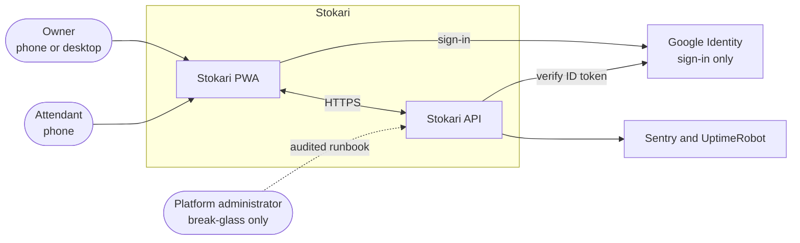

### 2.4 Containers

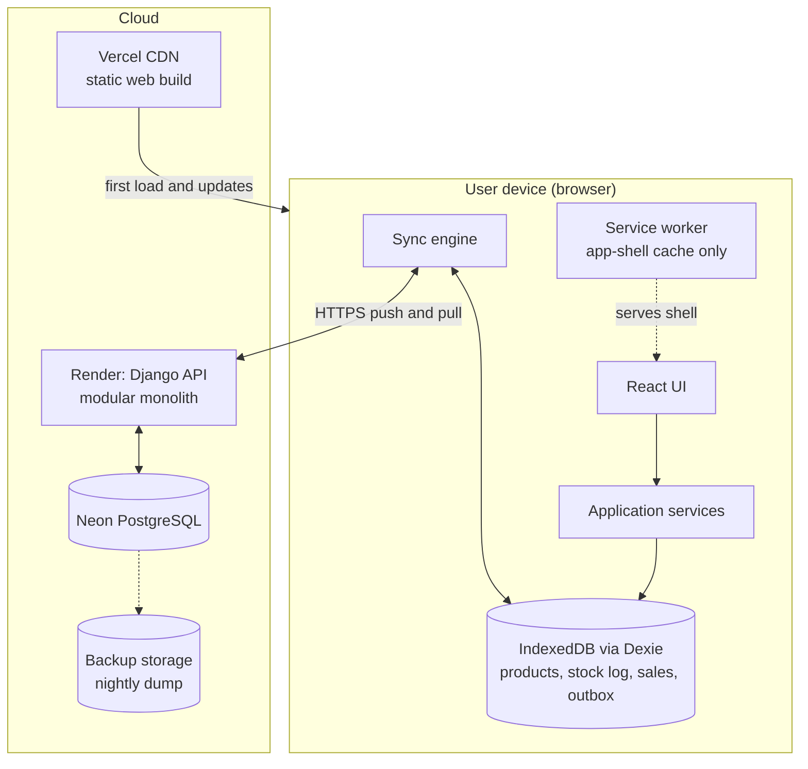

### 2.5 Technology stack

| Layer                      | Choice                                                                                                                                                                | Rationale                                                                   |
| -------------------------- | --------------------------------------------------------------------------------------------------------------------------------------------------------------------- | --------------------------------------------------------------------------- |
| Web build                  | Vite + React + TypeScript (strict); pin current stable at kickoff                                                                                                     | Static output, small bundle (NFR-19, ADR-001)                               |
| PWA                        | `vite-plugin-pwa` (Workbox)                                                                                                                                           | Precache shell, install, offline open (FR-28)                               |
| Local DB                   | Dexie.js over IndexedDB, `chromeTransactionDurability: 'strict'` (verify option name for the pinned Dexie version)                                                    | Transactions, indexes, live queries; strict flush supports NFR-05           |
| Server state               | TanStack Query                                                                                                                                                        | Online-only data (staff, reports). Not the offline store (ADR-007).         |
| Client state               | Zustand                                                                                                                                                               | UI-only state; business data lives in Dexie                                 |
| Forms/validation           | React Hook Form + Zod (client mirror of the API serializers)                                                                                                          | Same rules on both sides, kept aligned by shared fixtures (FR-11, §4.6)     |
| Routing                    | React Router (lazy routes)                                                                                                                                            | Code splitting for the 2 MB budget (NFR-19)                                 |
| i18n [S]                   | i18next                                                                                                                                                               | Amharic and English (FR-35)                                                 |
| API                        | Django + Django REST Framework                                                                                                                                        | Mature ORM and migrations, permission classes, serializers (ADR-015)        |
| ORM                        | Django ORM: `transaction.atomic`, `select_for_update`, `CompositePrimaryKey`, `CheckConstraint`                                                                       | Migrations; row locks implement the shop lock; composite tenant keys (§5.6) |
| Database                   | PostgreSQL (Neon), `READ COMMITTED` plus explicit row locks                                                                                                           | Unique indexes and triggers enforce invariants                              |
| Auth                       | Google Identity Services (client) + `google-auth` `id_token.verify_oauth2_token` (server) + PyJWT for Stokari's own tokens                                            | Maintained libraries (FR-02); provider replaceable behind `AuthProvider`    |
| API validation             | DRF serializers, one per operation type, with a strict integer field                                                                                                  | One validation layer on the server; web mirrors it with Zod                 |
| API docs                   | `drf-spectacular` (OpenAPI 3.1), committed as `contract/openapi.json`; web types via `openapi-typescript`                                                             | Contract for tests (§4.1)                                                   |
| Testing                    | Web: Vitest, Testing Library, `fake-indexeddb`, Playwright, fast-check. API: pytest, pytest-django, factory_boy, Hypothesis, pytest-cov, PostgreSQL service container | §12                                                                         |
| Quality                    | Web: ESLint, Prettier, dependency-cruiser, Husky + lint-staged. API: Ruff (lint and format), mypy with django-stubs, import-linter, pre-commit. GitHub Actions        | Enforce §4.7 and §4.9                                                       |
| Hosting                    | Vercel (web), Render (API), Neon (DB)                                                                                                                                 | Free tiers; verify current limits before launch (§11.5)                     |
| Package manager / runtime  | Web: pnpm and current LTS Node. API: `uv` with a committed hash lockfile and a currently supported Python at kickoff                                                  | Reproducible installs                                                       |
| Supporting libraries (API) | `django-cors-headers`, DRF throttling, `PyJWT[crypto]`, `psycopg`, `gunicorn`, `sentry-sdk`, JSON logging, typed environment settings                                 | Small, maintained, replaceable                                              |

Libraries and features not used: Next.js, Redux, PouchDB/RxDB/ElectricSQL, CRDT libraries, **Prisma and NestJS**, Celery or any message broker (no background queue in the MVP, §8.3), GraphQL, Django Channels, and in production the Django admin, `django.contrib.auth` and sessions (§10.1).

### 2.6 Component view: web client

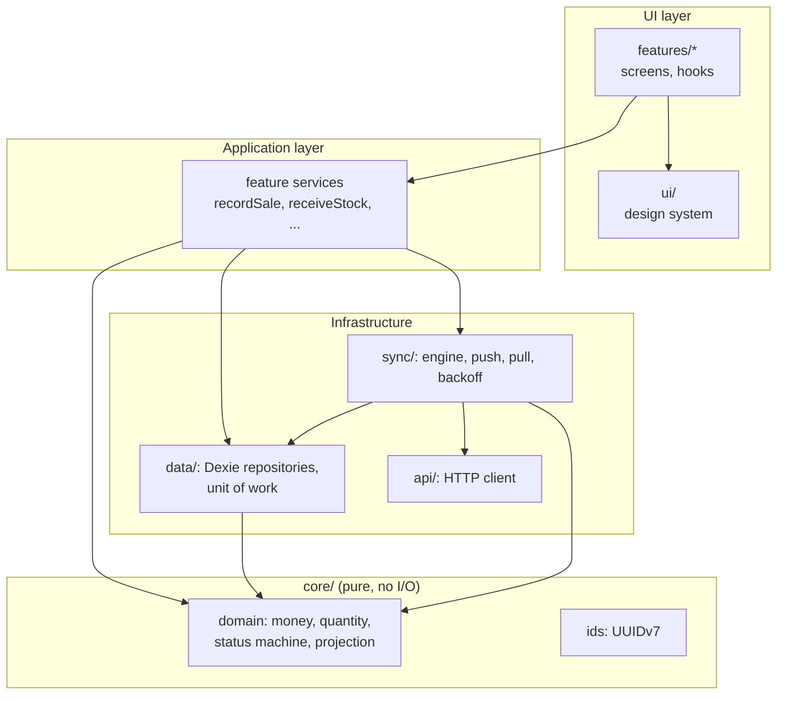

### 2.7 Component view: API

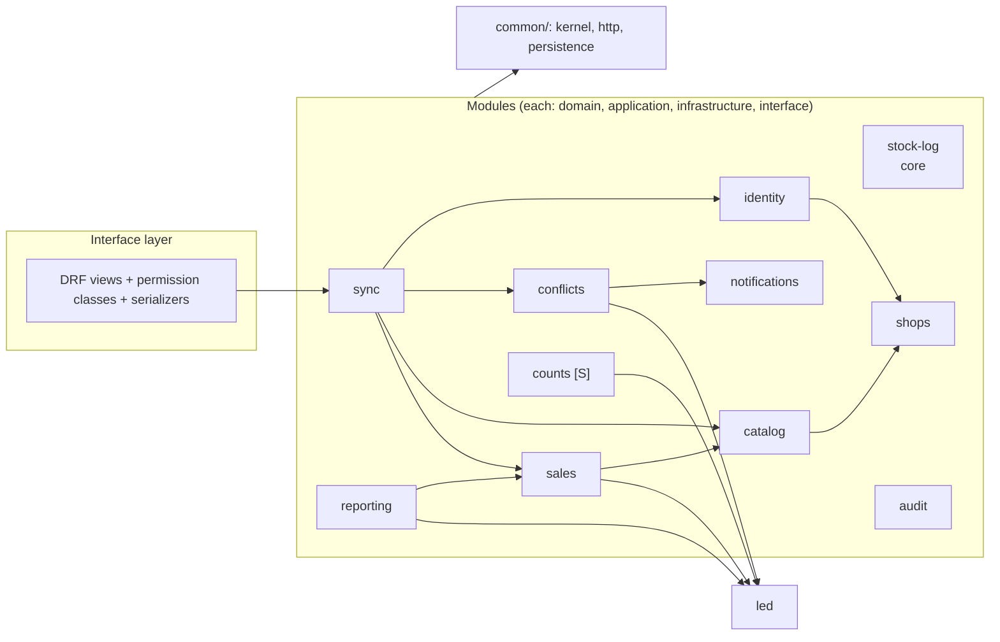

`stock-log` imports no other module. `sales`, `counts`, `conflicts` and `reporting` depend on it. Apps communicate through the public `api.py` of each app and through domain events (§3.2).

### 2.8 Component responsibilities

| Component                                       | Responsibility                                              | Must not                              |
| ----------------------------------------------- | ----------------------------------------------------------- | ------------------------------------- |
| React features                                  | Render, collect input, call hooks                           | Touch Dexie or `fetch`                |
| Feature services (web)                          | Use cases (`recordSale`, `cancelSale`)                      | Contain UI code                       |
| `core/`                                         | Money, quantity, projection, status machine                 | Do I/O or import frameworks           |
| `data/` (Dexie)                                 | Atomic write of record + stock log + outbox + projection    | Know about HTTP                       |
| `sync/`                                         | Push outbox, pull changes, apply results, backoff           | Decide business rules                 |
| Service worker                                  | Cache shell and static assets                               | Handle business data                  |
| DRF views and serializers                       | HTTP mapping, permission classes, shape validation          | Contain business rules                |
| Application handlers                            | Business use cases, transaction boundaries (through a port) | Import Django ORM, DRF or `django.db` |
| Domain                                          | Rules, entities, value objects, policies                    | Import anything but `common/kernel`   |
| Django ORM adapters (`models.py`, repositories) | Queries, locks, transactions                                | Hold business rules                   |
| `stock-log`                                     | The only code that writes `StockChange` and `StockLevel`    | Be bypassed                           |
| PostgreSQL                                      | Durable stock log, uniqueness, immutability triggers        | N/A                                   |

### 2.9 Deployment view

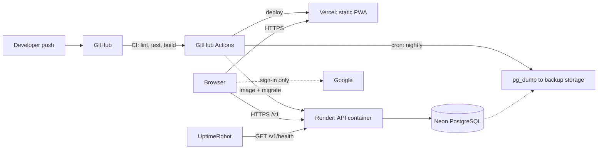

Render free instances sleep when idle, so a first request can take 30 to 60 seconds. The design handles this in four ways: a health ping keeps the instance warm, sale confirmation never blocks the till (§6.6), every client request has a 70 s timeout, and background sync tolerates delay. The 99% availability objective (SRS §8.6) needs a documented monitoring and maintenance-window plan (§11.5).

### 2.10 Trust boundaries and data classification

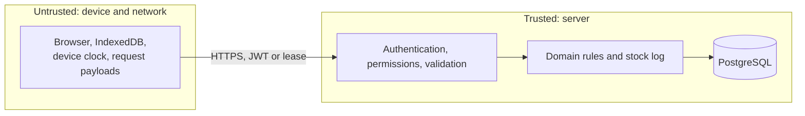

Anything crossing from the device is re-validated: shop, role, totals, stock, timestamps and prices are never trusted (FR-05, FR-07, FR-11, FR-34).

| Data                                | Where                                | Sensitivity        | Rule                                      |
| ----------------------------------- | ------------------------------------ | ------------------ | ----------------------------------------- |
| Google subject, email, name         | Server; email in local session       | Personal           | Minimal; no logging of emails (§10.3)     |
| Cost price, receipt cost, valuation | Server; **owner devices only**       | Business-sensitive | Stripped from attendant pull (NFR-12)     |
| Sales, stock log                    | Server and local                     | Business           | Shop-scoped (FR-07)                       |
| Access token                        | Memory                               | Secret             | 15 min                                    |
| Refresh token, lease                | IndexedDB (accepted trade-off, D-02) | Secret             | Hashed server-side; rotated; device-bound |
| Pending outbox                      | IndexedDB                            | Business           | Not a backup; export warning (SRS §7.3)   |

### 2.11 Data flow overview

**Level 0** shows data crossing the system boundary.

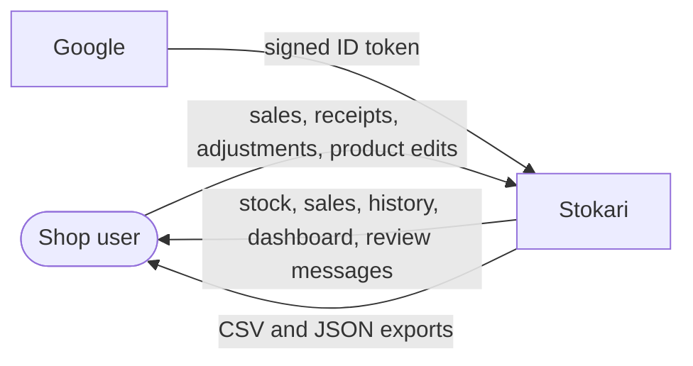

**Level 1** shows the stores and processes on both sides.

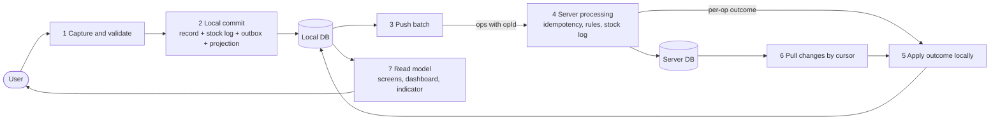

Numbered processes map to sections: 1 → §8.5; 2 → §6.6; 3 → §6.10; 4 → §6.7; 5 and 6 → §6.9; 7 → §8.7 and §9.

---

## 3. Design principles and patterns

### 3.1 Principles and enforcement

| Principle                           | Applied as                                                                                                                      | Enforced by                                                     |
| ----------------------------------- | ------------------------------------------------------------------------------------------------------------------------------- | --------------------------------------------------------------- |
| Single responsibility               | One use case per file; one reason to change                                                                                     | Ruff `C901`, `scripts/check_file_size.py`, ESLint (§4.9)        |
| Open/closed                         | New operation types and conflict rules added by registering a class, never by editing a `switch`                                | Registry tests                                                  |
| Interface segregation               | Small ports (`ProductRepository`, `LedgerRepository`), not one `Database` interface                                             | Review checklist                                                |
| Dependency inversion                | Domain and application depend on ports; adapters implement them                                                                 | import-linter (API) and dependency-cruiser (web) fail CI (§4.7) |
| Separation of concerns              | interface → application → domain; infrastructure behind ports                                                                   | Folders + import rules                                          |
| Make illegal states unrepresentable | `NewType` IDs, frozen dataclasses, `Enum`/`Literal` for operation types and statuses (web: branded types, discriminated unions) | `mypy --strict` on domain and application; TS `strict`          |
| Fail fast at boundaries             | DRF serializers at every API entry point (web: Zod); typed settings validated at boot                                           | Serializer validation; `config/settings/env.py`                 |
| Immutability of history             | Ledger, sales, cancellations, processed ops have no update path in code **and** a DB trigger                                    | Trigger + repository has no update method (§5.7)                |
| Server is authority                 | Device values are hints; server recomputes totals and re-checks permissions                                                     | Handler tests                                                   |

### 3.2 Pattern catalogue

Every pattern below has a **location** (where a developer finds it) and the **problem** it solves. Patterns not listed here are not used.

| #   | Pattern                                                                      | Category       | Location                                                                                        | Problem solved                                                                     | SRS                  |
| --- | ---------------------------------------------------------------------------- | -------------- | ----------------------------------------------------------------------------------------------- | ---------------------------------------------------------------------------------- | -------------------- |
| 1   | **Event-sourced stock log**                                                  | Data           | server `apps/stock-log`; web `data/repositories/stock-log.repository.ts`                        | Stock derived from immutable entries; audit                                        | FR-20, SRS §4.2      |
| 2   | **Projection (CQRS-lite)**                                                   | Data           | `StockLevel` (server) and local `stockLevels`                                                   | Fast reads without a second write model                                            | FR-19, FR-31, NFR-01 |
| 3   | **Command + handler**                                                        | Behavior       | server `apps/*/application/commands.py` and handler modules; web `features/*/services`          | One validated named action per business operation                                  | FR-12..FR-18         |
| 4   | **Registry / dispatcher** (open-closed)                                      | Behavior       | `apps/sync/application/dispatcher.py`; registry built in `config/container.py`                  | Add an operation without editing a switch                                          | FR-14                |
| 5   | **Transactional outbox (client)**                                            | Reliability    | `data/repositories/outbox.repository.ts`                                                        | A record is never saved without being queued                                       | FR-23, NFR-05        |
| 6   | **Transactional outbox (server, domain events)**                             | Reliability    | `common/persistence/domain_event.py` + `manage.py process_domain_events`                        | A crash cannot lose a notification or audit side effect                            | FR-27                |
| 7   | **Idempotent receiver**                                                      | Reliability    | `apps/sync/application/idempotency.py`; `ProcessedOperation`                                    | Retries and double taps never duplicate effects                                    | FR-14, NFR-08        |
| 8   | **Unit of Work**                                                             | Persistence    | web `data/unit-of-work.ts`; API `common/persistence/transaction.py` (`atomic()` wrapper)        | Sale, lines, stock log, outbox commit together                                     | FR-13, FR-23         |
| 9   | **Repository (port + adapter)**                                              | Persistence    | `apps/*/application/ports.py` (`Protocol`) + `apps/*/infrastructure/repositories.py`            | Domain independent of Dexie and the Django ORM                                     | NFR-20               |
| 10  | **Aggregate**                                                                | Domain         | §5.2                                                                                            | Defines the consistency boundary per transaction                                   | FR-13                |
| 11  | **Value object**                                                             | Domain         | `Money`, `Quantity`, `OpId` in `core/domain` and `common/kernel`                                | Exact arithmetic and validated values                                              | FR-34, SRS §6        |
| 12  | **Policy / Strategy**                                                        | Behavior       | `ConflictPolicy`, `PermissionPolicy`, `AuthProvider`, `IdGenerator`, `Clock`                    | Swap rules or providers without changing callers                                   | FR-02, FR-27         |
| 13  | **Specification** (permission table)                                         | Behavior       | `apps/shops/domain/permissions.py`, exported to `contract/fixtures/permissions.json`            | One permission table drives server and UI                                          | FR-05                |
| 14  | **State machine**                                                            | Behavior       | `core/domain/record-status.ts`; `conflicts/domain/case-status.ts`                               | Only legal transitions                                                             | FR-24                |
| 15  | **Adapter / anti-corruption layer**                                          | Integration    | `apps/identity/infrastructure/google_oidc.py`                                                   | Google claims mapped to `ExternalIdentity`                                         | FR-02                |
| 16  | **Facade**                                                                   | Structure      | web `sync/sync-facade.ts`                                                                       | UI sees `syncNow`, `status$` only                                                  | FR-24                |
| 17  | **Observer / live query**                                                    | Behavior       | Dexie `liveQuery` hooks                                                                         | UI updates on local change without polling                                         | FR-19                |
| 18  | **Domain events (pub/sub)**                                                  | Behavior       | `StockBecameNegative`, `OperationQuarantined`, `ConflictOpened`                                 | Decouples stock log from conflicts, notifications, audit                           | FR-27                |
| 19  | **Result type**                                                              | Error handling | `common/kernel/result.py`, web `core/result.ts`                                                 | Expected business failures are values, not exceptions                              | FR-11                |
| 20  | **Chain of responsibility** (middleware, authentication, permission classes) | Structure      | Django middleware + DRF pipeline (§7.6)                                                         | AuthN → membership → shop state → role → validation in order                       | FR-05, NFR-11        |
| 21  | **Dependency injection / composition root**                                  | Structure      | `config/container.py` (explicit constructor injection, no DI framework); web `app/container.ts` | Testability, swappable adapters                                                    | NFR-20               |
| 22  | **Pessimistic locking**                                                      | Concurrency    | per-shop lock in `common/persistence/transaction.py` (`shop_lock`)                              | Serial commit order; safe cursors                                                  | INV-10               |
| 23  | **Optimistic concurrency (version stamp)**                                   | Concurrency    | `baseVersion`, `ConflictCase.version`                                                           | Detect stale resolutions and stale inputs                                          | SRS §4.7             |
| 24  | **Compensating transaction**                                                 | Behavior       | `SaleCancellation` + `SALE_CANCELLATION` entries                                                | Reverse a sale without rewriting history                                           | FR-16                |
| 25  | **Snapshot**                                                                 | Data           | `SaleLine.unitPriceSantim`, unit, qty                                                           | Later price edits never rewrite history                                            | FR-09, SRS §6.4      |
| 26  | **Quarantine (dead-letter)**                                                 | Reliability    | `QuarantinedOperation`                                                                          | Preserve operations that cannot be safely applied                                  | FR-04, SRS §5.3      |
| 27  | **Incremental replication by cursor**                                        | Sync           | `ChangeLog` + `GET /v1/sync/pull`                                                               | Efficient, resumable pull                                                          | FR-26                |
| 28  | **Retry with exponential backoff and jitter**                                | Reliability    | web `sync/backoff.ts`                                                                           | Avoid hammering a sleeping server                                                  | FR-25                |
| 29  | **Single-flight lock**                                                       | Concurrency    | web `sync/sync-lock.ts` using Web Locks API                                                     | Only one sync cycle across browser tabs                                            | FR-25                |
| 30  | **Feature-sliced design / container-presentational**                         | UI structure   | web `features/*`                                                                                | Local reasoning; no cross-slice coupling                                           | NFR-20               |
| 31  | **Mapper / DTO**                                                             | Structure      | `apps/*/infrastructure/mappers.py`, `apps/*/interface/serializers.py`                           | Persistence and wire formats stay out of the domain                                | NFR-20               |
| 32  | **Soft delete / tombstone**                                                  | Data           | Product `status = INACTIVE`; no hard deletes                                                    | Audit and history                                                                  | FR-09, SRS §7.1      |
| 33  | **Shop-scoped repository**                                                   | Data           | `common/persistence/shop_scoped.py`                                                             | The shop filter cannot be forgotten: every tenant query is built by one base class | FR-07, NFR-11        |

### 3.3 Pattern structure diagrams

**Operation dispatch (patterns 3, 4, 12, 19).**

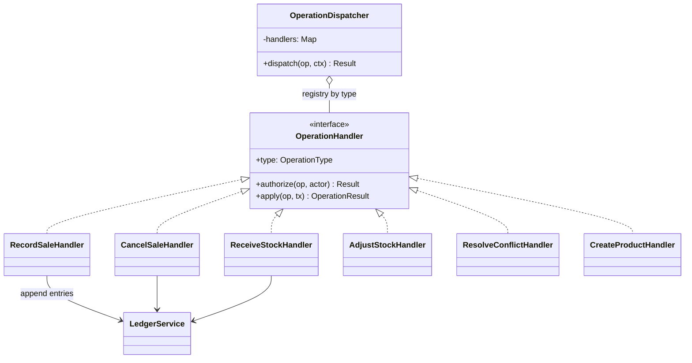

**Ports and adapters on the server (patterns 9, 12, 15, 21).**

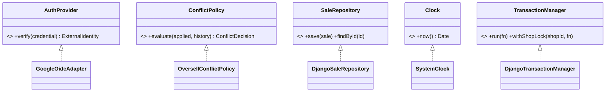

**Client sync structure (patterns 5, 8, 16, 28, 29).**

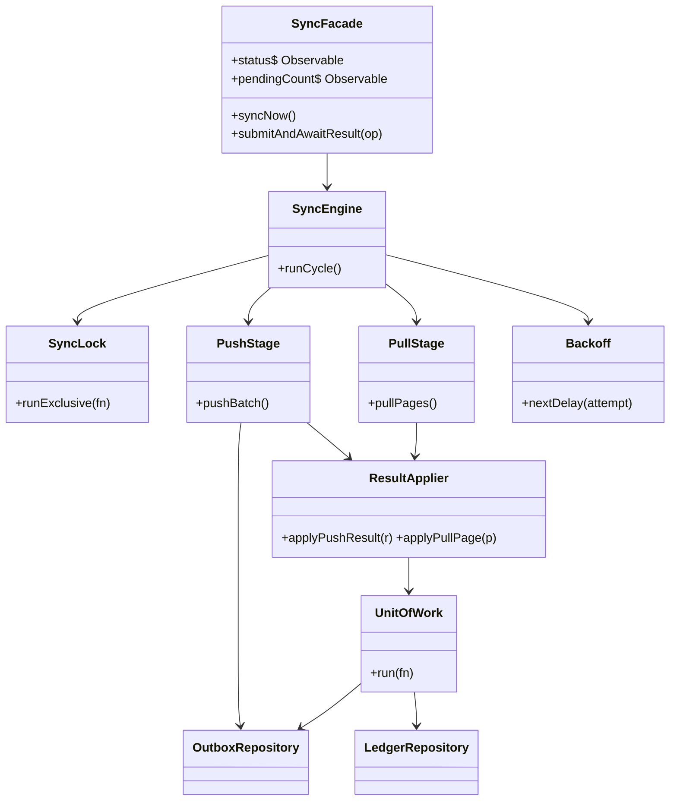

**Domain model (patterns 10, 11, 24, 25).**

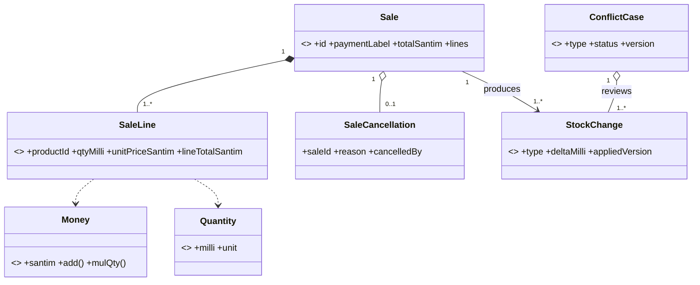

### 3.4 Pattern usage rules and anti-patterns

1. A handler never writes `StockChange` or `StockLevel` directly. Only `LedgerService.append` does.
2. Expected business failures return `Result`; only unexpected faults raise. A single DRF exception handler maps `DomainError` to problem+json (§7.4).
3. No service locator and no static singletons holding state. Dependencies arrive through constructors or `deps` objects.
4. Registries are populated in one place (`config/container.py`; web `container.ts`). An architecture test asserts every `OperationType` has exactly one handler.
5. Do not add a pattern for its name. A new pattern needs a row in §3.2 with a location and a problem.
6. Two things called "outbox" exist: the **client command outbox** (pattern 5) and the **server domain-event outbox** (pattern 6). Names in code: `outbox` (client table) and `domain_event` (server table).
7. No Django signals, no `save()`/`delete()` overrides, and no business logic in `models.py` or serializers. Flows are explicit calls or in-process events (§8.3).
8. `Model.objects` is used only inside repositories of the owning app, always through `ShopScopedRepository` for tenant tables (§10.1).

### 3.5 Alternatives considered

| Alternative                                                          | Why not                                                                                          |
| -------------------------------------------------------------------- | ------------------------------------------------------------------------------------------------ |
| Full CQRS with broker                                                | No infrastructure budget. A projection in one database gives the same benefit.                   |
| CRDTs or sync libraries (Automerge, Yjs, PouchDB, RxDB, ElectricSQL) | Stock is a bounded counter with a non-negative rule that CRDT counters cannot enforce (ADR-004). |
| Saga / distributed transactions                                      | One database, one transaction per operation.                                                     |
| Redux Toolkit                                                        | Business data already lives in Dexie; a second store creates two sources of truth.               |
| Last-write-wins for stock                                            | Silently loses sales (SRS §1.3 objective 4). Used only for non-inventory product fields (§6.16). |
| Microservices                                                        | Cost and failure modes without benefit at this size.                                             |

---

## 4. Code organization

Repositories are organized **feature first, layer second**, with one-directional dependencies and hard size limits. The backend is one Django project; each module of §2.7 is one Django app with a fixed internal layering.

### 4.1 Repositories and the contract bundle

| Repository    | Content                                                                               | Deploys to |
| ------------- | ------------------------------------------------------------------------------------- | ---------- |
| `stokari-api` | Django project, apps (one per module), migrations, `contract/` bundle, runbooks, ADRs | Render     |
| `stokari-web` | React PWA, generated API types, e2e tests                                             | Vercel     |

The backend is Python and the web is TypeScript, so **they cannot share code**. Instead `stokari-api` publishes a **contract bundle** that both sides test against:

| Bundle file                                            | Produced by                                            | Used by                                                                        |
| ------------------------------------------------------ | ------------------------------------------------------ | ------------------------------------------------------------------------------ |
| `openapi.json`                                         | `drf-spectacular` export, committed; CI fails if stale | Web generates TypeScript types with `openapi-typescript`                       |
| `fixtures/money-vectors.json`, `quantity-vectors.json` | Hand-written, reviewed                                 | pytest (Python implementation) and Vitest (TypeScript implementation)          |
| `fixtures/permissions.json`                            | Exported from `apps/shops/domain/permissions.py`       | Web hides actions; server enforces from the Python source                      |
| `fixtures/error-codes.json`                            | Exported from `common/kernel/errors.py`                | Web error mapping                                                              |
| `fixtures/sample-operations/*.json`                    | Hand-written valid and invalid operation payloads      | pytest serializers and web Zod schemas must accept and reject the same samples |
| `version.txt`                                          | Release tag `contract-vX.Y.Z`                          | `contract.lock` in `stokari-web` pins the version                              |

If the bundle's release friction costs more than one day in week 1, switch to a monorepo `stokari/{api,web,contract}` (D-05); the folder layouts below do not change.

### 4.2 API repository (`stokari-api`)

```text
stokari-api/
├─ .github/workflows/
│  ├─ ci.yml                    # ruff, mypy, import-linter, file-size check, pytest (Postgres service), manage.py check --deploy, OpenAPI diff, trace-check
│  ├─ deploy.yml                # migrate staging, deploy, smoke test, promote
│  ├─ nightly-backup.yml        # pg_dump to backup storage, 14-day pruning
│  ├─ nightly-reconcile.yml     # runs `manage.py reconcile_stock_log`, alerts on mismatch
│  └─ contract-release.yml      # attaches the contract bundle to a release tag
├─ config/
│  ├─ settings/
│  │  ├─ base.py  dev.py  test.py  prod.py
│  │  └─ env.py                 # typed, validated environment loader (process exits if invalid)
│  ├─ urls.py                   # /v1 routing only
│  ├─ wsgi.py
│  └─ container.py              # composition root: ports -> adapters, operation registry, service factories
├─ common/
│  ├─ kernel/                   # Result, DomainError, typed IDs (NewType), Clock port, UUID check, in-process event bus
│  ├─ http/                     # exception handler (problem+json), request-id middleware, throttles, pagination, StrictIntegerField
│  └─ persistence/
│     ├─ transaction.py         # TransactionManager (atomic) and shop_lock(shop_id)
│     ├─ shop_scoped.py         # ShopScopedRepository base: the only way to build tenant queries
│     ├─ domain_event.py        # server outbox model and dispatcher
│     └─ sql.py                 # helpers for RunSQL migrations (forbid_mutation trigger, composite FKs)
├─ apps/
│  ├─ identity/                 # Google verify, JWT, refresh rotation, lease, drain token, authentication class
│  ├─ shops/                    # shop, membership, invites, closure, permissions
│  ├─ catalog/                  # products
│  ├─ stock-log/                  # StockChange, StockLevel, StockLogService (core)
│  ├─ sales/                    # sale, lines, cancellation
│  ├─ sync/                     # push, pull, status, dispatcher, idempotency, change log
│  ├─ conflicts/                # cases, quarantine, resolution
│  ├─ counts/                   # [S]
│  ├─ reporting/                # dashboard, valuation, CSV [S]
│  ├─ notifications/
│  └─ audit/
├─ contract/
│  ├─ openapi.json
│  ├─ fixtures/                 # see §4.1
│  └─ version.txt
├─ tests/
│  ├─ unit/                     # pure domain tests, no database
│  ├─ integration/              # handlers and repositories on real PostgreSQL
│  ├─ api/                      # DRF APIClient, including cross-shop and role denial
│  ├─ concurrency/              # transaction=True tests with threads (duplicate opIds, pull during push)
│  ├─ property/                 # Hypothesis interleavings
│  ├─ architecture/             # tenant-scope, registry completeness, forbidden imports
│  ├─ conftest.py
│  └─ factories.py              # factory_boy
├─ scripts/
│  ├─ export_contract.py        # regenerates openapi.json and exported fixtures
│  ├─ trace_check.py            # fails CI if a Must requirement has no tagged test
│  └─ check_file_size.py        # enforces §4.9
├─ docs/
│  ├─ adr/                      # one file per ADR
│  └─ runbook.md                # deploy, rollback, key rotation, restore
├─ manage.py
├─ pyproject.toml               # dependencies, Ruff, mypy, pytest, import-linter configuration
├─ uv.lock                      # committed lockfile (hashes)
├─ Dockerfile
├─ render.yaml
└─ .env.example                 # names only
```

Management commands (replace ad-hoc scripts and are the only administrative entry points, §10.4): `reconcile_stock_log` (stock-log app), `process_domain_events` (common), `transfer_ownership`, `purge_closed_shop` (shops).

### 4.3 App template (API)

Django requires `models.py` in each app. It is treated as part of the **infrastructure** layer: the domain and application layers never import it.

```text
apps/sales/
├─ domain/                      # pure Python: no Django, no DRF
│  ├─ sale.py                   # Sale aggregate (frozen dataclasses)
│  ├─ sale_line.py
│  ├─ errors.py
│  └─ policy.py                 # cancellation conflict rules (§6.13)
├─ application/
│  ├─ commands.py               # RecordSaleCommand, CancelSaleCommand (dataclasses)
│  ├─ ports.py                  # SaleRepository(Protocol), ...
│  ├─ record_sale.py            # RecordSaleHandler
│  ├─ cancel_sale.py
│  └─ queries.py
├─ infrastructure/
│  ├─ repositories.py           # DjangoSaleRepository(ShopScopedRepository) implements the ports
│  └─ mappers.py                # model <-> domain
├─ models.py                    # Django ORM models (infrastructure layer)
├─ interface/
│  ├─ views.py                  # read endpoints only; writes go through sync
│  ├─ serializers.py            # response shapes
│  ├─ payloads.py               # operation-payload serializers -> commands
│  ├─ permissions.py
│  └─ urls.py
├─ migrations/
├─ api.py                       # the ONLY module other apps may import
└─ apps.py

apps/stock-log/
├─ domain/                      # pure Python: no Django, no DRF
│  ├─ stock_change.py
│  ├─ stock_level.py
│  ├─ invariants.py             # INV-03, INV-04 checks (pure)
│  ├─ money.py                  # santim and milli-unit rules (§5.8)
│  └─ conflict_policy.py        # ConflictPolicy protocol
├─ application/
│  ├─ stock_log_service.py      # append(entries, ctx)
│  ├─ queries.py                # quantity, history, balance_at_version
│  └─ ports.py
├─ infrastructure/  repositories.py  mappers.py
├─ models.py  migrations/  api.py
└─ management/commands/reconcile_stock_log.py

apps/sync/
├─ application/
│  ├─ push_service.py           # §6.7 steps
│  ├─ pull_service.py           # §6.9
│  ├─ status_service.py         # operation status query
│  ├─ dispatcher.py             # OperationDispatcher (registry lookup)
│  ├─ idempotency.py
│  ├─ change_log.py             # allocates seq under the shop lock
│  ├─ protocol.py               # PROTOCOL_VERSION, limits (50 ops, 200 KB)
│  └─ ports.py
├─ infrastructure/  repositories.py   # ProcessedOperation, ChangeLog
├─ interface/
│  ├─ views.py                  # push, pull, status, health
│  ├─ envelope.py               # envelope and batch serializers (§6.5)
│  └─ urls.py
├─ models.py  migrations/  api.py
```

Each operation's handler lives in the app that owns the business rule (`RecordSaleHandler` in `sales`, `ReceiveStockHandler` in `stock-log`, `ResolveConflictHandler` in `conflicts`). `sync` owns only dispatch, idempotency and ordering; the registry that maps `type → (payload parser, handler)` is built in `config/container.py`.

### 4.4 Web repository (`stokari-web`)

```text
stokari-web/
├─ .github/workflows/ci.yml
├─ contract.lock                # pinned contract bundle version
├─ public/                      # manifest, icons
├─ src/
│  ├─ main.tsx                  # bootstrap only
│  ├─ app/                      # composition root
│  │  ├─ providers.tsx          # QueryClient, i18n, session, db
│  │  ├─ router.tsx             # lazy routes
│  │  ├─ container.ts           # wires repositories, services, sync
│  │  └─ pwa/                   # service-worker config, update prompt
│  ├─ contract/                 # downloaded by `pnpm contract:sync`; do not edit by hand
│  │  ├─ openapi.json
│  │  ├─ api-types.ts           # generated by openapi-typescript
│  │  └─ fixtures/              # money vectors, permissions, error codes, sample operations
│  ├─ contracts/                # hand-written Zod schemas for operation payloads
│  │  ├─ operations/            # one schema per operation type
│  │  └─ operations.contract.test.ts   # runs every sample operation through the schemas
│  ├─ core/                     # framework-free, no I/O
│  │  ├─ domain/                # money.ts, quantity.ts, record-status.ts, projection.ts, totals.ts, permissions.ts
│  │  ├─ search/                # normalize.ts (Latin + Ethiopic), index.ts
│  │  ├─ ids/                   # uuidv7.ts
│  │  ├─ time/                  # date-eat.ts, clock.ts
│  │  └─ result.ts
│  ├─ data/
│  │  ├─ db.ts                  # Dexie schema, versions, migrations, durability option
│  │  ├─ db-name.ts             # stokari:{shopId}:{userId}
│  │  ├─ repositories/          # product, sale, stock-log, stock-level, outbox, conflict, meta
│  │  ├─ unit-of-work.ts
│  │  └─ recovery.ts            # rebuild projection, integrity check
│  ├─ sync/
│  │  ├─ sync-engine.ts  sync-lock.ts  scheduler.ts  reachability.ts
│  │  ├─ push.ts  pull.ts  result-applier.ts  backoff.ts
│  │  ├─ connectivity-state.ts  # OFFLINE / SYNCING / UP_TO_DATE / ATTENTION_REQUIRED
│  │  └─ sync-facade.ts         # what the UI imports
│  ├─ session/                  # tokens in memory, refresh, lease check, clock-rollback guard
│  ├─ api/                      # typed HTTP client (uses contract/api-types), 70 s timeout, token interceptor
│  ├─ features/
│  │  ├─ auth/  products/  sales/  stock/  history/
│  │  ├─ review/                # needs-review queue, resolution
│  │  ├─ dashboard/  staff/  settings/
│  │  ├─ export/                # CSV request [S], pending-record JSON export
│  │  └─ local-only/            # [S]
│  ├─ ui/                       # Button, Input, Sheet, StatusBadge, SyncPill
│  ├─ i18n/                     # en.json, am.json [S]
│  └─ test/                     # fixtures, fake clock, fake API
├─ scripts/contract-sync.ts     # downloads the pinned bundle, regenerates types
└─ e2e/                         # Playwright
```

### 4.5 Feature slice template

```text
features/sales/
├─ components/                  # presentational: props in, events out
│  ├─ SaleCart.tsx  ProductPicker.tsx  PaymentLabelSelect.tsx  PendingConfirmationList.tsx
├─ hooks/                       # useSaleCart, useRecordSale
├─ services/                    # recordSale.ts, cancelSale.ts (use cases)
├─ schemas.ts                   # re-exports Zod schemas from src/contracts
├─ routes.tsx
└─ index.ts                     # public API of the slice
```

### 4.6 Contract workflow

1. Change a serializer or fixture in `stokari-api`; run `python scripts/export_contract.py`, which regenerates `openapi.json` and the exported fixtures. CI fails if the committed files are stale.
2. A breaking change bumps `PROTOCOL_VERSION` (`apps/sync/application/protocol.py`) and the contract's major version; the API accepts the previous `protocolVersion` for one release, older returns `426 UPGRADE_REQUIRED`.
3. Tag `contract-vX.Y.Z`; `contract-release.yml` attaches the bundle.
4. In `stokari-web`, a PR bumps `contract.lock`; `pnpm contract:sync` downloads the bundle and regenerates `api-types.ts`.
5. Web CI runs the contract tests: money and quantity vectors, every sample operation through the Zod schemas, permission table, error-code map. A mismatch between Python and TypeScript behavior fails a build instead of reaching a shop.

### 4.7 Dependency rules and enforcement

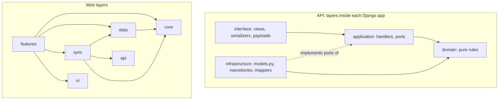

| Rule             | Detail                                                                                                                                               |
| ---------------- | ---------------------------------------------------------------------------------------------------------------------------------------------------- |
| App layers (API) | `interface → application → domain`. `infrastructure` implements `application` ports. `domain` imports only `common.kernel` and the standard library. |
| Apps (API)       | Import another app only through its `api.py`. No cycles. `stock-log` imports no other app.                                                           |
| ORM confinement  | Only `models.py` and `infrastructure/` import `django.db.models`. Application and domain code cannot see the ORM.                                    |
| Web layers       | `features → core, data, sync, ui`. `data` and `sync` never import `features`. `core` imports nothing project-specific.                               |
| Slices (web)     | A slice never imports another slice's internals.                                                                                                     |
| UI (web)         | Components never call Dexie or `fetch`; they call hooks, which call services.                                                                        |
| Tenancy (API)    | Repositories extend `ShopScopedRepository`; see §10.1.                                                                                               |

API enforcement uses **import-linter** (`pyproject.toml`; excerpt, to be completed from the app list, verifying wildcard support in the pinned version or generating explicit lists with a small script):

```toml
[tool.importlinter]
root_packages = ["apps", "common", "config"]

[[tool.importlinter.contracts]]
name = "Layers inside each app"
type = "layers"
containers = [
  "apps.sales",
  "apps.stock_log",
  "apps.sync",
  "apps.conflicts",
  "apps.catalog",
  "apps.identity",
  "apps.shops",
  "apps.counts",
  "apps.reporting",
]
layers = ["interface", "application", "domain"]

[[tool.importlinter.contracts]]
name = "Domain and application never see the ORM or the web framework"
type = "forbidden"
source_modules = [
  "apps.sales.domain",
  "apps.sales.application",
  "apps.stock_log.domain",
  "apps.stock_log.application",
] # repeat per app
forbidden_modules = ["django", "rest_framework", "psycopg"]

[[tool.importlinter.contracts]]
name = "Ledger imports no other app"
type = "forbidden"
source_modules = ["apps.stock_log"]
forbidden_modules = [
  "apps.sales",
  "apps.sync",
  "apps.conflicts",
  "apps.catalog",
  "apps.identity",
  "apps.shops",
  "apps.counts",
  "apps.reporting",
]
```

Additional **architecture tests** in `tests/architecture/` cover what import rules cannot: every `OperationType` has exactly one registered handler; no repository calls `Model.objects` directly; every tenant model has a repository that extends `ShopScopedRepository`; every tenant table has a composite primary key in the migration state.

Web enforcement uses **dependency-cruiser** (`.dependency-cruiser.cjs`):

```js
module.exports = {
  forbidden: [
    {
      name: "core-pure",
      severity: "error",
      from: { path: "^src/core/" },
      to: { path: "^src/(data|sync|api|features|ui|session)/" },
    },
    {
      name: "data-sync-not-features",
      severity: "error",
      from: { path: "^src/(data|sync)/" },
      to: { path: "^src/features/" },
    },
    {
      name: "ui-no-data-access",
      severity: "error",
      from: { path: "^src/(features/.*/components|ui)/" },
      to: { path: "^src/(data|api)/|dexie" },
    },
    {
      name: "no-cross-slice",
      severity: "error",
      from: { path: "^src/features/([^/]+)/" },
      to: { path: "^src/features/(?!\\1)[^/]+/(?!index\\.ts$)" },
    },
    { name: "no-circular", severity: "error", from: {}, to: { circular: true } },
  ],
};
```

### 4.8 Naming and coding conventions

| Item                       | Convention                                                                                                                                                                         |
| -------------------------- | ---------------------------------------------------------------------------------------------------------------------------------------------------------------------------------- |
| Python files               | `snake_case.py`; one handler or aggregate per file; ports in `ports.py`; the app's public surface in `api.py` with `__all__`                                                       |
| Python style               | PEP 8 via Ruff; type hints required; `mypy --strict` on `domain/` and `application/`; no star imports                                                                              |
| Python types               | `PascalCase` classes; `NewType` IDs (`ShopId`, `OpId`); frozen dataclasses for domain objects and commands; `Enum` or `Literal` for operation types and statuses                   |
| Web files                  | `kebab-case.ts(x)`; named exports only                                                                                                                                             |
| Operation types            | `PascalCase` verbs on the wire: `RecordSale`, `CancelSale`                                                                                                                         |
| Casing across the boundary | JSON and ER diagrams use `camelCase`; Django models and SQL use `snake_case`. Serializers map between them (explicit `source=` or a camel-case renderer, decided in week 1, D-14). |
| DB                         | Explicit `db_table` per model (`stock_change`); no implicit table names                                                                                                            |
| Errors                     | `DomainError` subclasses with a stable `code` from `common/kernel/errors.py`                                                                                                       |
| Logs                       | JSON, IDs only (`request_id`, `shop_id`, `op_id`); never tokens, emails, payloads                                                                                                  |
| Commits                    | Conventional Commits; PR references requirement IDs (`FR-14`)                                                                                                                      |
| Test tags                  | Python: `@pytest.mark.req("FR-14", "AT-04", "T-05")`. Web: `[FR-14][AT-04][T-05]` in the title. Read by `scripts/trace_check.py`.                                                  |

### 4.9 Anti-god-file rules

| Rule                                           | Limit                                                                    | Enforced by                                                  |
| ---------------------------------------------- | ------------------------------------------------------------------------ | ------------------------------------------------------------ |
| Lines per file                                 | 250 (React components 200)                                               | `scripts/check_file_size.py` (API), ESLint `max-lines` (web) |
| Function complexity                            | 10                                                                       | Ruff `C901`, ESLint `complexity`                             |
| Function length and arguments                  | 40 statements, 6 arguments                                               | Ruff `PLR0915`, `PLR0913`, ESLint                            |
| One aggregate, handler or component per file   | Required                                                                 | Review                                                       |
| Views and serializers are thin                 | Parse, authorize, call handler, map result; **no business rules**        | Review, handler unit tests                                   |
| **No business logic in `models.py`**           | Models are persistence only; no `save()` overrides, no custom `delete()` | Review, architecture test                                    |
| **No Django signals for business flow**        | Flows are explicit calls or in-process events (§8.3)                     | Review                                                       |
| No `utils.py` / `helpers.py`                   | Name by purpose (`money.py`, `date_eat.py`)                              | Review                                                       |
| Rules live in `domain/` (API) or `core/` (web) | Testable without a framework                                             | Coverage gate: 90% on `domain/`, `core/`, `sync/`            |

Splitting heuristic: if describing a file needs the word "and", split it.

### 4.10 Where does X go?

| I need to...                        | Put it in                                                                                                |
| ----------------------------------- | -------------------------------------------------------------------------------------------------------- |
| Add a business rule about stock     | `apps/stock_log/domain` (and a test)                                                                     |
| Add a new operation type            | §4.11 recipe 1                                                                                           |
| Change a permission                 | `apps/shops/domain/permissions.py`; re-export the fixture                                                |
| Add a money or quantity calculation | `apps/stock_log/domain/money.py` **and** `core/domain/money.ts`, with new vectors in `contract/fixtures` |
| Add a screen                        | `features/<slice>/` + route in `routes.tsx` (recipe 3)                                                   |
| Call the API from the UI            | `api/` client, wrapped by a feature service or hook                                                      |
| Add a table or index locally        | `data/db.ts` new `version(n)` with `upgrade()`                                                           |
| Add a DB column                     | `models.py` + migration (expand, migrate, contract)                                                      |
| Add a query                         | The owning app's repository (extends `ShopScopedRepository`)                                             |
| Add a user-visible string           | `i18n/en.json` first, never inline                                                                       |

### 4.11 Developer recipes

**Recipe 1: add an operation type (example `RecordReturn`).**

1. `application/commands.py` in the owning app: `RecordReturnCommand` dataclass. `application/record_return.py`: handler implementing the `OperationHandler` protocol (§8.2).
2. `interface/payloads.py`: payload serializer that validates input and returns the command.
3. Register `(type, parser, handler)` in `config/container.py`. The architecture test fails until exactly one handler exists.
4. Add the role and offline policy in `apps/shops/domain/permissions.py` (§6.4) and re-export the fixtures.
5. Tests: domain unit, handler integration (success, duplicate `opId`, forbidden role, conflict), API test.
6. Add valid and invalid samples to `contract/fixtures/sample-operations/`; run `export_contract.py`.
7. Web: bump `contract.lock`, add the Zod schema, service (`UnitOfWork` for local effects) and Dexie change if needed.
8. Update §6.4, §6.8 and §12.4; run `trace_check`.

**Recipe 2: add an endpoint.** Serializer → thin view → query or handler → permission classes → `drf-spectacular` annotation → API test including cross-shop and role denial → regenerate the contract.

**Recipe 3: add a screen.** Slice folder (§4.5) → hook over local repositories → presentational components → status badge for every record list → i18n keys → 320 px check.

**Definition of done (every PR).** Ruff, mypy, import-linter (API) and lint, types, dependency-cruiser (web) green; tests tagged with requirement IDs; no file over limits; shop-isolation and role tests for new endpoints; local-write failure path tested; contract bundle regenerated if the API changed; i18n keys added; docs or ADR updated if a decision changed.

---

## 5. Data design

The server database and the local IndexedDB hold the same logical entities. The **accepted stock-movement stock log is the source of truth** for shared inventory. `StockLevel` is a transactionally maintained projection that a nightly job reconciles against the stock log (§5.7).

### 5.1 Data conventions

| Convention    | Rule                                                                                                                                                                      | Reason                                                                                                                        |
| ------------- | ------------------------------------------------------------------------------------------------------------------------------------------------------------------------- | ----------------------------------------------------------------------------------------------------------------------------- |
| IDs           | UUIDv7 generated on the client for every record the client creates. Primary keys on tenant tables are **composite `(shop_id, id)`** (Django `CompositePrimaryKey`, §5.6). | No round trip; time-ordered. Composite keys stop one shop's chosen ID from colliding with, or revealing, another shop's rows. |
| Quantities    | Integer milli-units (`qtyMilli`, `deltaMilli`). Whole-number units must be multiples of 1000. Max `999_999_999` (999,999.999).                                            | Exact arithmetic (SRS §6.1, §6.2)                                                                                             |
| Money         | Integer santim (1 ETB = 100) in `*Santim`. Max price and cost `99_999_999_999` (ETB 999,999,999.99).                                                                      | SRS §6.2, §6.3                                                                                                                |
| Time          | UTC `timestamptz`. `clientCreatedAt` (device, untrusted), `receivedAt` (server). Display in EAT.                                                                          | FR-34                                                                                                                         |
| Business date | A sale's business day is its `clientCreatedAt` converted to EAT. A device-clock-skew warning appears when `serverTime` differs by more than 5 minutes.                    | Reports match what the shop experienced                                                                                       |
| Deletion      | No hard deletes of business data. Products are `INACTIVE`. Ledger, sales, cancellations are immutable.                                                                    | SRS §7, FR-09                                                                                                                 |
| Tenancy       | Every tenant table has `shop_id`; every query is built by a shop-scoped repository (§10.1).                                                                               | FR-07                                                                                                                         |
| Naming        | JSON and ER diagrams use `camelCase`; Django models and SQL use `snake_case`. Serializers map between them (§4.8).                                                        | Consistency                                                                                                                   |

### 5.2 Domain model and aggregates

An **aggregate** is the set of rows that must change together in one transaction.

| Aggregate          | Root                 | Members                                                                                         | Transaction rule                                                   |
| ------------------ | -------------------- | ----------------------------------------------------------------------------------------------- | ------------------------------------------------------------------ |
| Product            | `Product`            | `StockLevel`, opening `StockChange`                                                             | Product creation and opening stock are one transaction (FR-08)     |
| Sale               | `Sale`               | `SaleLine`, `StockChange` (type `SALE`), optional `SaleCancellation` and its `StockChange` rows | All lines applied or none (FR-13)                                  |
| Ledger entry batch | `StockChange` set    | `StockLevel` update                                                                             | Entries and level change atomically; level `version` +1 per entry  |
| Conflict case      | `ConflictCase`       | `ConflictCaseItem`, `ConflictCaseEvent`                                                         | Opened or extended in the same transaction as the triggering entry |
| Operation          | `ProcessedOperation` | outcome JSON                                                                                    | Written in the same transaction as every effect (INV-04)           |
| Membership         | `Membership`         | `OfflineLease`, `RefreshToken`                                                                  | Deactivation revokes both in one transaction (FR-04)               |

### 5.3 Entity-relationship diagrams

**Diagram A: business data.**

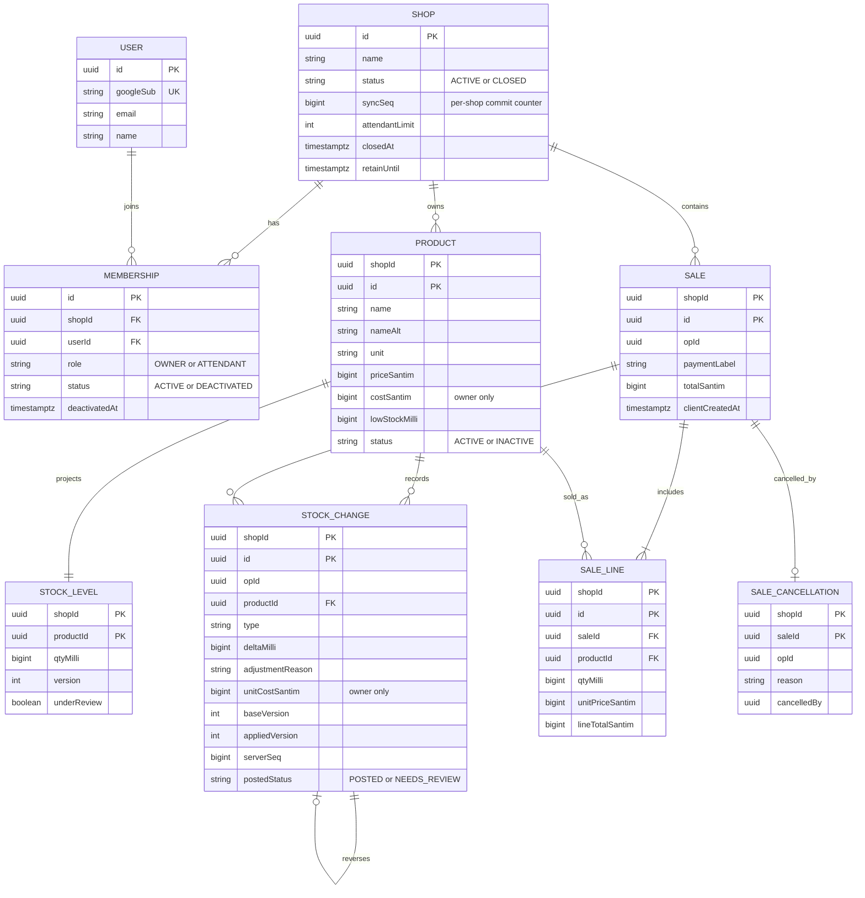

**Diagram B: synchronization, review and security data.**

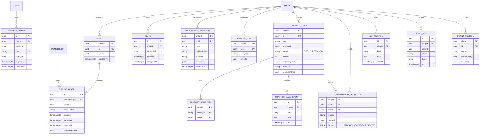

`DOMAIN_EVENT` (server outbox: `id`, `shopId`, `type`, `payload`, `createdAt`, `processedAt`) and `COUNT_LINE` [S] are omitted from the diagram for clarity.

### 5.4 Entity dictionary (rules not visible in the diagrams)

| Entity               | Rules                                                                                                                                                                                                                                                                                                                   |
| -------------------- | ----------------------------------------------------------------------------------------------------------------------------------------------------------------------------------------------------------------------------------------------------------------------------------------------------------------------- |
| Shop                 | `status` becomes `CLOSED` through the closure process (§6.16, SRS §7.1); closed shops reject ordinary operations with `SHOP_CLOSED`. `retainUntil = closedAt + 5 years`.                                                                                                                                                |
| Membership           | Unique `(shopId, userId)`. At most `attendantLimit` ACTIVE attendants, enforced inside the invite-accept transaction under the shop lock (FR-03). One ACTIVE membership is bound to a token (D-04).                                                                                                                     |
| Product              | `unit` is immutable after creation. At least one of `name`, `nameAlt` is required (FR-35: names are independent of the UI language). `costSantim` is owner-only; a RECEIPT with a unit cost updates it in the same transaction ("latest known cost", FR-32).                                                            |
| StockLevel           | Only `LedgerService` writes it. `version` +1 per entry. `underReview` is true while an open case of type `OFFLINE_OVERSELL`, `INVALID_STOCK_OPERATION` or `CANCELLATION_CONFLICT` references the product.                                                                                                               |
| StockChange          | Immutable (trigger). `deltaMilli != 0`. `adjustmentReason` required when `type = ADJUSTMENT`. `reversesId` required when `type = SALE_CANCELLATION`. `postedStatus` is fixed at insert. **Effective review status** is derived: NEEDS_REVIEW while linked to an OPEN case, RESOLVED after the case closes, else POSTED. |
| Sale                 | Immutable. Review state derives from its stock changes. Cancelled state derives from `SaleCancellation`.                                                                                                                                                                                                                |
| SaleCancellation     | Primary key `(shopId, saleId)`: the database guarantees at most one cancellation per sale (FR-16, SRS §4.9).                                                                                                                                                                                                            |
| ProcessedOperation   | Immutable. Stores `payloadHash` so key reuse with a different payload is detectable (INV-05).                                                                                                                                                                                                                           |
| ChangeLog            | One row per touched entity per transaction; `seq` allocated under the shop lock (INV-10).                                                                                                                                                                                                                               |
| ConflictCase         | `version` increments on every change; a resolution carrying an older version is stale (§6.12).                                                                                                                                                                                                                          |
| QuarantinedOperation | Holds the full payload of an operation with **no stock log effect** until the owner decides (§6.14).                                                                                                                                                                                                                    |
| OfflineLease         | Server-side record of every issued lease so the server can validate `leaseId` on late pushes (FR-06).                                                                                                                                                                                                                   |
| RefreshToken         | Stored as a hash; `familyId` groups rotations so reuse revokes the family (§10.1).                                                                                                                                                                                                                                      |

### 5.5 Enumerations

| Enum                         | Values                                                                                                                                                     |
| ---------------------------- | ---------------------------------------------------------------------------------------------------------------------------------------------------------- |
| `StockChangeType`            | `OPENING`, `SALE`, `RECEIPT`, `ADJUSTMENT`, `COUNT_CORRECTION`, `SALE_CANCELLATION`                                                                        |
| `AdjustmentReason`           | `DAMAGE`, `LOSS`, `CORRECTION`, `OTHER` (FR-18)                                                                                                            |
| `PaymentLabel`               | `CASH`, `TELEBIRR`, `OTHER` (label only; no settlement, FR-12)                                                                                             |
| `PostedStatus`               | `POSTED`, `NEEDS_REVIEW`                                                                                                                                   |
| `Unit`                       | `PIECE`, `PACK` (0 decimals); `KG`, `GRAM`, `LITRE`, `MILLILITRE` (3 decimals). No pack-to-piece conversion (SRS §6.1)                                     |
| `ConflictType`               | `OFFLINE_OVERSELL`, `PRODUCT_INACTIVE`, `AUTHORIZATION_REVIEW`, `INVALID_STOCK_OPERATION`, `CANCELLATION_CONFLICT`                                         |
| `ConflictResolution`         | `RECONCILE_STOCK`, `CANCEL_SALE`, `ACKNOWLEDGE`, `ACCEPT_QUARANTINED`, `REJECT_QUARANTINED` (plus `KEEP_OPEN`, which records a note and changes no status) |
| `OperationOutcome`           | `ACCEPTED`, `NEEDS_REVIEW`, `QUARANTINED`, `REJECTED`, `REJECTED_DEPENDENCY`                                                                               |
| `RecordSyncState` (client)   | `WAITING_TO_SYNC`, `SYNCING`, `SYNCED`, `NEEDS_REVIEW`, `REJECTED` (FR-24)                                                                                 |
| `ConnectivityState` (client) | `OFFLINE`, `SYNCING`, `UP_TO_DATE`, `ATTENTION_REQUIRED` (FR-24)                                                                                           |

### 5.6 Server schema (Django models, complete for the MVP)

Models live in each app's `models.py` (infrastructure layer). Tables use explicit `db_table` names. Three Django facts shape the design (verified against the current Django documentation):

1. `models.CompositePrimaryKey` exists (current Django), but **a `ForeignKey` cannot reference a model with a composite primary key**, the admin does not support such models, and **a table cannot be migrated to or from a composite key after creation**. Therefore tenant tables are created with their composite key in migration `0001`.
2. Cross-table references to tenant rows (`product_id`, `sale_id`, ...) are therefore plain `UUIDField`s, and the **composite foreign keys are created in migration SQL** (§5.7). The database still enforces them; the ORM just does not navigate them, so repositories join explicitly.
3. `CheckConstraint` uses the `condition=` argument (current Django).

If composite keys cause trouble in the week-1 spike, the fallback is a surrogate `id` primary key plus `UniqueConstraint(shop, client_id)`, treating any identifier collision as a generic `VALIDATION_FAILED` so existence is never revealed (D-13).

```python
# apps/shops/models.py
class Shop(models.Model):
    id = models.UUIDField(primary_key=True)
    name = models.TextField()
    status = models.CharField(max_length=10, default="ACTIVE")        # ACTIVE | CLOSED
    sync_seq = models.BigIntegerField(default=0)                       # incremented under the shop lock
    attendant_limit = models.PositiveSmallIntegerField(default=5)
    closed_at = models.DateTimeField(null=True)
    retain_until = models.DateTimeField(null=True)
    created_at = models.DateTimeField(auto_now_add=True)
    class Meta: db_table = "shop"

class Membership(models.Model):
    id = models.UUIDField(primary_key=True)
    shop = models.ForeignKey(Shop, on_delete=models.PROTECT)
    user = models.ForeignKey("identity.User", on_delete=models.PROTECT)
    role = models.CharField(max_length=10)                              # OWNER | ATTENDANT
    status = models.CharField(max_length=12, default="ACTIVE")          # ACTIVE | DEACTIVATED
    deactivated_at = models.DateTimeField(null=True)
    class Meta:
        db_table = "membership"
        constraints = [models.UniqueConstraint(fields=["shop", "user"], name="uq_membership_shop_user")]
        indexes = [models.Index(fields=["user", "status"])]

# apps/identity/models.py  (no django.contrib.auth: request.user is an Actor dataclass, §7.6)
class User(models.Model):
    id = models.UUIDField(primary_key=True)
    google_sub = models.TextField(unique=True)
    email = models.TextField()
    name = models.TextField()
    class Meta: db_table = "app_user"

class OfflineLease(models.Model):
    id = models.UUIDField(primary_key=True)                             # = JWT jti
    shop = models.ForeignKey("shops.Shop", on_delete=models.PROTECT)
    membership = models.ForeignKey("shops.Membership", on_delete=models.PROTECT)
    device_id = models.UUIDField()
    allowed_ops = ArrayField(models.CharField(max_length=40))
    issued_at = models.DateTimeField()
    expires_at = models.DateTimeField()
    revoked_at = models.DateTimeField(null=True)
    renewed_from = models.UUIDField(null=True)
    class Meta: db_table = "offline_lease"

class RefreshToken(models.Model):
    id = models.UUIDField(primary_key=True)
    user = models.ForeignKey(User, on_delete=models.PROTECT)
    device_id = models.UUIDField()
    hash = models.CharField(max_length=64, unique=True)                 # SHA-256 of the token
    family_id = models.UUIDField()
    expires_at = models.DateTimeField()
    revoked_at = models.DateTimeField(null=True)
    class Meta: db_table = "refresh_token"

# apps/catalog/models.py
class Product(models.Model):
    shop = models.ForeignKey("shops.Shop", on_delete=models.PROTECT)
    id = models.UUIDField()                                             # client-generated UUIDv7
    pk = models.CompositePrimaryKey("shop", "id")
    name = models.TextField()
    name_alt = models.TextField(null=True)
    unit = models.CharField(max_length=12)
    price_santim = models.BigIntegerField()
    cost_santim = models.BigIntegerField(null=True)                     # owner only
    low_stock_milli = models.BigIntegerField(default=0)
    status = models.CharField(max_length=10, default="ACTIVE")
    updated_seq = models.BigIntegerField()                              # last ChangeLog seq
    class Meta:
        db_table = "product"
        constraints = [
            models.CheckConstraint(condition=models.Q(price_santim__gte=0, price_santim__lte=99_999_999_999), name="ck_price_range"),
            models.CheckConstraint(condition=models.Q(cost_santim__isnull=True) | models.Q(cost_santim__gte=0, cost_santim__lte=99_999_999_999), name="ck_cost_range"),
        ]

# apps/stock-log/models.py
class StockLevel(models.Model):
    shop = models.ForeignKey("shops.Shop", on_delete=models.PROTECT)
    product_id = models.UUIDField()
    pk = models.CompositePrimaryKey("shop", "product_id")
    qty_milli = models.BigIntegerField(default=0)                       # may be negative: overselling must be recordable
    version = models.IntegerField(default=0)
    under_review = models.BooleanField(default=False)
    class Meta: db_table = "stock_level"

class StockChange(models.Model):
    shop = models.ForeignKey("shops.Shop", on_delete=models.PROTECT)
    id = models.UUIDField()
    pk = models.CompositePrimaryKey("shop", "id")
    op_id = models.UUIDField()
    product_id = models.UUIDField()
    type = models.CharField(max_length=20)                              # OPENING SALE RECEIPT ADJUSTMENT COUNT_CORRECTION SALE_CANCELLATION
    delta_milli = models.BigIntegerField()
    adjustment_reason = models.CharField(max_length=12, null=True)      # DAMAGE LOSS CORRECTION OTHER
    note = models.TextField(null=True)
    unit_cost_santim = models.BigIntegerField(null=True)                # owner only
    sale_id = models.UUIDField(null=True)
    reverses_id = models.UUIDField(null=True)                           # SALE_CANCELLATION -> original SALE entry
    count_session_id = models.UUIDField(null=True)
    conflict_case_id = models.UUIDField(null=True)                      # entries created by a resolution
    user_id = models.UUIDField()
    device_id = models.UUIDField()
    client_created_at = models.DateTimeField()
    received_at = models.DateTimeField(auto_now_add=True)
    base_version = models.IntegerField()
    applied_version = models.IntegerField()
    server_seq = models.BigIntegerField()
    posted_status = models.CharField(max_length=12, default="POSTED")   # POSTED | NEEDS_REVIEW (immutable)
    class Meta:
        db_table = "stock_change"
        constraints = [
            models.UniqueConstraint(fields=["shop", "product_id", "applied_version"], name="uq_change_product_version"),
            models.CheckConstraint(condition=~models.Q(delta_milli=0), name="ck_delta_nonzero"),
            models.CheckConstraint(condition=~models.Q(type="ADJUSTMENT") | models.Q(adjustment_reason__isnull=False), name="ck_reason_for_adjustment"),
            models.CheckConstraint(condition=models.Q(type="SALE_CANCELLATION", reverses_id__isnull=False) | (~models.Q(type="SALE_CANCELLATION") & models.Q(reverses_id__isnull=True)), name="ck_reverses_for_cancel"),
        ]
        indexes = [models.Index(fields=["shop", "server_seq"]), models.Index(fields=["shop", "op_id"]),
                   models.Index(fields=["shop", "received_at"])]

# apps/sales/models.py
class Sale(models.Model):
    shop = models.ForeignKey("shops.Shop", on_delete=models.PROTECT)
    id = models.UUIDField()
    pk = models.CompositePrimaryKey("shop", "id")
    op_id = models.UUIDField()
    user_id = models.UUIDField()
    device_id = models.UUIDField()
    payment_label = models.CharField(max_length=10)
    total_santim = models.BigIntegerField()
    client_created_at = models.DateTimeField()
    received_at = models.DateTimeField(auto_now_add=True)
    class Meta:
        db_table = "sale"
        indexes = [models.Index(fields=["shop", "client_created_at"])]

class SaleLine(models.Model):
    shop = models.ForeignKey("shops.Shop", on_delete=models.PROTECT)
    id = models.UUIDField()
    pk = models.CompositePrimaryKey("shop", "id")
    sale_id = models.UUIDField()
    product_id = models.UUIDField()
    qty_milli = models.BigIntegerField()
    unit_price_santim = models.BigIntegerField()                        # snapshot
    line_total_santim = models.BigIntegerField()
    class Meta:
        db_table = "sale_line"
        constraints = [models.CheckConstraint(condition=models.Q(qty_milli__gte=1, qty_milli__lte=999_999_999), name="ck_qty_range")]
        indexes = [models.Index(fields=["shop", "sale_id"])]

class SaleCancellation(models.Model):
    shop = models.ForeignKey("shops.Shop", on_delete=models.PROTECT)
    sale_id = models.UUIDField()
    pk = models.CompositePrimaryKey("shop", "sale_id")                  # at most one cancellation per sale
    op_id = models.UUIDField()
    reason = models.TextField()
    cancelled_by = models.UUIDField()
    at = models.DateTimeField(auto_now_add=True)
    class Meta: db_table = "sale_cancellation"

# apps/sync/models.py
class ProcessedOperation(models.Model):
    shop = models.ForeignKey("shops.Shop", on_delete=models.PROTECT)
    op_id = models.UUIDField()
    pk = models.CompositePrimaryKey("shop", "op_id")
    type = models.CharField(max_length=30)
    payload_hash = models.CharField(max_length=64)
    outcome = models.CharField(max_length=20)
    result_json = models.JSONField()
    received_at = models.DateTimeField(auto_now_add=True)
    class Meta: db_table = "processed_operation"

class ChangeLog(models.Model):
    shop = models.ForeignKey("shops.Shop", on_delete=models.PROTECT)
    seq = models.BigIntegerField()
    pk = models.CompositePrimaryKey("shop", "seq")
    entity_type = models.CharField(max_length=30)
    entity_id = models.UUIDField()
    class Meta: db_table = "change_log"

# apps/conflicts/models.py
class ConflictCase(models.Model):
    shop = models.ForeignKey("shops.Shop", on_delete=models.PROTECT)
    id = models.UUIDField()
    pk = models.CompositePrimaryKey("shop", "id")
    type = models.CharField(max_length=30)
    product_id = models.UUIDField(null=True)
    status = models.CharField(max_length=10, default="OPEN")
    version = models.IntegerField(default=1)
    state_snapshot = models.JSONField()
    resolution = models.CharField(max_length=30, null=True)
    resolution_op_id = models.UUIDField(null=True)
    resolved_by = models.UUIDField(null=True)
    opened_at = models.DateTimeField(auto_now_add=True)
    closed_at = models.DateTimeField(null=True)
    class Meta:
        db_table = "conflict_case"
        indexes = [models.Index(fields=["shop", "status"])]

# ConflictCaseItem (shop, case_id, item_type, item_id), ConflictCaseEvent, QuarantinedOperation
# (shop, op_id, case_id, reason, payload JSON, decision), Device, Invite, Notification, AuditLog,
# DomainEvent (server outbox), CountSession [S], CountLine [S] follow the same conventions:
# composite (shop, id) key where client-created or shop-owned, timestamptz, no hard deletes.
```

### 5.7 Database-level protections (migrations)

Two helper migrations per app use `RunSQL` (written through `common/persistence/sql.py` so the SQL is reviewed once):

```python
# apps/stock-log/migrations/0002_protections.py
migrations.RunSQL(
  sql=[
    # 1. Immutability: stock log, sales, cancellations, processed operations, audit
    """CREATE OR REPLACE FUNCTION forbid_mutation() RETURNS trigger AS $$
       BEGIN RAISE EXCEPTION 'table % is append-only', TG_TABLE_NAME; END; $$ LANGUAGE plpgsql;""",
    """CREATE TRIGGER stock_change_immutable BEFORE UPDATE OR DELETE ON stock_change
       FOR EACH ROW EXECUTE FUNCTION forbid_mutation();""",
    # 2. Composite foreign keys that Django cannot model (ON DELETE RESTRICT)
    """ALTER TABLE stock_change ADD CONSTRAINT fk_stock_change_product
       FOREIGN KEY (shop_id, product_id) REFERENCES product (shop_id, id) ON DELETE RESTRICT;""",
    """ALTER TABLE stock_level ADD CONSTRAINT fk_stock_level_product
       FOREIGN KEY (shop_id, product_id) REFERENCES product (shop_id, id) ON DELETE RESTRICT;""",
  ],
  reverse_sql=[...],
)
# repeat the trigger for sale, sale_line, sale_cancellation, processed_operation, audit_log;
# composite FKs: sale_line -> sale, sale_line -> product, sale_cancellation -> sale, stock_change.reverses_id -> stock_change, ...
```

Additional rules:

- **Value checks** are Django `CheckConstraint`s (§5.6). There is deliberately **no** check that `qty_milli >= 0`: overselling must be recordable (FR-15).
- **Immutability is enforced twice**: repositories expose no update or delete method for immutable tables, and the trigger blocks any `QuerySet.update()`, `delete()` or raw SQL.
- **Database roles.** The running application connects as `stokari_app`, which has **no `DELETE` privilege** on business tables and cannot alter schema. Migrations run in the deploy job with a separate `stokari_migrator` role (`MIGRATION_DATABASE_URL`).
- **Nightly reconciliation** (`manage.py reconcile_stock_log`) verifies `StockLevel.qty_milli = SUM(delta_milli)` and `version = COUNT(entries)` per product and alerts on mismatch (NFR-07, INV-03).
- **Isolation.** PostgreSQL's default `READ COMMITTED` plus the explicit shop lock (§6.7), not `SERIALIZABLE`, to avoid serialization retries. Every write path runs inside `transaction.atomic()`; `ATOMIC_REQUESTS` stays off because the push view opens one transaction **per operation**.

### 5.8 Numeric rules and algorithms (SRS §6)

**Two implementations, one specification.** Python integers are unbounded, so the server cannot overflow. JavaScript numbers lose precision above 2⁵³ − 1 and `qtyMilli × unitPriceSantim` can reach 10²⁰, so the web uses `BigInt` for the intermediate product. A sale total cap of 2⁵³ − 1 santim keeps every JSON value exactly representable on both sides. The Python and TypeScript implementations must return identical results for every vector in `contract/fixtures/money-vectors.json` (both repos run it in CI).

```python
# apps/stock-log/domain/money.py  (mirrored by web core/domain/money.ts)
MAX_SALE_TOTAL_SANTIM = 2**53 - 1
MAX_LINES_PER_SALE = 100

class MoneyOverflow(DomainError):
    code = "VALIDATION_FAILED"

def line_total_santim(qty_milli: int, unit_price_santim: int) -> int:
    """round_half_up(qty_milli * unit_price_santim / 1000), integer maths only."""
    total = (qty_milli * unit_price_santim + 500) // 1000          # non-negative inputs only
    if total > MAX_SALE_TOTAL_SANTIM:
        raise MoneyOverflow("LINE_TOTAL_TOO_LARGE")
    return total

def sale_total_santim(lines: Sequence[tuple[int, int]]) -> int:
    """Sale total = sum of rounded line totals (SRS §6.3)."""
    total = sum(line_total_santim(q, p) for q, p in lines)
    if total > MAX_SALE_TOTAL_SANTIM:
        raise MoneyOverflow("SALE_TOTAL_TOO_LARGE")
    return total
```

```ts
// web core/domain/money.ts
export function lineTotalSantim(qtyMilli: number, unitPriceSantim: number): number {
  const q = (BigInt(qtyMilli) * BigInt(unitPriceSantim) + 500n) / 1000n; // half-up
  if (q > BigInt(Number.MAX_SAFE_INTEGER)) throw new RangeError("LINE_TOTAL_TOO_LARGE");
  return Number(q);
}
```

| Rule                  | Detail                                                                                                                                                                                                                    |
| --------------------- | ------------------------------------------------------------------------------------------------------------------------------------------------------------------------------------------------------------------------- |
| Quantity validation   | `unit` decides decimals: 0 for `PIECE`/`PACK` (`qty_milli % 1000 == 0`), up to 3 for the others; `1 ≤ qty_milli ≤ 999_999_999`                                                                                            |
| Price validation      | `0 ≤ price_santim ≤ 99_999_999_999`, integer                                                                                                                                                                              |
| Serializer strictness | Numeric fields use a project `StrictIntegerField` that rejects strings, floats and booleans (DRF's default `IntegerField` accepts `"7"` and `7.0`). `FloatField` and `DecimalField` are never used for money or quantity. |
| Server authority      | The server recomputes line and sale totals; a client total that differs is `VALIDATION_FAILED` for that operation (AT-16)                                                                                                 |
| Money display         | ETB with two decimals via `Intl`, formatted from santim; never parsed from formatted strings                                                                                                                              |
| Tests                 | Shared vectors (half-up boundaries, maximum values, 0.001 kg) run in both repos from `contract/fixtures`                                                                                                                  |

### 5.9 Local schema (Dexie / IndexedDB)

One IndexedDB database per **shop and user**: `stokari:{shopId}:{userId}`. Role-filtered data (an owner's cost fields) therefore never shares a database with an attendant's, and logging out never deletes either (INV-12).

```ts
db.version(1).stores({
  meta: "key", // shopId, userId, deviceId, pullCursor, schemaVersion, lease, clockOffset, maxSeenTime
  products: "id, status, *searchTokens", // multiEntry index on normalized tokens
  stockLevels: "productId", // projection (see §5.10)
  stockChanges: "id, productId, [productId+serverSeq], opId, syncState, clientCreatedAt",
  sales: "id, opId, localDay, clientCreatedAt",
  saleLines: "id, saleId, productId",
  saleCancels: "saleId, opId",
  outbox: "++deviceSeq, &opId, state, nextAttemptAt",
  conflicts: "id, productId, status", // owner devices only; embeds items
  countSessions: "id, status", // [S]
});
```

| Table                               | Purpose                                                                                                                                                                                                                                                            | Server counterpart                     |
| ----------------------------------- | ------------------------------------------------------------------------------------------------------------------------------------------------------------------------------------------------------------------------------------------------------------------ | -------------------------------------- |
| `meta`                              | Session-independent device state. `maxSeenTime` guards against clock rollback (§6.14).                                                                                                                                                                             | n/a                                    |
| `products`                          | Catalogue; `searchTokens` from `name` and `nameAlt` (§8.8)                                                                                                                                                                                                         | `Product`                              |
| `stockLevels`                       | `{productId, confirmedQtyMilli, confirmedVersion, pendingDeltaMilli, projectedQtyMilli, underReview}`                                                                                                                                                              | `StockLevel`                           |
| `stockChanges`                      | Stock log rows, server-confirmed and pending, same `id` on both sides; `syncState` is a `RecordSyncState`                                                                                                                                                          | `StockChange`                          |
| `sales`, `saleLines`, `saleCancels` | Sale records with `localDay` (EAT date) for dashboard grouping                                                                                                                                                                                                     | `Sale`, `SaleLine`, `SaleCancellation` |
| `outbox`                            | **One table for every operation**, online-confirmation and offline-completed. Fields: `deviceSeq` (auto, defines order), `opId`, `type`, `mode`, `payload`, `payloadHash`, `dependsOn[]`, `state`, `attempts`, `nextAttemptAt`, `lastError`, `result`, `createdAt` | `ProcessedOperation` (conceptually)    |
| `conflicts`                         | Cases for owner devices, with embedded item list and quarantined-op summaries                                                                                                                                                                                      | `ConflictCase`                         |

`mode` is `ONLINE_CONFIRMATION_REQUIRED` (reject if invalid) or `OFFLINE_COMPLETED` (preserve and flag). Online-mode operations create **no** local sale or stock log rows until the server accepts (§6.6).

Mapping of server status to the local `syncState`:

| Server fact                                 | Local `syncState`                                                                                  |
| ------------------------------------------- | -------------------------------------------------------------------------------------------------- |
| Not yet sent                                | `WAITING_TO_SYNC`                                                                                  |
| Request in flight                           | `SYNCING`                                                                                          |
| Outcome `ACCEPTED`                          | `SYNCED`                                                                                           |
| Outcome `NEEDS_REVIEW` or `QUARANTINED`     | `NEEDS_REVIEW` (badge text distinguishes "stock discrepancy" from "awaiting authorization review") |
| Outcome `REJECTED` or `REJECTED_DEPENDENCY` | `REJECTED`                                                                                         |
| Case later `RESOLVED`                       | `SYNCED` (the original record is never rewritten; a resolution record exists)                      |

### 5.10 Stock projection algorithm (no double counting, INV-09)

Per product, the device keeps two parts and derives the third:

```text
projectedQty = confirmedQty + pendingDelta
confirmedQty  = last authoritative StockLevel.qty the device has seen (with confirmedVersion)
pendingDelta  = SUM(deltaMilli) of local stockChanges whose syncState is WAITING_TO_SYNC or SYNCING
```

Every transition happens in **one Dexie transaction**:

| Event                                             | Effect                                                                                                                                                                                                                                 |
| ------------------------------------------------- | -------------------------------------------------------------------------------------------------------------------------------------------------------------------------------------------------------------------------------------- |
| Local offline sale committed                      | Add pending entries; `pendingDelta += Σ delta`; recompute `projectedQty`                                                                                                                                                               |
| Push result `ACCEPTED`/`NEEDS_REVIEW` for entries | Update the **same rows** (same `id`) with `serverSeq`, `appliedVersion`, `syncState`; set `confirmedQty/confirmedVersion` from the result's `stockAfter` **if its version is newer**; recompute `pendingDelta` from rows still pending |
| Push result `REJECTED`/`QUARANTINED`              | Rows leave `pendingDelta` (no stock log effect); they stay visible with state                                                                                                                                                          |
| Pull page                                         | Upsert rows by `id`; apply `stockLevels` only if `version > confirmedVersion`; recompute `pendingDelta`                                                                                                                                |

Because an entry is either pending (counted in `pendingDelta`) or acknowledged (counted inside `confirmedQty`), it can never count twice. If integrity checks fail, `recovery.ts` rebuilds `stockLevels` from a fresh pull while keeping the outbox (§5.11).

### 5.11 Retention, ownership, migrations, recovery

- **Ownership.** Data belongs to the shop. Platform administrators have no default read access (FR-07); administrative actions follow §10.4.
- **Retention.** Stock log, sales and audit rows live for the life of the shop; five years after closure (SRS §7.1, subject to legal and privacy review). Closure warns about pending local records; the server cannot recover data that never synchronized (SRS §7.3).
- **Server migrations.** Django migrations, forward-only, reviewed, applied by the pipeline (`manage.py migrate` with the migrator role) before the new API starts. Destructive changes use expand, migrate, contract across two releases. Tenant tables get their composite key in migration `0001` because Django cannot convert a table to or from a composite key later.
- **Local migrations.** `db.version(n).upgrade()` with a unit test using a snapshot of the previous version. A migration must never drop `outbox` rows (SRS §9.3). `meta.schemaVersion` is sent with pushes; too old → `426`.
- **Rebuild.** `recovery.ts` can recompute `stockLevels` from `stockChanges` or re-pull from cursor 0; it never touches `outbox`.
- **Persistent storage.** On first run the app calls `navigator.storage.persist()` and shows the result and quota in Settings (§9.3).

---

## 6. Offline storage and synchronization

This section is the authoritative synchronization design. It implements SRS §4, FR-14, FR-22..FR-29 and FR-37.

### 6.1 Overview

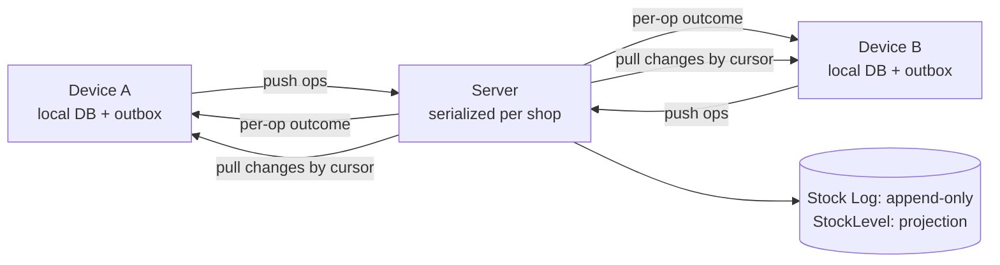

Devices never edit each other's data. They send **operations**; the server validates them in a deterministic order, appends stock log entries, and sends the results and changes back.

### 6.2 Required invariants

| ID     | Invariant                                                                                                                                                                                 | Verified by       |
| ------ | ----------------------------------------------------------------------------------------------------------------------------------------------------------------------------------------- | ----------------- |
| INV-01 | **Local save before confirmation.** "Saved on this device" is shown only after the sale, lines, stock log entries, projection and outbox row commit in one IndexedDB transaction (FR-23). | T-07, T-08        |
| INV-02 | **Immutable business facts.** A completed sale is never deleted or rewritten because of a later conflict.                                                                                 | T-03, T-12        |
| INV-03 | **Stock log consistency.** For every product `StockLevel.qty = Σ deltaMilli` and `version = entry count`.                                                                                 | Nightly job, T-14 |
| INV-04 | **Idempotent effects.** Operation result and every effect commit in the same transaction; a repeated `opId` with the same payload returns the stored result.                              | T-04, T-05, T-06  |
| INV-05 | **Key reuse.** Same `opId` with a different payload is rejected as `IDEMPOTENCY_KEY_REUSE`.                                                                                               | T-05              |
| INV-06 | **Atomic sale.** A sale and all its lines are applied together or not at all (FR-13).                                                                                                     | T-02              |
| INV-07 | **No ordinary online overselling.** An online-mode sale that would make stock negative, or touch a product under review, is rejected before commit (FR-15).                               | T-03, T-09        |
| INV-08 | **Offline sale preservation.** An offline-completed sale is stored and flagged, never discarded, when stock is insufficient (FR-15).                                                      | T-03              |
| INV-09 | **No double counting.** A pending contribution is replaced by the confirmed one in a single local transaction (§5.10).                                                                    | T-13              |
| INV-10 | **Cursor safety.** The pull cursor never passes a change that could commit later behind it.                                                                                               | T-15              |
| INV-11 | **Client time is not authority.** `clientCreatedAt` is display and routing evidence only (FR-06, FR-34).                                                                                  | T-17              |
| INV-12 | **No automatic local purge.** Sync, logout and deactivation never delete pending local records (SRS §7.3).                                                                                | T-18              |

### 6.3 State machines

**Record state (per operation and its records, FR-24).** Connectivity states are separate (below).

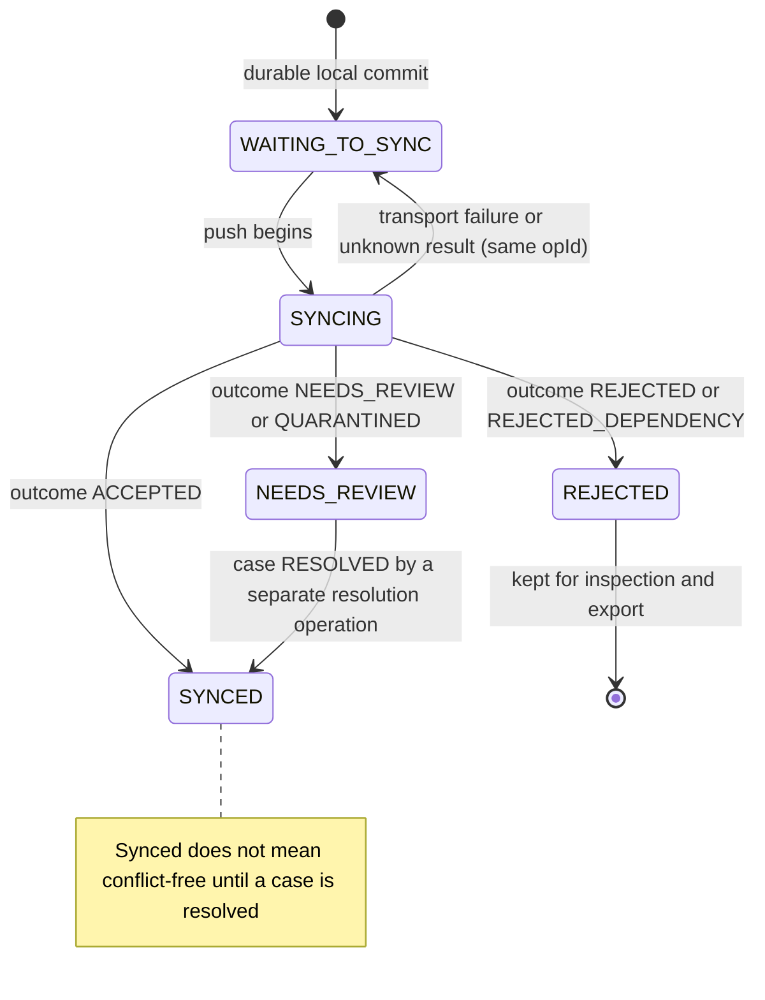

`REJECTED` is terminal. A corrected re-entry is a **new** operation with a new `opId` and a `supersedesOpId` link, created by explicit user action (D-10). Rejected records stay inspectable and exportable; only the owner may archive them, with an audit entry (FR-24, SRS §7.3).

**Conflict case.**

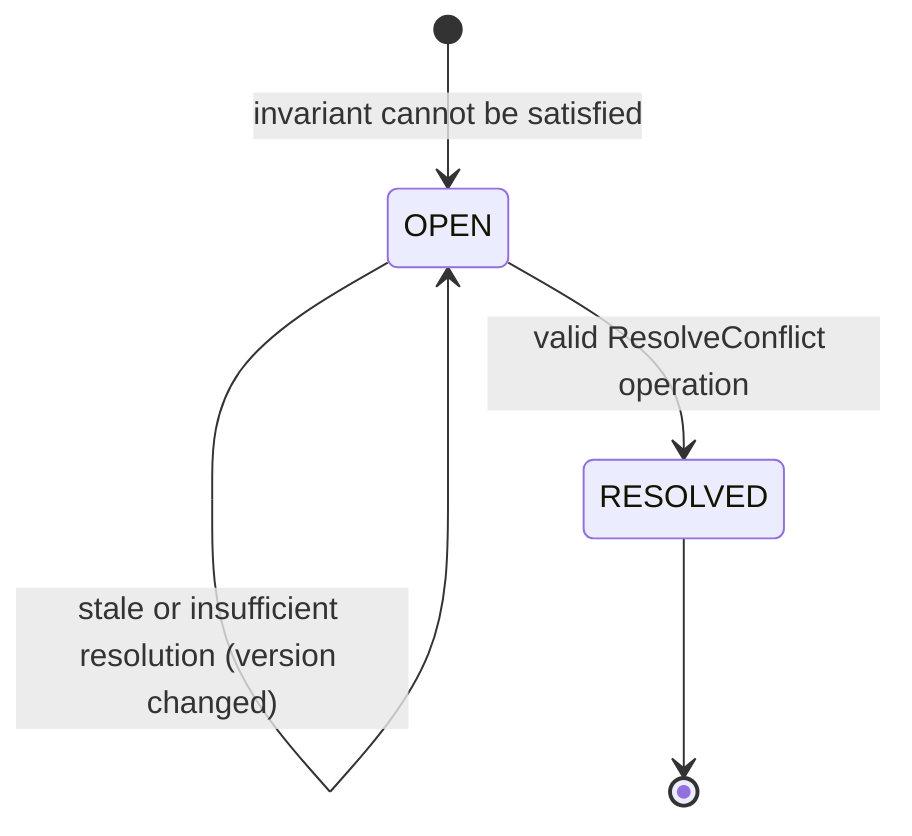

**Connectivity and overall status (FR-24, FR-37).**

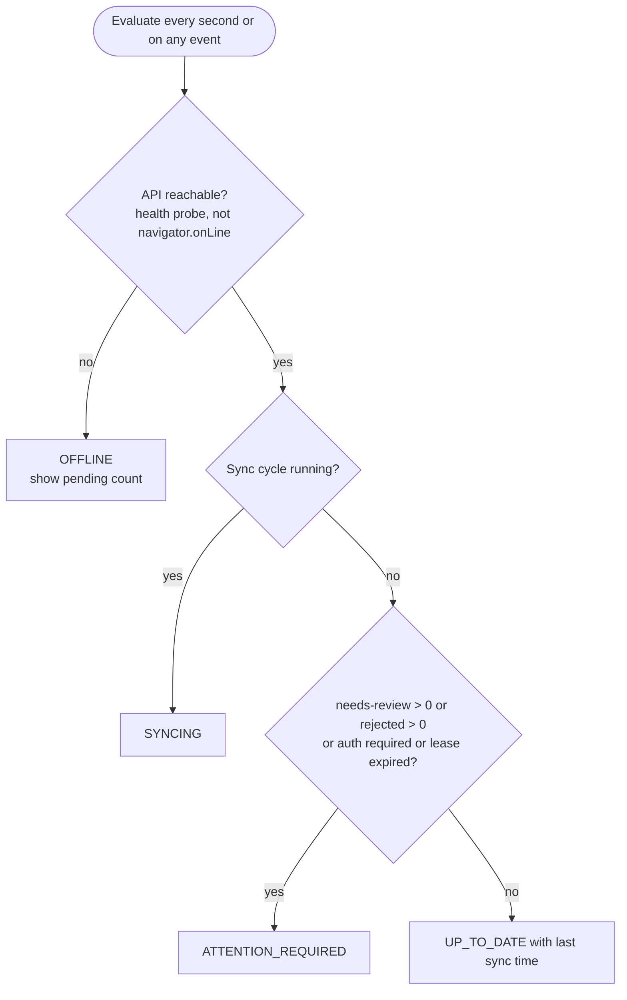

**Offline lease.**

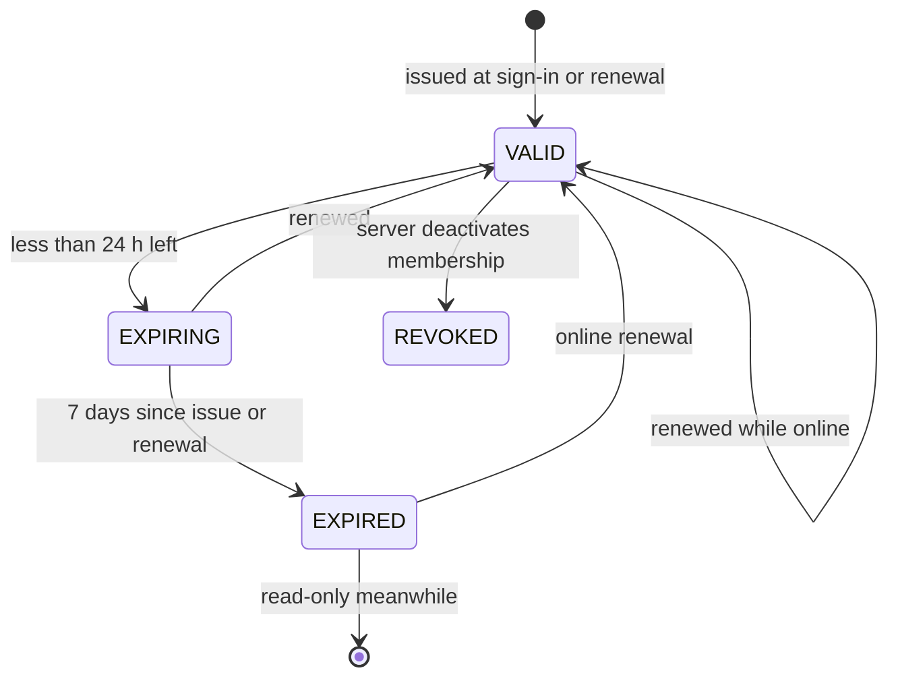

### 6.4 Operation catalogue and offline policy

FR-22 delegates the offline policy per role to this SDD. "Offline" means the operation may be **created** without connectivity while the lease is valid; it is always synchronized later.

| Operation                                        | Roles            | Offline-capable         | Effect                                           | Online-only reason                                              |
| ------------------------------------------------ | ---------------- | ----------------------- | ------------------------------------------------ | --------------------------------------------------------------- |
| `RecordSale`                                     | Owner, Attendant | Yes (FR-22 minimum)     | Sale, lines, `SALE` entries                      | n/a                                                             |
| `CancelSale`                                     | Owner            | Yes, pending (FR-16)    | `SaleCancellation` + `SALE_CANCELLATION` entries | n/a                                                             |
| `ReceiveStock`                                   | Owner (D-01)     | Yes                     | `RECEIPT` entries; may update product cost       | n/a                                                             |
| `AdjustStock`                                    | Owner            | Yes                     | `ADJUSTMENT` entry with reason                   | n/a                                                             |
| `CreateProduct`                                  | Owner            | Yes                     | Product + `OPENING` entry, atomic (FR-08)        | n/a                                                             |
| `UpdateProduct`, `SetProductStatus`              | Owner            | Yes                     | Product fields (last-writer-wins, §6.16)         | n/a                                                             |
| `ResolveConflict`                                | Owner            | Yes, pending (SRS §4.7) | See §6.12                                        | n/a                                                             |
| `ReviewQuarantine`                               | Owner            | Yes, pending            | Accept or reject held operations                 | n/a                                                             |
| `SubmitCount`, `DecideCount` [S]                 | Owner            | Yes                     | `COUNT_CORRECTION`                               | n/a                                                             |
| Register shop, sign in, first sign-in per device | Any              | No                      | n/a                                              | Identity needs Google and server                                |
| Invite, accept, deactivate attendant             | Owner            | No                      | n/a                                              | Deactivation must take effect on the server immediately (FR-04) |
| Close shop                                       | Owner            | No                      | n/a                                              | Destructive state change (SRS §7.1)                             |
| Reports for large ranges, CSV                    | Owner            | No                      | n/a                                              | Server-side aggregation                                         |
| Search, dashboard, history, local export         | Per role         | Yes (read)              | n/a                                              | n/a                                                             |

Attendants never see or create owner-only operations; the server enforces this regardless of the UI (FR-05). The permission table lives in `apps/shops/domain/permissions.py`, is exported to `contract/fixtures/permissions.json`, and drives the server directly and the UI through the bundle.

### 6.5 Operation envelope and batch

The envelope is shown in TypeScript notation because it is the wire contract. On the server it is validated by DRF serializers (`apps/sync/interface/envelope.py` and each app's `payloads.py`); on the client by Zod (`src/contracts`). Both are tested against `contract/fixtures/sample-operations` (§4.6).

```ts
type PushRequest = {
  protocolVersion: number; // 426 if unsupported
  schemaVersion: number; // client's local schema version
  deviceId: string;
  leaseId?: string; // required when any op has mode OFFLINE_COMPLETED
  ops: OperationEnvelope<unknown>[]; // at most 50 per request, body at most 200 KB, in deviceSeq order
};

type OperationEnvelope<T> = {
  opId: string; // UUIDv7, stable across every retry
  deviceSeq: number; // monotonic per device; preserves causal order
  type: OperationType;
  mode: "ONLINE_CONFIRMATION_REQUIRED" | "OFFLINE_COMPLETED";
  dependsOn?: string[]; // opIds that must be accepted first (e.g. CancelSale -> RecordSale)
  clientCreatedAt: string; // display and routing hint only (INV-11)
  baseVersions?: Record<string, number>;
  payload: T;
  payloadHash: string; // SHA-256 of canonical JSON, detects local corruption and key reuse
};
```

The shop is **never** in the request: the server takes it from the access token or lease (FR-07). The server also ignores any client-supplied user, role, totals or stock. `mode` is a client declaration; forging it can only produce a flagged, audited discrepancy, not an unflagged one (accepted risk).

**Payload size (NFR-04).** A one-line sale op is about 400 to 450 bytes (two UUIDs, hash, timestamps, one line). 200 sales are therefore roughly 80 to 130 KB before compression, under the 200 KB target. Measure with the real fixture in T-26.

### 6.6 Local write path

**Offline-completed sale (one Dexie transaction).**

```mermaid
flowchart TD
  a(["User taps Save"]) --> b["1 Validate with the Zod schema and the shared money rules"]
  b -->|"invalid"| e1["Show field errors, nothing stored"]
  b --> c["2 Check lease permits RecordSale<br/>using server-corrected time and rollback guard"]
  c -->|"expired"| e2["Block with 'sign in to renew'; local data stays readable"]
  c --> d["3 BEGIN Dexie transaction, strict durability"]
  d --> f["4 Insert sale, lines with price snapshot"]
  f --> g["5 Insert pending stock log entries"]
  g --> h["6 Update stockLevels projection"]
  h --> i["7 Insert outbox row WAITING_TO_SYNC"]
  i --> j{"COMMIT ok?"}
  j -->|"no"| e3["Roll back; show error; do not say saved"]
  j -->|"yes"| k["8 Show 'Saved on this device. Waiting to sync.'"]
```

A local pre-check warns when the quantity exceeds the projected stock and requires **Sell anyway**. It cannot prevent oversell because another device may sell the same stock offline.

**Online-mode sale.** The decision "online or offline" is made **before anything is sent**, by a reachability probe (`GET /v1/health`, 2 s timeout) rather than `navigator.onLine`. If the probe fails, the sale is completed offline (lease permitting). The sequence for a reachable server:

```mermaid
sequenceDiagram
  actor U as User
  participant UI as Sell screen
  participant UC as recordSale service
  participant L as Dexie
  participant SE as Sync engine
  participant API as Django API
  participant DB as PostgreSQL
  U->>UI: Save
  UI->>UC: command
  UC->>L: tx: outbox row (mode ONLINE_CONFIRMATION_REQUIRED, no sale yet)
  L-->>UC: committed
  UC-->>UI: "Sending, awaiting server confirmation" (till is free for the next sale)
  UC->>SE: submit opId
  SE->>API: POST /v1/sync/push (one op)
  API->>DB: tx: lock, check stock, sale, lines, stock log, result
  DB-->>API: commit
  API-->>SE: outcome ACCEPTED with entries and stockAfter
  SE->>L: tx: create sale and stock log rows as SYNCED, update projection
  L-->>UI: live query shows "Synced"
```

If the response is lost or times out, the UI says **"Awaiting confirmation"** and the engine retries or queries `POST /v1/sync/ops/status` with the **same `opId`** (SRS §4.6). The user must not re-enter the sale, and the operation is never converted to an offline sale after it was sent; that would risk a duplicate real-world transaction. A rejection (for example `INSUFFICIENT_STOCK`) keeps the intent as `REJECTED` for inspection and counts as no sale and no stock movement.

### 6.7 Server push processing

Each operation is processed in its **own transaction**, in `deviceSeq` order, so one invalid operation does not roll back others.

```mermaid
flowchart TD
  s(["Operation received"]) --> v1["1 Authenticate; load membership (must be checked every request)"]
  v1 --> v2["2 Verify protocol and schema version, payload hash, serializer-validated payload, role permission"]
  v2 --> v3{"3 ProcessedOperation exists?"}
  v3 -->|"same hash"| ret1["Return stored result"]
  v3 -->|"different hash"| ret2["REJECTED IDEMPOTENCY_KEY_REUSE, audit"]
  v3 -->|"no"| lock["4 BEGIN; lock shop row; then product rows in ascending ID"]
  lock --> v5{"5 Re-check ProcessedOperation after lock"}
  v5 -->|"found"| ret1
  v5 -->|"no"| auth{"6 Authorization at receipt time:<br/>membership ACTIVE, lease valid, op allowed, dependencies ok?"}
  auth -->|"membership deactivated or lease problem"| q["QUARANTINED: store payload, open AUTHORIZATION_REVIEW case"]
  auth -->|"dependency rejected"| rd["REJECTED_DEPENDENCY"]
  auth -->|"ok"| rules["7 Business rules by operation (§6.8)"]
  rules -->|"invalid, safe to refuse"| rej["REJECTED with code"]
  rules -->|"cannot be applied safely"| q
  rules -->|"applies, invariant holds"| acc["8a Apply; stock log append; projection; ChangeLog; outcome ACCEPTED"]
  rules -->|"applies but invariant broken (offline sale)"| nr["8b Apply; mark NEEDS_REVIEW; open or extend case; set underReview"]
  acc --> done["9 Store ProcessedOperation (with outcome) in the same transaction"]
  nr --> done
  q --> done
  rej --> done
  rd --> done
  done --> commit(["10 COMMIT; return result"])
```

**Lock order (prevents deadlocks).** 1) shop row `FOR UPDATE` (`select_for_update()` inside `transaction.atomic()`), 2) `StockLevel` rows in ascending product ID, 3) everything else. While the shop lock is held, only one write transaction per shop runs; product locks are kept as defence in depth. The sequence is allocated under the shop lock and visible only at commit, which is what makes cursors safe (INV-10, ADR-009).

If the response is lost after commit, the client retries the same `opId` and receives the stored result (T-06).

### 6.8 Outcome matrix

`effectApplied` in each result says whether stock or records changed.

| Operation                           | Situation                                                                                                   | Outcome                                                     | effectApplied           | Client state                |
| ----------------------------------- | ----------------------------------------------------------------------------------------------------------- | ----------------------------------------------------------- | ----------------------- | --------------------------- |
| `RecordSale` (online mode)          | Stock sufficient                                                                                            | `ACCEPTED`                                                  | yes                     | SYNCED                      |
|                                     | Stock would go below zero                                                                                   | `REJECTED` `INSUFFICIENT_STOCK`                             | no                      | REJECTED                    |
|                                     | Product `underReview`                                                                                       | `REJECTED` `PRODUCT_UNDER_REVIEW`                           | no                      | REJECTED                    |
|                                     | Product inactive                                                                                            | `REJECTED` `PRODUCT_INACTIVE`                               | no                      | REJECTED                    |
| `RecordSale` (offline completed)    | Stock sufficient                                                                                            | `ACCEPTED`                                                  | yes                     | SYNCED                      |
|                                     | Stock insufficient                                                                                          | `NEEDS_REVIEW` (`OFFLINE_OVERSELL`)                         | yes, all lines          | NEEDS_REVIEW                |
|                                     | Product inactive on server                                                                                  | `NEEDS_REVIEW` (`PRODUCT_INACTIVE`)                         | yes                     | NEEDS_REVIEW                |
|                                     | Price differs from catalogue                                                                                | `ACCEPTED`, price snapshot kept, deviation noted in history | yes                     | SYNCED                      |
|                                     | Product unknown or other shop                                                                               | `REJECTED` `VALIDATION_FAILED` / `SHOP_MISMATCH`            | no                      | REJECTED (record preserved) |
|                                     | Membership deactivated, lease unknown, revoked, wrong device, or `clientCreatedAt` outside the lease window | `QUARANTINED` (`AUTHORIZATION_REVIEW`)                      | no                      | NEEDS_REVIEW                |
| Any                                 | Totals, precision or limits invalid                                                                         | `REJECTED` `VALIDATION_FAILED`                              | no                      | REJECTED                    |
| `CancelSale`                        | Sale accepted, not cancelled, no later reconciliation                                                       | `ACCEPTED`                                                  | yes                     | SYNCED                      |
|                                     | Already cancelled                                                                                           | `ACCEPTED`, `noop: true`                                    | no (no second movement) | SYNCED                      |
|                                     | Sale was rejected                                                                                           | `REJECTED_DEPENDENCY`                                       | no                      | REJECTED                    |
|                                     | Sale was quarantined                                                                                        | `QUARANTINED` (same case)                                   | no                      | NEEDS_REVIEW                |
|                                     | Conflicts with later movements (§6.13)                                                                      | `QUARANTINED` (`CANCELLATION_CONFLICT`)                     | no                      | NEEDS_REVIEW                |
| `ReceiveStock`                      | Valid                                                                                                       | `ACCEPTED`                                                  | yes                     | SYNCED                      |
| `AdjustStock`                       | Result would be negative (online)                                                                           | `REJECTED` `INSUFFICIENT_STOCK`                             | no                      | REJECTED                    |
|                                     | Result would be negative (stale offline)                                                                    | `QUARANTINED` (`INVALID_STOCK_OPERATION`)                   | no                      | NEEDS_REVIEW                |
|                                     | Valid                                                                                                       | `ACCEPTED`                                                  | yes                     | SYNCED                      |
| `CreateProduct`                     | Valid, atomic with opening stock                                                                            | `ACCEPTED`                                                  | yes                     | SYNCED                      |
| `UpdateProduct`, `SetProductStatus` | Valid                                                                                                       | `ACCEPTED`                                                  | yes                     | SYNCED                      |
| `ResolveConflict`                   | Case version matches, resolution valid                                                                      | `ACCEPTED`                                                  | yes                     | SYNCED                      |
|                                     | Case changed since the owner looked                                                                         | `NEEDS_REVIEW` (stale), case stays OPEN                     | no                      | NEEDS_REVIEW                |
|                                     | Case already resolved                                                                                       | `ACCEPTED`, `noop: true`                                    | no                      | SYNCED                      |
| Any                                 | Role not permitted                                                                                          | `REJECTED` `FORBIDDEN_ROLE`                                 | no                      | REJECTED                    |
| Any                                 | Shop closed                                                                                                 | `REJECTED` `SHOP_CLOSED` (record preserved)                 | no                      | REJECTED                    |

Dependents of a **rejected** operation become `REJECTED_DEPENDENCY`; dependents of a **quarantined** operation are quarantined into the same case.

### 6.9 Pull, cursors and new-device bootstrap

`ChangeLog(shopId, seq, entityType, entityId)` has one row per touched entity per transaction. `GET /v1/sync/pull?cursor=N&limit=200`:

1. Read the next `limit` rows with `seq > N` in order.
2. Load the **current** state of each distinct entity, filtered for the caller's role (attendants never receive cost fields, NFR-12).
3. Return the entities, `nextCursor` (the last `seq` scanned, never a client time), `hasMore`, `headSeq` (for progress display) and `serverTime`.

```mermaid
sequenceDiagram
  participant SE as Sync engine
  participant API as API
  participant DB as PostgreSQL
  participant L as Dexie
  SE->>API: GET pull?cursor=4800
  API->>DB: SELECT change_log WHERE seq > 4800 ORDER BY seq LIMIT 200
  API->>DB: load current entities, strip owner-only fields by role
  API-->>SE: entities, nextCursor 4890, hasMore false
  SE->>L: ONE tx: upsert by id, apply stockLevels if newer, update outcomes and cases, recompute projection
  SE->>L: set pullCursor = 4890 in the same tx
```

The cursor is stored **in the same transaction** that applies the page (INV-10, step 5 of the v0.2 list preserved). A crash between pages simply re-applies an idempotent upsert.

**New device (bootstrap).** There is no separate snapshot endpoint: a new device starts with `cursor = 0` and pulls pages until `hasMore = false`, showing progress from `headSeq`. Each page is atomic and idempotent, so a partial download is resumable. The device is not marked ready until the last page is applied and the integrity check passes (`StockLevel` versus local entries). If a cursor is ever too old or invalid the API answers `409 CURSOR_RESET` and the client restarts from 0 **without** touching the outbox.

### 6.10 Client sync engine

```mermaid
flowchart TD
  t(["Trigger: app open, online event, tab visible,<br/>after enqueue (debounced 500 ms), timer every 30 s while active"]) --> lock{"Acquire Web Lock stokari-sync-shopId"}
  lock -->|"held by another tab"| skip["Skip; the other tab syncs"]
  lock -->|"acquired"| auth["Ensure auth: refresh token once on 401; renew lease if online and less than 24 h left"]
  auth -->|"403 ACCOUNT_DEACTIVATED"| drain["Drain flow §6.14"]
  auth -->|"426"| upg["Stop; prompt to update the app"]
  auth --> push["Push: next batch of at most 50 ops in deviceSeq order"]
  push --> res{"Result"}
  res -->|"per-op results"| apply["Apply in one tx (§5.10); loop until outbox drained"]
  res -->|"transport error or 5xx"| bo["Backoff with jitter; ops return to WAITING_TO_SYNC, same opIds"]
  res -->|"429"| ra["Wait Retry-After"]
  apply --> pull["Pull pages until hasMore = false"]
  pull --> ok(["Update status, lastSyncAt, indicator"])
```

| Setting                            | Value                                                                                                                                            |
| ---------------------------------- | ------------------------------------------------------------------------------------------------------------------------------------------------ |
| Request timeout                    | 70 s (covers Render cold start)                                                                                                                  |
| Backoff                            | exponential, base 2 s, factor 2, cap 5 min, full jitter                                                                                          |
| Poison guard                       | After 8 consecutive failures on the same head operation the engine stops and sets `ATTENTION_REQUIRED` with **Retry now** and **Export pending** |
| Validation or authorization errors | Never retried without user action                                                                                                                |
| Uncertain result                   | Same `opId`, or query status; never a new ID                                                                                                     |
| Background                         | The app does not promise background sync; Background Sync API is a best-effort extra on Chrome only (FR-25)                                      |
| Warm-up                            | Reachability probe on app open and when an online sale starts                                                                                    |
| Clock                              | Each response's `serverTime` updates `meta.clockOffset`; offset above 5 minutes shows a banner                                                   |
| Storage                            | `navigator.storage.persist()` requested at first run; quota warnings in Settings and once at sign-in                                             |

### 6.11 Conflict strategy and worked example (AT-06)

The strategy composes known patterns: **append-only stock log + transactional outbox + idempotent processing + serialized server validation + explicit owner reconciliation** (references in §15). It does not use device time, arrival time or last-write-wins to choose winners, and it never silently drops a sale.

```mermaid
sequenceDiagram
  actor A as Attendant (device A, offline)
  actor B as Attendant (device B, offline)
  participant S as Server
  actor O as Owner
  Note over S: stock = 10, version 0
  A->>A: sell 7 (opId a1) saved locally
  B->>B: sell 6 (opId b1) saved locally
  A->>S: push a1
  S-->>A: ACCEPTED, stock 3, version 1
  B->>S: push b1
  S->>S: apply -6 gives -3: invariant broken
  S-->>B: NEEDS_REVIEW, case C1 opened, product underReview
  S-->>O: notification: stock discrepancy
  O->>O: investigates shelf, receipts, both sales
  O->>S: ResolveConflict RECONCILE_STOCK +3 receipt, caseVersion 1
  S-->>O: ACCEPTED, stock 0, case RESOLVED
  Note over S: both sales kept, online sales of this product allowed again
```

Worked rules for the example:

- Both sales stay. The first leaves 3; the second takes the stock log to -3 and the server records a single case covering both sales and their entries.
- Until resolved, the product shows **Needs review**; ordinary online sales are rejected (INV-07) and offline devices show a warning with **Sell anyway** (D-07).
- Resolution options are an owner-approved receipt or correction (when stock records were wrong) or a justified cancellation (only when a sale record itself was erroneous). The system never edits a sale quantity.
- The case closes only through an explicit `ResolveConflict` operation, and an `OFFLINE_OVERSELL` resolution is accepted only if the product's resulting balance is not negative.

### 6.12 Conflict model and owner resolution

A `ConflictCase` records: `id`, `type`, `productId`, `status`, `version`, `stateSnapshot` (quantities and versions used when evaluated), linked items (stock changes, sales, operations), an event timeline, and resolution data (`resolution`, `resolvedBy`, `resolutionOpId`).

| Type                      | Raised when                                         | Blocks online sales | Typical resolutions                        |
| ------------------------- | --------------------------------------------------- | ------------------- | ------------------------------------------ |
| `OFFLINE_OVERSELL`        | An offline sale takes stock below zero              | Yes                 | `RECONCILE_STOCK`, `CANCEL_SALE`           |
| `PRODUCT_INACTIVE`        | Offline sale of a product deactivated on the server | No                  | `ACKNOWLEDGE`                              |
| `AUTHORIZATION_REVIEW`    | Operations quarantined for authorization reasons    | No                  | `ACCEPT_QUARANTINED`, `REJECT_QUARANTINED` |
| `INVALID_STOCK_OPERATION` | Stale adjustment would make stock negative          | Yes                 | `ACCEPT_QUARANTINED`, `REJECT_QUARANTINED` |
| `CANCELLATION_CONFLICT`   | Cancellation overlaps later reconciliation          | Yes                 | `ACCEPT_QUARANTINED`, `REJECT_QUARANTINED` |

A stale `baseVersion` alone never creates a case; it is evidence. A case is raised only when an invariant or policy cannot be satisfied.

**Resolution is a new operation** (`ResolveConflict`) carrying `caseId`, `caseVersion` and one outcome. The server revalidates against the latest state: if `caseVersion` is older, the resolution is recorded as a timeline event, **not applied**, and the case stays OPEN (SRS §4.7). Offline resolutions are stored as pending and shown as such, never as confirmed. A rejected or quarantined operation remains auditable and exportable; "reject" never erases a real sale from history.

```mermaid
sequenceDiagram
  actor O as Owner
  participant D as Owner device
  participant S as Server
  O->>D: choose resolution on case C1 (version 1)
  D->>D: outbox ResolveConflict, shown as pending
  D->>S: push op with caseVersion 1
  alt case unchanged
    S->>S: apply resolution entries via LedgerService, close case, clear underReview
    S-->>D: ACCEPTED, case RESOLVED
  else case changed meanwhile
    S->>S: event STALE_RESOLUTION, no effect
    S-->>D: NEEDS_REVIEW, case OPEN with new version
    D-->>O: "The situation changed. Review again."
  end
```

### 6.13 Cancellation (FR-16, SRS §4.9)

Cancellation inserts one `SaleCancellation` (primary key `(shopId, saleId)`, so at most once) and one compensating `SALE_CANCELLATION` entry per sale line, each with `reversesId` pointing to the original `SALE` entry. The original sale is never changed. The handler quarantines the cancellation (`CANCELLATION_CONFLICT`) when either condition holds, because restoring stock would likely double-compensate:

1. A `COUNT_CORRECTION` was applied to any of the sale's products after the sale entry's `appliedVersion`.
2. The sale belongs to a case that was already resolved by `RECONCILE_STOCK`.

Cancellation made from inside an open `OFFLINE_OVERSELL` case is the normal `CANCEL_SALE` resolution path. An offline cancellation is pending and shown as such until accepted (FR-16).

### 6.14 Leases, deactivation, quarantine and drain

**Lease.** At sign-in and at every online renewal the server issues a signed lease token and stores an `OfflineLease` row. Claims: `jti` (leaseId), user, membership, shop, role, device, allowed operation types, `iat`, `exp` (at most 7 days). The token lives in `meta.lease`.

**Client checks** (UX gate, not security): the lease must permit the operation, and expiry is tested with `now + clockOffset`. A **rollback guard** also stores `meta.maxSeenTime` and treats the lease as expired if the device clock goes backwards by more than 5 minutes. After expiry the app is **read-only**: local data stays searchable and exportable, new protected operations are blocked until online renewal (FR-06, AT-11).

**Server checks at push time** for `OFFLINE_COMPLETED` operations (all at **receipt time**): the lease exists, belongs to this user and device, is not revoked, allows the op type, and the membership is `ACTIVE`. As routing evidence only, an operation whose `clientCreatedAt` lies outside the lease window (plus 5 minutes of skew) is quarantined instead of accepted. Client time can send an operation to **human review**, never approve it (INV-11).

```mermaid
sequenceDiagram
  actor O as Owner
  participant S as Server
  participant D as Attendant device (offline with pending sales)
  O->>S: deactivate attendant (online-only action)
  S->>S: membership DEACTIVATED, revoke refresh tokens and leases, audit
  Note over D: still offline, keeps working until lease expiry (documented limitation)
  D->>S: reconnect, refresh token
  S-->>D: 403 ACCOUNT_DEACTIVATED + drainToken
  D->>S: POST sync/push with drainToken
  S->>S: every op becomes QUARANTINED, no stock log effect, case AUTHORIZATION_REVIEW
  S-->>O: notification: operations awaiting your review
  O->>S: ReviewQuarantine ACCEPT or REJECT (single or bulk)
  S->>S: ACCEPT: apply through the normal handler, attributed to the original actor
```

**Drain token.** A short-lived (10 minutes) JWT with scope `sync:drain`, bound to user, membership and device. It allows only `POST /v1/sync/push` and `POST /v1/sync/ops/status`, forces every operation to quarantine, and cannot read data. It exists so pending records are **preserved server-side for audit** (FR-04, SRS §5.3) without re-granting access.

**Quarantine rules (D-08).** A quarantined operation stores its full payload, has **no stock log or sale effect**, and is excluded from confirmed totals but shown separately on the dashboard (SRS §4.11). The owner may accept or reject each operation, or all operations of one device with a single confirmation. Accept runs the original handler as the original actor; if the original rules now fail (for example insufficient stock) the result follows the normal matrix. Reject stores an auditable reason and keeps the record visible and exportable.

After deactivation or logout, credentials are cleared but local business records are **not** purged while unsynchronized records exist. A separate **Remove data from this device** action warns about unsynchronized data and requires confirmation (INV-12).

### 6.15 Local-only mode [S] and physical counts [S]

**Local-only mode (FR-30).** `meta.mode = 'LOCAL_ONLY'`: no tokens, no outbox transmission, no pull. A persistent banner shows the SRS wording. It never converts silently to shared mode; any migration to shared mode is a separate explicit procedure and is out of the MVP.

**Physical counts (FR-21, SRS §4.10).** A count session records `startedAt` and `observedMilli` per product plus the `baseVersion` it saw. The server proposes `delta = observedMilli − balanceAtVersion(baseVersion)` (a stock log query on `appliedVersion ≤ baseVersion`) and shows every movement after that version with its client time. The owner may edit the delta and must approve (`DecideCount`). Later sales or receipts are never overwritten; the approved delta is added as a `COUNT_CORRECTION` entry.

### 6.16 Known limits

- Offline concurrent sales can create temporary or persistent negative balances by design; they are flagged, never hidden.
- Browser storage can be evicted or lost; local persistence is not a backup (SRS §7.3).
- A disconnected device cannot learn about revocation; the 7-day lease bounds the exposure (FR-06).
- **Product master-data fields** (name, price, cost, status) use last-writer-wins by server order. Past sales are unaffected because of price snapshots (FR-09).
- The per-shop lock favors correctness over write throughput; benchmark it in week 3 (T-27). Do not replace it without preserving INV-10.
- No protocol can infer physical truth when stock records are wrong; owner investigation and an auditable correction are required.
- **Shop closure.** `POST /v1/shops/me/close` (online, owner, explicit confirmation after a pending-records warning) sets `status = CLOSED`. Later operations from devices are rejected with `SHOP_CLOSED` but their records stay preserved and exportable locally.

---

## 7. API and interface design

A versioned REST API at `/v1`, JSON only, HTTPS only. **All device writes go through one endpoint** (`POST /v1/sync/push`), so there is one idempotent write path (ADR-006). Other endpoints serve online-only features.

### 7.1 Conventions

| Topic       | Convention                                                                                                                                                                                                                                            |
| ----------- | ----------------------------------------------------------------------------------------------------------------------------------------------------------------------------------------------------------------------------------------------------- |
| Versioning  | URL prefix `/v1`; push also carries `protocolVersion` (`426` if unsupported).                                                                                                                                                                         |
| Auth        | `Authorization: Bearer <access JWT>` (15 min). The shop comes from the token, never from a header or body. Membership status is checked on every request, so deactivation takes effect immediately (FR-04).                                           |
| Content     | Money in santim integers, quantities in milli-units, times as ISO 8601 UTC.                                                                                                                                                                           |
| Errors      | RFC 9457 `application/problem+json`: `type`, `title`, `status`, `code`, `detail`, `fieldErrors[]`, `requestId`. Transport failure, business rejection and "accepted but acknowledgment lost" are distinct (SRS §9.2).                                 |
| Pagination  | `?cursor=&limit=` (default 50, max 200); response `{ items, nextCursor }`. Pull uses its own default 200, max 500.                                                                                                                                    |
| Filtering   | `productId`, `from`, `to` (dates interpreted in EAT), `status`.                                                                                                                                                                                       |
| Idempotency | Sync ops use `opId`. Other creating POSTs accept `Idempotency-Key`.                                                                                                                                                                                   |
| Rate limits | DRF throttle classes: push/pull 60 req/min/user; auth 10 req/min/IP; push batch at most 50 ops and 200 KB (checked in the view; `DATA_UPLOAD_MAX_MEMORY_SIZE` as a hard cap). Counters use a shared cache table so they hold across gunicorn workers. |
| Validation  | DRF serializers at every boundary (one per operation type, strict integer fields, §5.8); the web mirrors them with Zod and both are tested against `contract/fixtures`.                                                                               |
| Docs        | `drf-spectacular` generates OpenAPI 3.1, committed as `contract/openapi.json`; CI fails if it is stale.                                                                                                                                               |

### 7.2 Endpoints

| Area       | Method and path                                             | Role                   | Purpose                                                                                                           | SRS          |
| ---------- | ----------------------------------------------------------- | ---------------------- | ----------------------------------------------------------------------------------------------------------------- | ------------ |
| Auth       | `POST /v1/auth/google`                                      | Public                 | Exchange Google ID token (+ nonce, `deviceId`, optional `membershipId`) for access token, refresh token and lease | FR-01, FR-02 |
| Auth       | `GET /v1/auth/nonce`                                        | Public                 | One-time nonce for the sign-in request                                                                            | FR-02        |
| Auth       | `POST /v1/auth/refresh`                                     | Refresh token          | Rotate refresh token; `403 ACCOUNT_DEACTIVATED` + `drainToken` if deactivated                                     | FR-04, FR-06 |
| Auth       | `POST /v1/auth/lease`                                       | Member                 | Renew the offline lease (online only)                                                                             | FR-06        |
| Auth       | `POST /v1/auth/logout`                                      | Any                    | Revoke refresh token                                                                                              | FR-06        |
| Shop       | `POST /v1/shops`                                            | Signed-in user         | Register shop; caller becomes owner                                                                               | FR-01        |
| Shop       | `GET /v1/shops/me`                                          | Member                 | Profile, role, settings, status                                                                                   | FR-29        |
| Shop       | `POST /v1/shops/me/close`                                   | Owner                  | Start controlled closure after confirmation                                                                       | SRS §7.1     |
| Staff      | `POST /v1/shops/me/invites`                                 | Owner                  | Invite attendant (limit check)                                                                                    | FR-03        |
| Staff      | `POST /v1/invites/{token}/accept`                           | Signed-in user         | Join as attendant                                                                                                 | FR-03        |
| Staff      | `GET /v1/shops/me/members`                                  | Owner                  | List members                                                                                                      | FR-03        |
| Staff      | `POST /v1/shops/me/members/{id}/deactivate`                 | Owner                  | Deactivate attendant                                                                                              | FR-04        |
| Sync       | `POST /v1/sync/push`                                        | Member or `drainToken` | Upload operations, per-op results                                                                                 | FR-14, FR-25 |
| Sync       | `GET /v1/sync/pull?cursor=`                                 | Member                 | Changes since cursor, role-filtered; cursor 0 bootstraps                                                          | FR-26, FR-29 |
| Sync       | `POST /v1/sync/ops/status`                                  | Member or `drainToken` | Outcomes for given `opIds` (uncertain results)                                                                    | SRS §4.6     |
| Sync       | `GET /v1/health`                                            | Public                 | Reachability probe and warm-up (no DB heavy work)                                                                 | FR-25        |
| Review     | `GET /v1/conflicts`, `GET /v1/conflicts/{id}`               | Owner                  | Cases with items and timeline                                                                                     | FR-27        |
| History    | `GET /v1/products/{id}/stock-changes`                       | Member                 | Paged history, role-filtered                                                                                      | FR-20        |
| Reports    | `GET /v1/reports/dashboard?date=`                           | Member                 | Server-confirmed totals (role-filtered)                                                                           | FR-31        |
| Reports    | `GET /v1/reports/inventory-value`                           | Owner                  | Valuation with completeness flag                                                                                  | FR-32        |
| Notices    | `GET /v1/notifications`, `POST /v1/notifications/{id}/read` | Owner                  | In-app alerts                                                                                                     | FR-27        |
| Export [S] | `GET /v1/exports/sales.csv`, `/stock-changes.csv`           | Owner                  | CSV                                                                                                               | FR-33        |
| Counts [S] | `POST /v1/counts`, `POST /v1/counts/{id}/decision`          | Owner                  | Count sessions                                                                                                    | FR-21        |

Product creation, edits, sales, receipts, adjustments, cancellations and conflict resolutions are **operations in `push`**, online or not. There is no `POST /sales`. Photos are not part of the MVP (D-03).

### 7.3 Sync contracts

**Push request** (see §6.5 for the envelope).

```json
{
  "protocolVersion": 1,
  "schemaVersion": 3,
  "deviceId": "0191...",
  "leaseId": "0191...",
  "ops": [
    {
      "opId": "0191a2f0-...",
      "deviceSeq": 41,
      "type": "RecordSale",
      "mode": "OFFLINE_COMPLETED",
      "clientCreatedAt": "2026-10-12T08:14:03Z",
      "payloadHash": "k3J...",
      "payload": {
        "saleId": "0191a2f0-...",
        "paymentLabel": "CASH",
        "lines": [
          {
            "lineId": "0191...",
            "changeId": "0191...",
            "productId": "0190...",
            "qtyMilli": 7000,
            "unitPriceSantim": 12500,
            "baseVersion": 0
          }
        ],
        "totalSantim": 87500
      }
    }
  ]
}
```

**Push response**

```json
{
  "serverTime": "2026-10-12T08:30:11Z",
  "results": [
    {
      "opId": "0191a2f0-...",
      "outcome": "NEEDS_REVIEW",
      "effectApplied": true,
      "entries": [
        {
          "changeId": "0191...",
          "appliedVersion": 2,
          "serverSeq": 4821,
          "postedStatus": "NEEDS_REVIEW"
        }
      ],
      "stockAfter": [
        { "productId": "0190...", "qtyMilli": -3000, "version": 2, "underReview": true }
      ],
      "conflictCaseId": "0191b7..."
    }
  ]
}
```

Outcomes: `ACCEPTED`, `NEEDS_REVIEW`, `QUARANTINED`, `REJECTED`, `REJECTED_DEPENDENCY` (matrix in §6.8). A repeated `opId` with the same hash returns the **stored** result; there is no `DUPLICATE` outcome. A different hash returns `IDEMPOTENCY_KEY_REUSE`. One HTTP 200 carries one result per operation; request-level 4xx/5xx mean the batch could not be processed as submitted.

**Pull response**

```json
{
  "nextCursor": 4890,
  "hasMore": false,
  "headSeq": 4890,
  "serverTime": "2026-10-12T08:30:15Z",
  "products": [
    { "id": "...", "name": "Sugar", "nameAlt": "ስኳር", "priceSantim": 12500, "status": "ACTIVE" }
  ],
  "stockChanges": [
    {
      "id": "...",
      "productId": "...",
      "type": "SALE",
      "deltaMilli": -6000,
      "effectiveStatus": "NEEDS_REVIEW",
      "serverSeq": 4821,
      "appliedVersion": 2
    }
  ],
  "stockLevels": [{ "productId": "...", "qtyMilli": -3000, "version": 2, "underReview": true }],
  "sales": [],
  "saleCancellations": [],
  "conflicts": [
    { "id": "...", "type": "OFFLINE_OVERSELL", "productId": "...", "status": "OPEN", "version": 2 }
  ]
}
```

Attendant responses omit `costSantim`, `unitCostSantim`, valuation fields and the `conflicts` array (they get only an `effectiveStatus` per record). The server strips these fields; the UI hiding them is not the protection (NFR-12).

### 7.4 Error catalogue

| Code                    | HTTP          | Meaning                                                                            | Client reaction                               |
| ----------------------- | ------------- | ---------------------------------------------------------------------------------- | --------------------------------------------- |
| `VALIDATION_FAILED`     | 400 or per-op | Schema or business validation failed                                               | Mark Rejected; keep record; show field errors |
| `UNAUTHENTICATED`       | 401           | Token missing or expired                                                           | Refresh once, then retry                      |
| `ACCOUNT_DEACTIVATED`   | 403           | Membership deactivated                                                             | Drain flow (§6.14)                            |
| `FORBIDDEN_ROLE`        | 403 or per-op | Role cannot do this                                                                | Mark Rejected                                 |
| `SHOP_MISMATCH`         | 404           | Resource not in token's shop (404 to avoid leaking existence)                      | Mark Rejected                                 |
| `SHOP_CLOSED`           | 403 or per-op | Shop closed                                                                        | Mark Rejected; keep for export                |
| `INSUFFICIENT_STOCK`    | per-op        | Online sale or adjustment would go below zero                                      | Show reason; no sale recorded                 |
| `PRODUCT_UNDER_REVIEW`  | per-op        | Product has an open stock case                                                     | Tell user to ask the owner                    |
| `PRODUCT_INACTIVE`      | per-op        | New online sale on inactive product; offline-completed sale goes to review instead | Show rejection or review reason               |
| `IDEMPOTENCY_KEY_REUSE` | per-op        | Same `opId`, different payload                                                     | Mark Rejected; report bug                     |
| `LEASE_INVALID`         | per-op        | Lease unknown, revoked, or wrong device                                            | Quarantine result expected                    |
| `UPGRADE_REQUIRED`      | 426           | Protocol or schema too old                                                         | Stop; prompt update                           |
| `CURSOR_RESET`          | 409           | Cursor invalid                                                                     | Restart pull from 0                           |
| `RATE_LIMITED`          | 429           | Too many requests                                                                  | Honor `Retry-After`                           |
| `INTERNAL`              | 500           | Unexpected                                                                         | Backoff and retry                             |

A custom DRF `EXCEPTION_HANDLER` maps `DomainError.code` to this table. Errors never expose secrets, stack traces or other shops' data (NFR-13).

### 7.5 Google sign-in and session flow (FR-02, FR-06)

```mermaid
sequenceDiagram
  actor U as User
  participant W as PWA
  participant G as Google Identity Services
  participant A as API
  participant DB as PostgreSQL
  U->>W: Sign in with Google (needs internet)
  W->>A: GET /v1/auth/nonce
  A-->>W: nonce
  W->>G: request ID token with nonce
  G-->>W: ID token
  W->>A: POST /v1/auth/google {idToken, nonce, deviceId}
  A->>A: google-auth verify_oauth2_token: signature, aud, iss, exp, email_verified, nonce
  A->>DB: find or create User by (provider, sub), load membership
  A->>DB: register Device, create RefreshToken (hashed), create OfflineLease
  A-->>W: access JWT (15 min), refresh token (30 days max), lease token (7 days max)
  W->>W: access token in memory, refresh token and lease in IndexedDB
```

Stokari, not Google, decides what the user may do (membership and role). Adding another provider means one new adapter behind `AuthProvider`; no other module changes (and needs an SRS scope change, SRS §5.1). First sign-in per device requires internet.

### 7.6 Request pipeline (chain of responsibility)

```mermaid
flowchart LR
  r(["Request"]) --> mw["Middleware: request id, security headers, CORS"] --> th["Throttle classes"] --> au["Authentication class<br/>verify access JWT or drain token, build Actor"] --> mb["Permission: ActiveMembership<br/>DB check, shop from token"] --> sg["Permission: ShopOpen"] --> pg["Permission: RolePermission<br/>role x action table"] --> sz["Serializer validation"] --> v["Thin view"] --> h["Handler"]
  h --> ex["Exception handler<br/>problem+json"]
```

`request.user` is an `Actor` dataclass (`user_id`, `shop_id`, `membership_id`, `role`, `device_id`, `is_authenticated = True`), not a Django user. DRF's default authentication classes are replaced, so cookies, sessions and CSRF do not apply: the API accepts bearer tokens only.

---

## 8. Detailed component design

### 8.1 API modules

| Module (Django app) | Responsibility                                                                                            | Public interface (`api.py`)                                            | Depends on                                               |
| ------------------- | --------------------------------------------------------------------------------------------------------- | ---------------------------------------------------------------------- | -------------------------------------------------------- |
| `stock-log`         | Append `StockChange`, maintain `StockLevel`, enforce INV-03/04, detect negative stock, `underReview` flag | `StockLogService.append`, `StockLogQueries`                            | none                                                     |
| `catalog`           | Products, unit and price validation                                                                       | `CatalogService`, `ProductReader`                                      | `shops`                                                  |
| `sales`             | Sale, lines, cancellation rules                                                                           | `RecordSaleHandler`, `CancelSaleHandler`                               | `stock-log`, `catalog`                                   |
| `sync`              | Push, pull, status, dispatcher, idempotency, change log                                                   | `PushService`, `PullService`, `OperationDispatcher`                    | `stock-log`, `sales`, `catalog`, `conflicts`, `identity` |
| `conflicts`         | Cases, quarantine, resolution                                                                             | `ConflictService`, `ResolveConflictHandler`, `ReviewQuarantineHandler` | `stock-log`, `notifications`                             |
| `identity`          | Google verify, JWT, refresh rotation, lease, drain token, authentication class                            | `AuthProvider`, `TokenService`, `LeaseService`, `ActorAuthentication`  | `shops`                                                  |
| `shops`             | Shop, membership, invites, closure, permissions                                                           | `PermissionService`, `ShopOpen` permission                             | none                                                     |
| `reporting`         | Server dashboard, valuation, CSV [S]                                                                      | read-only queries                                                      | `stock-log`, `sales`                                     |
| `counts` [S]        | Count sessions                                                                                            | `SubmitCountHandler`, `DecideCountHandler`                             | `stock-log`                                              |
| `notifications`     | In-app owner notices                                                                                      | `NotificationService`                                                  | none                                                     |
| `audit`             | Audit entries from domain events                                                                          | event subscriber                                                       | none                                                     |

### 8.2 Key interfaces

```python
# apps/stock-log/application: ports and service
class StockLogService(Protocol):
    def append(self, entries: Sequence[NewStockChange], ctx: ApplyContext) -> AppliedResult: ...
    # AppliedResult: entries (AppliedEntry), stock_after (StockLevelView), crossed_below_zero (list[ProductId])

class ConflictPolicy(Protocol):                       # Strategy
    def evaluate(self, applied: AppliedResult, ctx: PolicyContext) -> ConflictDecision: ...

# apps/sync/application/ports.py
class OperationHandler(Protocol[C]):                  # one implementation per OperationType
    type: ClassVar[OperationType]
    def authorize(self, command: C, actor: Actor) -> Result[None, DomainError]: ...
    def apply(self, command: C, ctx: ApplyContext) -> OperationResult: ...

# apps/identity/application/ports.py
class AuthProvider(Protocol):
    def verify(self, credential: str, nonce: str) -> ExternalIdentity: ...

# common/persistence/transaction.py
class TransactionManager(Protocol):
    def run(self, fn: Callable[[], T]) -> T: ...            # transaction.atomic()
    def shop_lock(self, shop_id: ShopId) -> None: ...       # select_for_update on the shop row
```

### 8.3 Key server algorithms

**Dispatch.** `OperationDispatcher` finds the handler by `op.type`, runs `authorize`, then `apply` inside the transaction opened by `PushService`. Adding an operation never edits a `switch` (recipe in §4.11).

**Record sale handler.** Validates lines and recomputes totals (§5.8), loads products, builds one negative entry per line plus the `Sale` and `SaleLine` rows (price copied from the payload, the price actually charged), calls `StockLogService.append`, and applies the outcome rules of §6.8 by `mode`. It never reads or writes `StockLevel` directly.

**Stock log append.**

```text
for each entry (ascending productId):
    lock StockLevel row FOR UPDATE            # after the shop lock
    level.qty     += entry.delta
    level.version += 1
    entry.appliedVersion = level.version
    insert StockChange (serverSeq from ChangeLog allocation)
after all entries:
    crossed = products whose qty < 0 after the append and was >= 0 before, or already negative
    return crossed, stockAfter
```

**Domain events and conflicts (no task queue).** `StockLogService.append` publishes `StockBecameNegative` on the in-process event bus. `ConflictService` subscribes and runs **synchronously inside the same transaction**: it opens or extends the case and sets `underReview`, so a crash cannot leave a negative balance without a case (FR-27). Side effects that do not need atomicity (owner notification, audit entry) are written to the `domain_event` table in the same transaction and consumed **after commit** by a `transaction.on_commit` hook; `manage.py process_domain_events`, run every few minutes by a cron job, is the safety net that guarantees eventual delivery. There is no Celery or broker (ADR-017).

**Shop lock in Django** (inside `DjangoTransactionManager`, called by `PushService` for each operation):

```python
with transaction.atomic():                                         # one transaction per operation
    Shop.objects.select_for_update().get(pk=shop_id)               # 1) shop row
    levels = (StockLevel.objects.filter(shop_id=shop_id, product_id__in=product_ids)
              .select_for_update().order_by("product_id"))         # 2) product rows, ascending
    ...                                                            # 3) stock log, sale, change log, ProcessedOperation
```

**Change log allocation.** `shop.syncSeq += 1` per touched entity, under the shop lock; the value is written to `ChangeLog` and to `StockChange.serverSeq`/`Product.updatedSeq`.

### 8.4 Web modules

| Module        | Responsibility                                                      | Key interface                                                              | Depends on                       |
| ------------- | ------------------------------------------------------------------- | -------------------------------------------------------------------------- | -------------------------------- |
| `core/domain` | Money, quantity per unit, projection, record status machine, totals | pure functions                                                             | none                             |
| `core/search` | Normalization and in-memory search                                  | `searchProducts(query)`                                                    | none                             |
| `data`        | Dexie schema, repositories, unit of work, recovery                  | `StockLogRepository`, `OutboxRepository`, `UnitOfWork.run`                 | `core`                           |
| `sync`        | Engine, push, pull, backoff, lock, connectivity state               | `SyncFacade { syncNow(), status$, pendingCount$, submitAndAwaitResult() }` | `data`, `api`, `core`            |
| `session`     | Tokens, lease check, rollback guard                                 | `useSession()`, `LeaseGuard`                                               | `api`, `data`                    |
| `api`         | Typed HTTP client, timeout, refresh interceptor                     | `ApiClient`                                                                | generated types (`src/contract`) |
| `features/*`  | Screens, hooks, services (§4.4)                                     | `use...()` hooks                                                           | `data`, `core`, `sync`           |
| `ui`          | Design system                                                       | props only                                                                 | none                             |

### 8.5 Web use case: record sale

```ts
async function recordSale(
  command: RecordSaleCommand,
  deps: Deps,
): Promise<Result<SaleReceipt, SaleError>> {
  const parsed = recordSaleSchema.safeParse(command);
  if (!parsed.success) return err(validationError(parsed.error));
  const op = buildOperation(parsed.data, deps.ids, deps.clock); // stable opId, payloadHash

  const online = await deps.reachability.probe({ timeoutMs: 2000 }); // decide BEFORE sending
  if (online) {
    // Persist the intent, not a completed sale. Same opId for every retry.
    await deps.unitOfWork.run((tx) =>
      tx.outbox.add({ ...op, mode: "ONLINE_CONFIRMATION_REQUIRED", state: "WAITING_TO_SYNC" }),
    );
    deps.sync.submitAndAwaitResult(op.opId); // async; UI is not blocked
    return ok({ saleId: op.payload.saleId, state: "AWAITING_CONFIRMATION" });
  }

  if (!deps.leaseGuard.permits("RecordSale")) return err({ kind: "offline_authorization_expired" });

  return deps.unitOfWork.run(async (tx) => {
    // ONE Dexie transaction
    const sale = buildSaleSnapshot(parsed.data, op);
    await tx.sales.add(sale);
    await tx.saleLines.bulkAdd(sale.lines);
    await tx.stockLog.appendPending(op.stockChanges);
    await tx.stockLevels.recomputeFor(op.productIds); // §5.10
    await tx.outbox.add({ ...op, mode: "OFFLINE_COMPLETED", state: "WAITING_TO_SYNC" });
    return ok({
      saleId: sale.id,
      state: "WAITING_TO_SYNC",
      message: "Saved on this device; waiting to sync.",
    });
  });
}
```

When the server accepts an online-mode operation, the result applier creates the sale and stock log rows locally as `SYNCED` in one transaction. A rejection keeps the intent as `REJECTED` and counts as no sale (§6.6).

### 8.6 Roles and permission enforcement

Permissions are defined once in `apps/shops/domain/permissions.py` and exported to `contract/fixtures/permissions.json`. The UI hides unavailable actions for convenience; the server `RolePermission` class and each handler enforce them (FR-05, NFR-11).

| Action                                                                 | Owner | Attendant            |
| ---------------------------------------------------------------------- | ----- | -------------------- |
| Search products, record sale, view stock and own sales                 | Yes   | Yes                  |
| View stock history                                                     | Yes   | Yes (no cost fields) |
| Receive stock (D-01)                                                   | Yes   | No                   |
| Adjust stock, create or edit product, change price, deactivate product | Yes   | No                   |
| Cancel sale                                                            | Yes   | No                   |
| View cost, inventory valuation                                         | Yes   | No                   |
| Manage staff, resolve conflicts, review quarantine, close shop, export | Yes   | No                   |

A platform administrator has no shop membership, so every shop route denies them (FR-07).

### 8.7 Dashboard and valuation (FR-31, FR-32, SRS §4.11)

The dashboard reads Dexie so it works offline. It always computes three buckets and labels them (AT-13):

| Bucket           | Included operations               | Label                                                          |
| ---------------- | --------------------------------- | -------------------------------------------------------------- |
| Server-confirmed | `SYNCED` sales and stock log rows | "Confirmed"                                                    |
| Local pending    | `WAITING_TO_SYNC` and `SYNCING`   | "On this device, not yet synced"                               |
| Needs review     | `NEEDS_REVIEW` (and quarantined)  | "Needs review" (counted separately, never in confirmed totals) |

An operation is in exactly one bucket (no double counting). "Today" is 00:00 to 24:00 EAT converted to UTC, using `localDay`. Low-stock status is a live query over `stockLevels` (projected quantity) and threshold, and identifies projected-versus-confirmed when they differ (FR-19).

**Valuation (owner only).** `Σ max(qty, 0) × costSantim` over products **with a known cost**. Products without cost are excluded and counted ("N products have no cost"); products with negative or pending stock mark the figure **approximate**. Price is never used as a cost substitute (D-06). Large ranges (month totals, CSV) run on the server in `reporting`.

### 8.8 Product search (FR-10, NFR-03)

`core/search/normalize.ts` lowercases Latin text, applies Unicode NFC, strips punctuation, and folds Ethiopic homophone letters (for example ሀ/ሐ/ኀ and ሰ/ሠ) so that spelling variants match. Active products are held in memory (2,000 items is trivial) and searched by prefix and substring over normalized `name` and `nameAlt`; results rank prefix matches first. Rendering uses list virtualization; the one-second target (NFR-03) is met by the in-memory index, not by virtualization.

### 8.9 Export (FR-33, SRS §7.5)

CSV [S] is generated on the server. The **pending-records export** is generated on the device from `outbox`, `sales` and `stockChanges` as JSON `stokari-pending-export/v1` containing `opId`, state, timestamps and payloads, never marked as server-confirmed, with a warning that the file contains sensitive data (AT-19). It remains available when the lease has expired.

### 8.10 Time and i18n

All strings come from `i18n/en.json` from day one; Amharic [S] is a translation task. Dates use `Intl` with `Africa/Addis_Ababa`; Ethiopian calendar [C] is isolated in `core/time/date-eat.ts`. Amharic text uses the system Ethiopic font stack by default (Android includes one) so no font file counts against NFR-19; bundling a subset font is an exception that needs approval.

---

## 9. User interface and interaction design

Mobile-first with a single-hand sale flow; the same code serves desktop from 1024 px (NFR-14, NFR-15). Wireframes in the design tool must follow the structure below (D-11 tracks producing them).

### 9.1 Navigation and screen map

```mermaid
flowchart TD
  login["Sign in"] --> home{"Role"}
  home --> sell["Sell"]
  home --> prod["Products"]
  home --> stock["Stock"]
  home --> today["Today (dashboard)"]
  home --> more["More"]
  sell --> cart["Cart and payment label"] --> saved["Saved or awaiting confirmation"]
  prod --> pdetail["Product detail and history"]
  stock --> recv["Receive stock (owner)"]
  stock --> adj["Adjust stock (owner)"]
  more --> review["Review queue (owner)"]
  more --> staff["Staff (owner, online)"]
  more --> settings["Settings: storage, export, close shop"]
  review --> case["Case detail and resolution"]
```

| Area                    | Mobile (under 1024 px)                                                   | Desktop (1024 px and up)                                      |
| ----------------------- | ------------------------------------------------------------------------ | ------------------------------------------------------------- |
| Primary navigation      | Bottom tab bar: Sell, Products, Stock, Today, More                       | Left sidebar with the same items plus Review, Staff, Settings |
| Global status indicator | Pill in the top bar, tap for detail                                      | Same, with popover                                            |
| Attendant               | Sell, Products (no cost or price editing), Stock (view), Today (no cost) | Same, restricted                                              |

### 9.2 Core workflows

**Sale (target 10 s and at most 3 taps after the product is found, FR-12).** Sell tab opens with focused search and recent/frequent products. Tap a product (quantity 1); tap the quantity chip for a keypad; tap Save. Payment label defaults to Cash. The confirmation is shown only after the local commit (INV-01) or, in online mode, as "Sending, awaiting server confirmation" while the till stays free.

```text
┌────────────────────────────┐
│ ● Offline · 3 waiting      │  ← global status pill (always visible)
├────────────────────────────┤
│ [ Search products…       ] │
│ [Sugar][Rice][Oil][Salt]   │  ← recent / frequent
│ Cart                       │
│  Sugar  1 kg  x 125.00     │
│  Rice   2 kg  x  80.00     │
│ Payment: (Cash) Telebirr Other │
│ ┌────────────────────────┐ │
│ │ Save · ETB 285.00      │ │  ← bottom, thumb reach
│ └────────────────────────┘ │
└────────────────────────────┘
```

If the quantity exceeds the local estimate, a sheet shows the estimate and requires **Sell anyway**; the sale is then flagged for review (D-07).

**Receive stock (owner).** Stock tab → product → quantity and optional cost → Save; quantity updates from the local stock log.

**Review (owner).** A badge shows open cases. The case screen shows product, stock timeline, conflicting sales with user, device and time, and actions: Cancel a sale (reason required), Record correction (quantity and reason), Acknowledge, or Keep open. For quarantined operations: Accept or Reject, single or all from one device.

```text
┌────────────────────────────────────┐
│ Needs review · Sugar               │
│ Stock now: -3 kg (confirmed)       │
│ Timeline: +10 opening, -7 A, -6 B  │
│ Sales: A (Hana, 14:02)  B (Dawit)  │
│ [Cancel a sale] [Record correction]│
│ [Keep open]                        │
└────────────────────────────────────┘
```

### 9.3 Status and indicator design

Three meanings must never be conflated: **saved on this device**, **accepted by the server**, **accepted but needing owner review**. A connected sale awaiting a response is "pending confirmation"; a timeout never justifies creating a second sale or claiming failure.

| Element                  | States                                                                                                       | Notes                                                                                               |
| ------------------------ | ------------------------------------------------------------------------------------------------------------ | --------------------------------------------------------------------------------------------------- |
| Global indicator (FR-37) | Offline, Syncing, Up to date, Needs review, Local-only                                                       | Wording is the SRS FR-37 baseline, stored in `i18n/en.json`; shows pending count and last sync time |
| Record badge (FR-24)     | Waiting to sync, Syncing, Synced, Needs review, Rejected                                                     | Color + icon + text (NFR-17)                                                                        |
| Rejected record          | Plain-language reason; Re-enter as new (creates a new op, D-10); Archive (owner, audit)                      | Never silently deleted                                                                              |
| Storage warning          | Persistent storage denied, quota nearly full                                                                 | Settings and once at sign-in                                                                        |
| Lease                    | "Offline access ends in N days" at 24 h; read-only banner after expiry                                       | Never blocks reading local data                                                                     |
| Pending warning          | "Pending records are not yet backed up by the server. Export them before clearing or replacing this device." | SRS §7.3                                                                                            |
| Clock                    | "Your device clock looks wrong" above 5 min skew                                                             | §6.10                                                                                               |

### 9.4 Responsive and accessibility rules

- Works at 320 px without horizontal scrolling; tables become cards under 640 px (NFR-14).
- Touch targets at least 44 px (NFR-15); primary actions in thumb reach at the bottom.
- WCAG 2.1 AA contrast; every status has text and an icon, not color alone.
- Error messages state whether an operation was saved locally, accepted, rejected, or needs review (SRS §9.1).
- Large lists are virtualized.

---

## 10. Security and privacy design

### 10.1 Controls

| Area                   | Design                                                                                                                                                                                                                                                                                                                                                                                                                                                                                        | SRS            |
| ---------------------- | --------------------------------------------------------------------------------------------------------------------------------------------------------------------------------------------------------------------------------------------------------------------------------------------------------------------------------------------------------------------------------------------------------------------------------------------------------------------------------------------- | -------------- |
| Transport              | HTTPS only, HSTS, CORS allows only the web origin. Django settings: `SECURE_SSL_REDIRECT`, `SECURE_HSTS_SECONDS`, `SECURE_PROXY_SSL_HEADER`, `SESSION_COOKIE_SECURE`; `manage.py check --deploy` runs in CI.                                                                                                                                                                                                                                                                                  | NFR-10         |
| Django hardening       | `DEBUG` off; `ALLOWED_HOSTS` set; **Django admin, `django.contrib.auth`, sessions and CSRF middleware not installed** (bearer-token API only, no default admin access for anyone, FR-07); `DEFAULT_AUTHENTICATION_CLASSES` is the project `ActorAuthentication` only; DRF browsable API disabled in production.                                                                                                                                                                               | NFR-10, NFR-13 |
| Authentication         | Google ID token verified server-side with `google-auth` (`id_token.verify_oauth2_token`: signature, audience, issuer, expiry; plus `email_verified` and nonce checks). No passwords.                                                                                                                                                                                                                                                                                                          | FR-02          |
| Sessions               | Access JWT 15 min (asymmetric key with `kid`, rotation). Refresh token: random 256-bit, stored hashed, rotated each use, device-bound, 30 days max. **Reuse of a rotated token revokes the whole `familyId`.**                                                                                                                                                                                                                                                                                | FR-06          |
| Token storage          | Access token in memory only. Refresh token and lease in IndexedDB (accepted trade-off D-02). Strict CSP (no inline scripts; only Google Identity as third party).                                                                                                                                                                                                                                                                                                                             | SRS §5.6       |
| Immediate deactivation | The `ActiveMembership` permission class checks membership status on **every** request; deactivation also revokes refresh tokens and leases                                                                                                                                                                                                                                                                                                                                                    | FR-04, AT-09   |
| Shop isolation         | `shop_id` only from the token. Every repository is constructed with the token's `shop_id` and builds queries only through `ShopScopedRepository`; application and domain code cannot import the ORM (import-linter), so they cannot bypass it. An architecture test fails CI if any repository calls `Model.objects` directly. Composite `(shop_id, id)` keys and composite foreign keys (§5.7). Optional PostgreSQL row-level security with `SET LOCAL app.shop_id` as defence in depth [C]. | FR-07, NFR-11  |
| Role authorization     | Central permission table; `RolePermission` class on every view and again in each handler                                                                                                                                                                                                                                                                                                                                                                                                      | FR-05          |
| Sensitive fields       | Cost, receipt cost and valuation stripped from every attendant response, pull, export and log (NFR-12)                                                                                                                                                                                                                                                                                                                                                                                        | FR-05          |
| Input validation       | DRF serializers (web: Zod); totals recomputed; business rules re-checked in handlers                                                                                                                                                                                                                                                                                                                                                                                                          | FR-11, FR-13   |
| Abuse protection       | Rate limits (§7.1), body limits (200 KB push), request IDs                                                                                                                                                                                                                                                                                                                                                                                                                                    | NFR-13         |
| Audit                  | `AuditLog`: membership changes, price changes, deactivations, resolutions, count decisions, administrative actions. The stock log is the stock audit trail.                                                                                                                                                                                                                                                                                                                                   | FR-20          |
| Secrets                | Environment variables in host dashboards; `.env.example` has names only; JWT key rotation with two keys during overlap                                                                                                                                                                                                                                                                                                                                                                        | NFR-13         |
| Dependencies           | Dependabot, `pip-audit` (API) and `pnpm audit` (web) in CI, hash-pinned lockfiles, only maintained libraries, no custom crypto                                                                                                                                                                                                                                                                                                                                                                | NFR-13         |
| Logging                | IDs only; no tokens, emails or payloads                                                                                                                                                                                                                                                                                                                                                                                                                                                       | NFR-13         |
| Backups                | §11.4                                                                                                                                                                                                                                                                                                                                                                                                                                                                                         | SRS §7.4       |

### 10.2 Threat model

| Threat                                                | Mitigation                                                                                                                                      | Residual risk                                                             |
| ----------------------------------------------------- | ----------------------------------------------------------------------------------------------------------------------------------------------- | ------------------------------------------------------------------------- |
| **Spoofing:** stolen phone with active session        | Owner deactivates (online); lease limits offline use to 7 days; optional device PIN [S]                                                         | Unencrypted local data until lease expiry and until the device reconnects |
| **Spoofing:** forged or replayed Google token         | Signature, audience, issuer, expiry, nonce check                                                                                                | Low                                                                       |
| **Tampering:** edited client data or prices           | Server recomputes totals; unit price accepted as the price charged but deviations are flagged in history; payload hash detects local corruption | A member can still choose a wrong price; it is auditable                  |
| **Tampering:** forged `mode` to avoid stock rejection | Result is a flagged discrepancy, never an unflagged one                                                                                         | Accepted (D-07)                                                           |
| **Tampering:** backdated sales after deactivation     | Receipt-time membership check + quarantine; client time is routing evidence only                                                                | Owner must review quarantined operations                                  |
| **Repudiation:** denial of a sale or action           | Actor, device, `opId`, timestamps on every entry; immutable stock log and audit log                                                             | Shared Google accounts defeat attribution (policy)                        |
| **Information disclosure:** cross-shop access         | Token-scoped shop, shop-scoped repositories, composite keys, 404 not 403, automated tests on every endpoint                                     | Low                                                                       |
| **Information disclosure:** attendant reads cost      | Server-side field stripping; local DB per user never holds it                                                                                   | Low                                                                       |
| **Information disclosure:** XSS reads refresh token   | CSP, no inline scripts, rotation with reuse detection, 15-minute access token                                                                   | Residual risk accepted for MVP (D-02)                                     |
| **Denial of service**                                 | Rate limits, body limits, batch cap, per-shop write lock bounded by small shops                                                                 | Free tier is not DoS-resilient                                            |
| **Elevation:** attendant calls owner operation        | Permission table in permission class and handler; tests T-19                                                                                    | Low                                                                       |
| **Replay:** resent requests                           | `opId` idempotency; short token lifetime                                                                                                        | Low                                                                       |

This threat model satisfies the review item in SRS §14.1 only after team sign-off.

### 10.3 Privacy

Stored personal data: Google subject ID, email and display name. Shop data belongs to the shop. Owners can request export and controlled closure. Records are retained five years after closure (SRS §7.1), subject to legal and privacy review; later deletion or anonymization follows the approved procedure.

### 10.4 Platform administrator procedures

The platform administrator has no shop membership and no default data access (FR-07). Support actions (ownership transfer, closure purge, restore) are **Django management commands** (`transfer_ownership`, `purge_closed_shop`) in `apps/shops/management/commands/`, each requiring a written request, a second team member's approval, and an `AuditLog` entry with actor, reason and target. Ownership transfer verifies identity by documented steps and revokes the old owner's access (SRS §5.4, §7.2). Production database access is break-glass, time-limited and logged.

---

## 11. Deployment and operational design

### 11.1 Topology and environments

| Component         | Host                                       | Environments                      | Notes                                                  |
| ----------------- | ------------------------------------------ | --------------------------------- | ------------------------------------------------------ |
| `stokari-web`     | Vercel (static)                            | Preview per PR, Production        | Service worker caches the shell                        |
| `stokari-api`     | Render web service (Docker)                | Staging, Production               | gunicorn; free instances sleep, health ping keeps warm |
| Database          | Neon PostgreSQL                            | Dev, Staging, Production branches | Branch for migration tests                             |
| Scheduled jobs    | GitHub Actions cron                        | Production                        | Nightly dump; nightly stock log reconciliation         |
| Errors and uptime | Sentry (free), UptimeRobot on `/v1/health` | Production                        | Ping also warms the API                                |

### 11.2 Configuration and secrets

- Typed settings validated at boot (`config/settings/env.py`); the process exits if a variable is missing.
- API: `DJANGO_SECRET_KEY`, `DJANGO_ALLOWED_HOSTS`, `DATABASE_URL`, `MIGRATION_DATABASE_URL`, `JWT_PRIVATE_KEY`, `JWT_KEY_ID`, `GOOGLE_CLIENT_ID`, `CORS_ALLOWED_ORIGINS`, `SENTRY_DSN`. Web: `VITE_API_URL`, `VITE_GOOGLE_CLIENT_ID`, `VITE_SENTRY_DSN`. Downloading the contract bundle needs a read token in web CI and the Vercel build (if D-05 stays two repos).
- Process: `gunicorn config.wsgi --workers 2 --threads 4 --timeout 120` (tune on the Render instance). Synchronous workers suffice because every request is a short transaction.
- Database connections: with Neon's pooled endpoint use `CONN_MAX_AGE = 0` and `DISABLE_SERVER_SIDE_CURSORS = True`; row locks work because they live inside one `atomic()` block. Migrations use the direct, unpooled connection.
- `manage.py migrate` runs in the deploy job, never at process start, to keep cold starts short.
- Scheduled commands (GitHub Actions or Render cron): `reconcile_stock_log` nightly, `process_domain_events` every few minutes.
- Secrets live only in host dashboards. Key rotation is in the runbook (two keys valid during overlap).

### 11.3 CI/CD and release

```mermaid
flowchart LR
  pr["Pull request"] --> chk["Ruff, mypy, import-linter, file-size check, pytest incl. concurrency tests (Postgres service), check --deploy, OpenAPI diff; web lint, types, dependency-cruiser, tests, bundle-size gate; trace-check"]
  chk --> merge["Merge to main"]
  merge --> mig["manage.py migrate on staging (migrator role)"] --> dep["Deploy API staging, web preview"]
  dep --> smoke["Smoke test: two-device sync scenario"] --> prod["Promote to production"]
  prod --> mon["Monitor: Sentry, uptime"]
```

Rollback: web promotes the previous Vercel deployment; API redeploys the previous image. Migrations are expand, migrate, contract, so the previous API still works on the new schema. Old clients keep working because the API accepts the previous `protocolVersion` for one release; otherwise `426`.

### 11.4 Backup and restore (SRS §7.4, NFR-09, AT-15)

| Item            | Design                                                                                                                               |
| --------------- | ------------------------------------------------------------------------------------------------------------------------------------ |
| Schedule        | Nightly logical dump (GitHub Actions) plus Neon's point-in-time window (verify current window)                                       |
| Retention       | 14 daily dumps, older ones auto-deleted                                                                                              |
| Targets         | RPO 24 h, RTO 24 h                                                                                                                   |
| Storage         | Separate object storage; provider to be chosen (D-09), not the same account as the database                                          |
| Restore         | New Neon branch or database → load dump → run reconciliation job → repoint `DATABASE_URL`                                            |
| Test            | One full restore into staging **before release**, recorded in the test report                                                        |
| After a restore | Devices re-sync; server records lost after the backup still exist in device outboxes or local stock logs and are resent idempotently |

```mermaid
flowchart TD
  a["Disaster or bad migration"] --> b["Create new DB branch"] --> c["Load latest dump"] --> d["Run stock log reconciliation"]
  d -->|"mismatch"| e["Investigate; try previous dump"]
  d -->|"ok"| f["Repoint DATABASE_URL and redeploy"] --> g["Devices resend pending ops idempotently"]
```

### 11.5 Free-tier limits, availability and cost watch

| Service        | Limit to verify before launch               | Mitigation                                             |
| -------------- | ------------------------------------------- | ------------------------------------------------------ |
| Render free    | Sleeps when idle; cold start; monthly hours | 70 s timeout; uptime ping; lowest paid tier as upgrade |
| Neon free      | Storage cap, compute hours, PITR window     | Separate nightly dump; small rows                      |
| Vercel free    | Bandwidth, build minutes                    | Service-worker caching                                 |
| GitHub Actions | Free minutes                                | Short cron jobs                                        |

Never rely on remembered limits; check each provider's current page. The 99% monthly availability objective (SRS §8.6) is measured by UptimeRobot with documented maintenance windows; a free tier cannot guarantee it, so the report states the measured value rather than claiming compliance. Expected MVP cost is zero; always-on API and larger database are the first paid change.

**Observability.** JSON logs with `requestId`, `shopId`, `opId`; Sentry for errors; counters for push outcomes (`ACCEPTED`, `NEEDS_REVIEW`, `QUARANTINED`, `REJECTED`), push latency and open cases, visible in logs; alert on nightly reconciliation mismatch.

---

## 12. Verification and validation design

Every Must requirement has at least one automated or recorded test (NFR-20). Coverage target: 70% overall; 90% on `domain/`, `core/` and `sync/`. A mapping is not proof of passing: the test must run and its result be recorded.

### 12.1 Test levels

| Level              | Tools                                                                                         | Scope                                                                                                                                                    |
| ------------------ | --------------------------------------------------------------------------------------------- | -------------------------------------------------------------------------------------------------------------------------------------------------------- |
| Unit               | Vitest (web), pytest (API)                                                                    | Money and quantity vectors, status machines, backoff, permission table, serializers, conflict policy, projection                                         |
| Integration (API)  | pytest-django + factory_boy on real PostgreSQL (CI service container, docker-compose locally) | Every handler, repository and API endpoint: idempotency, shop isolation, role checks, immutability trigger, composite keys                               |
| Integration (web)  | Vitest + `fake-indexeddb`                                                                     | Use cases on Dexie: atomic writes, outbox, result applier, recovery                                                                                      |
| Property-based     | Hypothesis (API), fast-check (web)                                                            | API: random interleavings of operations from simulated devices (`qty = Σ deltas`, no duplicate effect, cursor safety). Web: projection and outbox state. |
| Concurrency (API)  | `pytest.mark.django_db(transaction=True)` with threads, each on its own connection            | Parallel pushes, duplicate `opId`, pull during push (T-05, T-15)                                                                                         |
| Architecture (API) | pytest in `tests/architecture`                                                                | One handler per operation, no direct `Model.objects`, composite keys present, no business logic in models                                                |
| Contract           | OpenAPI export diff, shared fixtures in both repos                                            | Detect drift between Python and TypeScript                                                                                                               |
| End-to-end         | Playwright (offline and throttled modes; two browser contexts as two devices)                 | Offline sale then sync, reload offline, conflict flow                                                                                                    |
| Device             | Real low-end Android (2 GB RAM), 320 px emulator                                              | NFR-01, NFR-02, NFR-14, install and offline open                                                                                                         |
| Usability          | At least 5 outside participants                                                               | NFR-16                                                                                                                                                   |

**Test tagging.** Python tests use `@pytest.mark.req("FR-14", "AT-04", "T-05")`; web test titles carry the same IDs, for example `[FR-14][AT-04][T-05]`. `scripts/trace_check.py` reads both and fails CI when a Must requirement has no tagged test.

### 12.2 Critical scenarios

| ID   | Scenario                                                                       | Method                                                                                     | Pass criterion                                                                                              | Covers                                    |
| ---- | ------------------------------------------------------------------------------ | ------------------------------------------------------------------------------------------ | ----------------------------------------------------------------------------------------------------------- | ----------------------------------------- |
| T-01 | Two devices, 100 offline records each, then sync                               | Playwright, two contexts                                                                   | 200 records on both; 0 lost; 0 duplicated                                                                   | FR-26, NFR-06, AT-05                      |
| T-02 | Multi-product sale with one conflicting line                                   | Integration + E2E                                                                          | Whole sale applied and flagged, never partial or truncated                                                  | FR-13, INV-06, AT-07                      |
| T-03 | Stock 10: offline sales 7 and 6                                                | Integration + E2E                                                                          | Both preserved; stock log −3; one case; product `underReview`; owner notified; resolution closes it         | FR-15, FR-27, AT-06                       |
| T-04 | Duplicate tap on Save                                                          | Unit + E2E                                                                                 | One sale, one deduction                                                                                     | FR-14                                     |
| T-05 | Same op sent twice, including concurrently; same `opId` with different payload | Integration with parallel requests                                                         | One effect; second returns stored result; reuse returns `IDEMPOTENCY_KEY_REUSE`                             | FR-14, NFR-08, INV-05                     |
| T-06 | Response lost after server commit                                              | Fault injection                                                                            | Retry or status query returns stored result; no second effect                                               | FR-25, AT-04                              |
| T-07 | 50 forced closes and 20 simulated power losses during save                     | Playwright kills tab and browser process (SIGKILL), reopens same profile, checks IndexedDB | Every record shown as saved is present; interrupted saves reported as saved, failed or retry                | FR-23, NFR-05, AT-03                      |
| T-08 | Local write failure (quota or mock)                                            | Integration                                                                                | Error shown; no success message; no outbox row                                                              | FR-23, INV-01                             |
| T-09 | Online sale on negative or under-review product                                | Integration                                                                                | `INSUFFICIENT_STOCK` or `PRODUCT_UNDER_REVIEW`; no effect                                                   | FR-15, INV-07                             |
| T-10 | Stock 10: sales 2 and 3 on two devices                                         | Integration + E2E                                                                          | Both `SYNCED`; quantity 5                                                                                   | FR-25, AT-05                              |
| T-11 | Cancel sale on two devices                                                     | Integration                                                                                | One compensating effect; second is `noop`                                                                   | FR-16, AT-08                              |
| T-12 | Sale immutability                                                              | Integration                                                                                | UPDATE/DELETE on sale, stock log, cancellation fail; original sale remains after cancel                     | INV-02, FR-20                             |
| T-13 | Pending-to-confirmed transition                                                | Unit + integration (web)                                                                   | Projection never counts an entry twice at ack, at pull, or when both race                                   | INV-09                                    |
| T-14 | Ledger reconciliation                                                          | Hypothesis                                                                                 | `StockLevel.qty = Σ delta`; versions contiguous; no duplicate effect                                        | INV-03, NFR-07, NFR-08                    |
| T-15 | Concurrent pushes while another device pulls                                   | Integration                                                                                | No change skipped behind a cursor                                                                           | INV-10                                    |
| T-16 | Deactivation while offline                                                     | E2E                                                                                        | Reconnect: refresh denied; drain token; ops quarantined with no stock log effect; owner accept/reject works | FR-04, AT-09                              |
| T-17 | Backdated operation after deactivation or outside lease window                 | Integration                                                                                | Quarantined; client time never approves                                                                     | INV-11, FR-06                             |
| T-18 | Logout, deactivation, sync, app update                                         | E2E                                                                                        | Pending local records never purged; migration keeps outbox                                                  | INV-12, SRS §9.3                          |
| T-19 | Attendant calls every owner-only endpoint and operation                        | Integration                                                                                | 100% denied                                                                                                 | FR-05, NFR-11                             |
| T-20 | Cross-shop access on every endpoint, including platform admin                  | Integration                                                                                | 100% rejected with 404                                                                                      | FR-07, AT-10                              |
| T-21 | Attendant requests cost data (API, pull, export)                               | Integration                                                                                | No cost field anywhere                                                                                      | NFR-12, AT-12                             |
| T-22 | Price change and product deactivation after offline sale                       | Unit + integration                                                                         | Snapshot unchanged; stale sale preserved and routed to review                                               | FR-09, AT-17                              |
| T-23 | Expired lease                                                                  | E2E with fake clock, rollback attempt                                                      | Read-only; protected ops blocked; export works                                                              | FR-06, AT-11                              |
| T-24 | Quantity, price and rounding rules                                             | Unit (shared vectors) + integration                                                        | Invalid precision, range, totals rejected; half-up correct incl. extremes                                   | FR-11, FR-34, AT-16                       |
| T-25 | Status indicator and dashboard buckets offline                                 | UI tests                                                                                   | Five states distinguishable; confirmed, pending and review never double counted                             | FR-24, FR-31, FR-37, NFR-17, AT-13, AT-20 |
| T-26 | Payload and bundle size                                                        | CI                                                                                         | 200 sales under 200 KB; compressed bundle ≤ 2 MB                                                            | NFR-04, NFR-19                            |
| T-27 | Performance and capacity                                                       | Lighthouse + timers on target phone; 2,000 products, 50,000 movements; lock benchmark      | Local actions p95 ≤ 300 ms; search < 1 s; launch < 3 s; dashboard < 2 s                                     | NFR-01..03, NFR-18, §6.16                 |
| T-28 | Backup restore                                                                 | Manual, once before release                                                                | Staging restored within target; reconciliation passes                                                       | NFR-09, AT-15                             |
| T-29 | Pending export and local-data-loss guidance                                    | UI + unit                                                                                  | Export lists pending records and never labels them confirmed; guidance never promises recovery              | FR-33, AT-14, AT-19                       |
| T-30 | Simulated shop: 50 products, 200 transactions, 2 devices                       | Scripted                                                                                   | Final stock matches expected for 100% of products                                                           | FR-26                                     |
| T-31 | Usability with ≥ 5 outside users                                               | Moderated                                                                                  | ≥ 80% complete the basic sale on first attempt; offline messages understood                                 | NFR-16, FR-12                             |
| T-32 | Sale flow timing                                                               | Timed test                                                                                 | ≤ 10 s and ≤ 3 extra taps for a found product                                                               | FR-12                                     |
| T-33 | Offline shell launch                                                           | E2E                                                                                        | Cached shell opens offline with explanation of stale data                                                   | FR-28                                     |
| T-34 | Responsive and touch targets                                                   | Emulator                                                                                   | No horizontal scroll at 320 px; targets ≥ 44 px                                                             | NFR-14, NFR-15                            |
| T-35 | Shop closure and attendant limit                                               | Integration                                                                                | Closed shop rejects ops, preserves records; sixth attendant refused under race                              | SRS §7.1, FR-03                           |

### 12.3 Acceptance test mapping (SRS §10.1)

| AT    | Scenario                              | Design                | Tests                                              |
| ----- | ------------------------------------- | --------------------- | -------------------------------------------------- |
| AT-01 | Online sale                           | §6.6, §6.7            | T-09 (negative path), T-04, integration happy path |
| AT-02 | Offline sale pending                  | §6.6, §5.9            | T-08, T-25                                         |
| AT-03 | Restart after local save              | §5.9, §5.1 durability | T-07                                               |
| AT-04 | Retry after uncertain result          | §6.7, §7.3            | T-06, T-05                                         |
| AT-05 | Two devices, non-conflicting          | §6.9                  | T-01, T-10                                         |
| AT-06 | Stock 10, sales 7 and 6               | §6.11, §6.12          | T-03                                               |
| AT-07 | Multi-product with conflicting line   | §6.7, §6.8            | T-02                                               |
| AT-08 | Cancel sale                           | §6.13                 | T-11                                               |
| AT-09 | Deactivate attendant                  | §6.14, §7.1           | T-16                                               |
| AT-10 | Cross-shop access                     | §10.1                 | T-20                                               |
| AT-11 | Expired lease                         | §6.14                 | T-23                                               |
| AT-12 | Attendant requests cost               | §7.3, §10.1           | T-21                                               |
| AT-13 | Dashboard offline                     | §8.7                  | T-25                                               |
| AT-14 | Clear or replace storage              | §9.3                  | T-29                                               |
| AT-15 | Restore backup                        | §11.4                 | T-28                                               |
| AT-16 | Quantity and price rules              | §5.8                  | T-24                                               |
| AT-17 | Deactivation during offline operation | §6.8                  | T-22                                               |
| AT-18 | Physical count [S]                    | §6.15                 | Count test with later movements, if implemented    |
| AT-19 | Pending export                        | §8.9                  | T-29                                               |
| AT-20 | Offline-state indicator               | §6.3, §9.3            | T-25                                               |

### 12.4 Requirement traceability

**SRS §10.2 minimum rows**

| Requirement | Design component                                                      | Verification             | Status |
| ----------- | --------------------------------------------------------------------- | ------------------------ | ------ |
| FR-13       | `RecordSaleHandler` + shop-locked `atomic()` transaction (§6.7, §8.3) | AT-07, T-02              | Mapped |
| FR-14       | `IdempotencyService`, `ProcessedOperation` (§6.7)                     | AT-04, T-05              | Mapped |
| FR-23       | `data/` local persistence layer (§5.9, §6.6)                          | AT-02, AT-03, T-07, T-08 | Mapped |
| FR-25       | `sync/` engine (§6.10)                                                | AT-04, AT-05, T-06       | Mapped |
| FR-27       | `conflicts` module (§6.12)                                            | AT-06, AT-07, T-03       | Mapped |
| FR-37       | `connectivity-state.ts`, `SyncPill` (§6.3, §9.3)                      | AT-13, AT-20, T-25       | Mapped |

**Functional requirements**

| SRS                               | Priority | Design           | Verification                               |
| --------------------------------- | -------- | ---------------- | ------------------------------------------ |
| FR-01 Shop registration           | Must     | §7.2, §8.1, §5.4 | Shop-creation integration test             |
| FR-02 Google OIDC                 | Must     | §7.5, §10.1      | Token verification tests, sign-in E2E      |
| FR-03 Invitations, limit 5        | Must     | §5.4, §7.2       | T-35                                       |
| FR-04 Deactivation                | Must     | §6.14, §7.1      | T-16, T-17, AT-09                          |
| FR-05 Role permissions            | Must     | §8.6, §10.1      | T-19                                       |
| FR-06 Sessions, lease             | Must     | §6.14, §7.5      | T-23, T-17, refresh-rotation tests         |
| FR-07 Shop isolation              | Must     | §5.1, §10.1      | T-20                                       |
| FR-08 Product creation            | Must     | §5.2, §6.4       | Atomic product + opening stock test        |
| FR-09 Edit, deactivate, snapshots | Must     | §5.4, §6.8       | T-22                                       |
| FR-10 Search EN/AM                | Must     | §8.8             | T-27 search benchmark, Amharic fold tests  |
| FR-11 Validation                  | Must     | §5.8             | T-24                                       |
| FR-12 Sales                       | Must     | §6.6, §9.2       | T-31, T-32, T-04                           |
| FR-13 Atomic sale                 | Must     | §6.7             | T-02                                       |
| FR-14 Idempotency                 | Must     | §6.7             | T-05, T-04                                 |
| FR-15 Overselling                 | Must     | §6.8, §6.11      | T-03, T-09                                 |
| FR-16 Cancellation                | Must     | §6.13            | T-11                                       |
| FR-17 Receipts                    | Must     | §6.4, §8.6       | Receipt atomicity; attendant denial (T-19) |
| FR-18 Adjustments                 | Must     | §5.5, §6.4       | Reason-enum and append-only tests          |
| FR-19 Low stock                   | Must     | §8.7             | Projection threshold test                  |
| FR-20 Stock history               | Must     | §5.4, §7.2       | T-12, stock log reconstruction             |
| FR-21 Counts                      | Should   | §6.15            | AT-18 if built                             |
| FR-22 Offline availability        | Must     | §6.4             | E2E offline search and sale                |
| FR-23 Durable persistence         | Must     | §5.9, §6.6       | T-07, T-08                                 |
| FR-24 States                      | Must     | §6.3, §9.3       | T-25, state-machine unit tests             |
| FR-25 Auto sync, retry            | Must     | §6.10            | T-06, backoff tests                        |
| FR-26 Two-device integrity        | Must     | §6.9             | T-01, T-30                                 |
| FR-27 Conflicts                   | Must     | §6.12            | T-03                                       |
| FR-28 Offline launch              | Must     | §2.5             | T-33                                       |
| FR-29 Shared mode, freshness      | Must     | §6.9, §9.3       | Last-sync and cross-device tests           |
| FR-30 Local-only                  | Should   | §6.15            | Isolation test if built                    |
| FR-31 Dashboard                   | Must     | §8.7             | T-25                                       |
| FR-32 Valuation                   | Must     | §8.7             | Owner-only and uncertainty-flag tests      |
| FR-33 Export                      | Should   | §8.9             | T-29                                       |
| FR-34 Currency, time              | Must     | §5.1, §5.8       | T-24, EAT boundary tests                   |
| FR-35 Amharic UI                  | Should   | §8.10            | Locale tests if built                      |
| FR-36 Ethiopian calendar          | Could    | §8.10            | Conversion tests if built                  |
| FR-37 Indicator                   | Must     | §6.3, §9.3       | T-25                                       |

**Nonfunctional requirements (SRS numbering)**

| SRS                                      | Design        | Verification                    |
| ---------------------------------------- | ------------- | ------------------------------- |
| NFR-01 Local action ≤ 300 ms p95         | §5.9, §6.6    | T-27                            |
| NFR-02 Cached launch < 3 s               | §2.5, §4.4    | T-27, T-33                      |
| NFR-03 Search < 1 s at 2,000 products    | §8.8          | T-27                            |
| NFR-04 200 sales < 200 KB                | §6.5          | T-26                            |
| NFR-05 50 closures, 20 power losses      | §2.5, §6.6    | T-07                            |
| NFR-06 Two devices × 100 records         | §6.9          | T-01                            |
| NFR-07 Movements traceable to operations | §5.4 (`opId`) | T-14                            |
| NFR-08 Retries do not duplicate          | §6.7          | T-05, T-06, T-14                |
| NFR-09 Restore demonstrated              | §11.4         | T-28                            |
| NFR-10 HTTPS                             | §10.1         | Config and header test          |
| NFR-11 Isolation server-side             | §10.1         | T-19, T-20                      |
| NFR-12 Cost never leaked                 | §7.3, §10.1   | T-21                            |
| NFR-13 Errors without secrets            | §7.4, §10.1   | Error-body tests, log review    |
| NFR-14 320 px                            | §9.4          | T-34                            |
| NFR-15 Touch targets                     | §9.4          | T-34                            |
| NFR-16 Usability ≥ 80%                   | §9.2          | T-31                            |
| NFR-17 States distinguishable            | §9.3          | T-25                            |
| NFR-18 2,000 products, 50,000 movements  | §5.9          | T-27                            |
| NFR-19 Bundle ≤ 2 MB                     | §2.5, §8.10   | T-26                            |
| NFR-20 Coverage, Must mapping            | §12           | CI coverage gate, `trace-check` |
| Availability 99% (SRS §8.6)              | §11.5         | UptimeRobot report              |

---

## 13. Decisions, risks and open items

### 13.1 Architecture decision records

| ID      | Decision                                                                                                                                                           | Alternatives                                    | Reason and trade-off                                                                                                                                                              |
| ------- | ------------------------------------------------------------------------------------------------------------------------------------------------------------------ | ----------------------------------------------- | --------------------------------------------------------------------------------------------------------------------------------------------------------------------------------- |
| ADR-001 | Vite + React SPA                                                                                                                                                   | Next.js (static or SSR)                         | UI must render without a server; SSR adds runtime and no offline benefit.                                                                                                         |
| ADR-002 | Two repos linked by a **contract bundle** (OpenAPI + fixtures)                                                                                                     | Monorepo                                        | Team choice. Python and TypeScript cannot share code, so the bundle keeps both sides honest. Risk: drift and release friction; fallback D-05.                                     |
| ADR-003 | Django modular monolith: one project, one app per module, layered inside each app                                                                                  | Microservices; flat Django apps with fat models | One deployable for free hosting and four developers; layering keeps business rules out of the ORM.                                                                                |
| ADR-004 | Custom stock log + outbox sync                                                                                                                                     | CRDTs, PouchDB, RxDB, ElectricSQL               | Non-negative bounded counter that CRDTs cannot enforce; small, testable. Team owns the protocol (week-1 prototype).                                                               |
| ADR-005 | Preserve completed offline sales; flag discrepancy                                                                                                                 | Reject later sale; LWW; skip stock effect       | A completed sale is a business fact (SRS §4.3).                                                                                                                                   |
| ADR-006 | Single idempotent write endpoint                                                                                                                                   | REST per resource                               | One path to secure and test.                                                                                                                                                      |
| ADR-007 | Dexie as offline store; TanStack Query for online-only data                                                                                                        | Query persist plugin                            | Query cache is not a transactional store.                                                                                                                                         |
| ADR-008 | **Product photos deferred** (not in SRS v0.5)                                                                                                                      | R2 storage, bytea                               | Removes scope and a storage dependency; revisit post-MVP (D-03).                                                                                                                  |
| ADR-009 | Per-shop lock and transactional change sequence                                                                                                                    | Client timestamps; sequence outside transaction | Safe cursors; shop writes serialized, acceptable for small shops.                                                                                                                 |
| ADR-010 | Integer milli-units and santim; Python integers on the server, `BigInt` in the web                                                                                 | Decimal, floats                                 | Exact arithmetic with identical results proven by shared vectors (§5.8).                                                                                                          |
| ADR-011 | Immutable stock log: no mutable status column; review state derived from cases                                                                                     | Mutable `status`                                | Reconciles "append-only" with review workflow.                                                                                                                                    |
| ADR-012 | Quarantine with no stock log effect for unauthorized or unsafe operations                                                                                          | Apply with NEEDS_REVIEW                         | Prevents fraudulent or invalid operations from changing stock before owner decision (D-08).                                                                                       |
| ADR-013 | Reachability probe decides online versus offline sale before sending                                                                                               | `navigator.onLine`                              | `navigator.onLine` is unreliable; deciding before sending avoids duplicate real-world sales.                                                                                      |
| ADR-014 | Bootstrap = pull from cursor 0                                                                                                                                     | Separate snapshot endpoint                      | One mechanism, resumable, consistent by construction.                                                                                                                             |
| ADR-015 | **Django + Django REST Framework** for the backend                                                                                                                 | NestJS, FastAPI, Django Ninja                   | Team decision. Mature ORM and migrations, widely used and maintained API toolkit. Trade-offs: serializer and dataclass layering, lower raw throughput than Node (benchmark T-27). |
| ADR-016 | Composite `(shop_id, id)` keys with `CompositePrimaryKey`; plain UUID columns for cross-table references; composite FKs in migration SQL; shop-scoped repositories | Surrogate keys + unique constraint              | Django FKs cannot target composite-key models and keys cannot be converted later; confirmed in the Django docs. Fallback D-13.                                                    |
| ADR-017 | No task queue in the MVP: conflicts handled in-transaction; other side effects via `on_commit` plus a sweeper command                                              | Celery + Redis                                  | No extra infrastructure on free tiers; atomicity where it matters.                                                                                                                |
| ADR-018 | Django admin, sessions and `django.contrib.auth` not installed in production                                                                                       | Enable admin for support                        | No default admin access to shop data (FR-07); smaller attack surface. Support uses audited management commands.                                                                   |

### 13.2 Risks and mitigation

| Risk                                                                                                | Impact                                    | Mitigation                                                                             |
| --------------------------------------------------------------------------------------------------- | ----------------------------------------- | -------------------------------------------------------------------------------------- |
| Sync flaws found late                                                                               | Data loss, duplicates                     | Two-device prototype week 1; property tests; sync prioritized (SRS §11.1)              |
| Scope too large for 4 weeks                                                                         | Missed MVP                                | Defer [S] and [C] in SRS §11.2 order; modules allow parallel work                      |
| IndexedDB durability differs on low-end Android                                                     | Test failures                             | Early real-device test; strict durability; recovery routine                            |
| Contract-bundle friction (two languages)                                                            | Lost days, silent Python/TypeScript drift | Decide in week 1; shared fixtures run in both CI pipelines; monorepo fallback (D-05)   |
| Free-tier cold starts or limits                                                                     | Slow sync, quota stop                     | Health ping, 70 s timeout, nightly dump, upgrade path                                  |
| God files and coupling under deadline                                                               | Hard to maintain                          | Ruff limits and import-linter (API), ESLint and dependency-cruiser (web) in CI         |
| Google-only sign-in excludes users                                                                  | Lower adoption                            | `AuthProvider` port; validate with users (SRS §5.1)                                    |
| Refresh token readable by XSS                                                                       | Account takeover                          | CSP, rotation with family revoke; D-02                                                 |
| Owner overwhelmed by review items                                                                   | Unresolved cases                          | Bulk accept for quarantine; clear case screen; notifications                           |
| Clock errors distort reports                                                                        | Wrong daily totals                        | Skew banner, `serverTime` offset                                                       |
| Django composite primary keys are recent and limited (no FK targets, no admin, no later conversion) | Rework of schema                          | Week-1 spike on migration `0001`; design already avoids ORM FKs to them; fallback D-13 |
| Python request throughput under the per-shop write lock                                             | Slow sync for busy shops                  | Benchmark in week 3 (T-27); batch limits; indexes; upgrade the instance if needed      |

### 13.3 Known design limitations

Eventual consistency (devices show estimates); client clocks untrusted; unsynced data can be lost with the device; product master-data last-writer-wins; count approval timing [S]; cold starts (§6.16, §11.5).

### 13.4 Decisions the team must confirm

| ID   | Question                                                                          | Default in this SDD                                                       |
| ---- | --------------------------------------------------------------------------------- | ------------------------------------------------------------------------- |
| D-01 | May attendants receive stock? SRS FR-17 says the owner records receipts.          | Owner only; changing it is one line in the permission table               |
| D-02 | Refresh token in IndexedDB versus same-site cookie via proxy                      | IndexedDB with mitigations (cookie via proxy risks the Render cold start) |
| D-03 | Photos                                                                            | Deferred (not in SRS)                                                     |
| D-04 | One ACTIVE membership per user and device                                         | Yes; sign-in selects one                                                  |
| D-05 | Two repos with a contract bundle versus a monorepo                                | Two repos; decide by end of week 1                                        |
| D-06 | Valuation for products without cost                                               | Excluded and counted, price never substituted                             |
| D-07 | Offline "Sell anyway" on a product under review                                   | Allowed with explicit warning; always flagged                             |
| D-08 | Quarantined operations have no stock log effect until owner accepts               | Yes                                                                       |
| D-09 | Backup storage provider                                                           | To be chosen (for example Cloudflare R2 or Backblaze B2); verify limits   |
| D-10 | Rejected record re-entry as a new linked operation                                | Yes, explicit user action                                                 |
| D-11 | Wireframes for offline sale, review, local-data warnings                          | To be produced before week 2                                              |
| D-12 | SRS §14 conditions (threat model review, traceability sign-off, research sources) | Tracked outside this SDD                                                  |
| D-13 | Composite primary keys in Django or surrogate keys                                | Composite; decide after the week-1 spike (§5.6)                           |
| D-14 | Camel-case JSON via explicit serializer mapping or a camel-case renderer library  | Decide in week 1; verify the library is maintained before adopting it     |

Changing any of these does not alter SRS decisions; D-01 and D-07 touch role and policy text and should be recorded as requirement clarifications.

---

## 14. Delivery plan (SRS §11)

Suggested ownership for four developers: **A** server sync, stock log, conflicts; **B** web data and sync engine; **C** web features and UI; **D** identity, shops, CI/CD, infrastructure.

| Week | Goals (SRS §11.1 order)                                                                                                                                                                                                                                   | Exit criteria                                                    |
| ---- | --------------------------------------------------------------------------------------------------------------------------------------------------------------------------------------------------------------------------------------------------------- | ---------------------------------------------------------------- |
| 1    | Repos, Django skeleton (settings, shop-scoped repository, **composite-key migration spike**), CI, lint boundaries; schema and migrations; identity and shops; **two-device sync prototype for stock 10 / sales 7 and 6**; contract-bundle decision (D-05) | CI green; AT-10 passes; prototype demonstrates AT-06             |
| 2    | Catalog, stock log, sales, cancellation; Dexie layer; outbox; local write path; outcome matrix                                                                                                                                                            | AT-01, AT-02, AT-03, AT-07, AT-08, AT-16 pass                    |
| 3    | Push/pull, idempotency, cursors, conflicts, quarantine, lease and drain; sync engine; indicators                                                                                                                                                          | AT-04, AT-05, AT-06, AT-09, AT-11, AT-17, AT-20 pass             |
| 4    | Dashboard, valuation, export, hardening, performance, restore test, usability test, release                                                                                                                                                               | All Must tests pass; AT-12..AT-15, AT-19 pass; coverage gate met |

**Three-week contingency (SRS §11.2).** Drop in order: Ethiopian calendar, local-only mode, physical counts, CSV export enhancements, Amharic UI. Never drop: atomic sales, local persistence, sync integrity, server-side authorization, conflict visibility, offline indicator.

**Parallel work lanes.** A: `stock-log`, `sync`, `conflicts`. B: `data`, `sync`, `session`. C: `features/*`, `ui`, `i18n`. D: `identity`, `shops`, pipelines, backups. Contract-bundle changes go through PRs reviewed by A and B.

---

## 15. References

1. Stokari, _Software Requirements Specification (SRS), Version 0.5_, October 13, 2026 (internal).
2. Android Developers, "Build an offline-first app": https://developer.android.com/topic/architecture/data-layer/offline-first
3. Amazon Builders' Library, "Making retries safe with idempotent APIs": https://aws.amazon.com/builders-library/making-retries-safe-with-idempotent-APIs/
4. AWS Well-Architected, REL04-BP04 "Make all responses idempotent": https://docs.aws.amazon.com/wellarchitected/2022-03-31/framework/rel_prevent_interaction_failure_idempotent.html
5. RFC 9457, Problem Details for HTTP APIs.
6. OpenID Connect Core 1.0 (ID token validation, nonce).
7. Django documentation, "Composite primary keys": https://docs.djangoproject.com/en/stable/topics/composite-primary-key/
8. Django REST Framework: https://www.django-rest-framework.org/
9. drf-spectacular (OpenAPI generation): https://drf-spectacular.readthedocs.io/
10. google-auth for Python (ID token verification): https://google-auth.readthedocs.io/
11. import-linter: https://import-linter.readthedocs.io/
12. Hypothesis (property-based testing): https://hypothesis.readthedocs.io/

External references support general patterns only; product rules derive from SRS v0.5.

---

## Appendix A. Review log: v0.2 → v0.3

This is the historical log of the v0.2 → v0.3 review. Entries that name NestJS, Prisma or `google-auth-library` describe the v0.3 resolution; Appendix B gives the Django equivalents.

Severity: **C** correctness or contradiction, **M** missing design, **R** requirement mismatch, **m** minor.

| #    | Sev | Finding in v0.2                                                                                                                                                            | Resolution in v0.3                                                            |
| ---- | --- | -------------------------------------------------------------------------------------------------------------------------------------------------------------------------- | ----------------------------------------------------------------------------- |
| F-01 | R   | NFR-1..NFR-12 used, SRS has NFR-01..NFR-20 with different meaning; traceability pointed at wrong requirements                                                              | Full remap (§12.4)                                                            |
| F-02 | m   | `FR-1` format vs SRS `FR-01`                                                                                                                                               | SRS format throughout                                                         |
| F-03 | R   | Wrong SRS pointers ("SRS Section 6" for audit, "SRS 2.3" for free tiers, "SRS Section 5/7", a quoted SRS term that does not exist)                                         | Corrected or removed                                                          |
| F-04 | M   | AT-01..AT-20 and SRS §10.2 rows not mapped                                                                                                                                 | §12.3, §12.4                                                                  |
| F-05 | R   | Photos (cited as FR-8, 200 KB cap, R2) are not in SRS v0.5                                                                                                                 | Deferred (ADR-008, D-03)                                                      |
| F-06 | R   | "Profit" and "top 5" not in SRS; valuation used price when cost missing                                                                                                    | Removed profit; valuation excludes uncosted products (§8.7, D-06)             |
| F-07 | R   | Adjustments had free-text reason; SRS requires DAMAGE, LOSS, CORRECTION, OTHER                                                                                             | `ADJUSTMENT` type + reason enum + DB check                                    |
| F-08 | R   | Attendants could receive stock; SRS FR-17 says owner                                                                                                                       | Owner only (D-01)                                                             |
| F-09 | M   | FR-22 delegates offline policy per role to the SDD; none existed                                                                                                           | §6.4                                                                          |
| F-10 | M   | Missing endpoints: status query (SRS §4.6), lease renewal, shop closure, notifications, nonce                                                                              | §7.2                                                                          |
| F-11 | C   | `drainToken` and "drain flow" referenced, never defined                                                                                                                    | §6.14                                                                         |
| F-12 | C   | "Failed" in UI vs SRS "Rejected"                                                                                                                                           | Unified                                                                       |
| F-13 | C   | Test table expected a `DUPLICATE` outcome contradicting §7.3                                                                                                               | Stored-result semantics only                                                  |
| F-14 | C   | Record state machine had dead ends; quarantine and `REJECTED_DEPENDENCY` had no client mapping                                                                             | §6.3, §5.9                                                                    |
| F-15 | C   | Stock log "append-only" with a trigger blocking UPDATE, yet `StockChange.status` had to change to RESOLVED                                                                 | Immutable stock log; effective status derived (ADR-011)                       |
| F-16 | C   | Sale had mutable `status` although cancellation must not rewrite a sale                                                                                                    | `SaleCancellation` table with PK `(shopId, saleId)`                           |
| F-17 | C   | `ProcessedOperation` had no `payloadHash` yet key-reuse detection required it                                                                                              | Added                                                                         |
| F-18 | M   | Missing entities: OfflineLease, Invite, QuarantinedOperation, ChangeLog schema, DomainEvent, Device; Sale lacked timestamps; Prisma excerpt inconsistent with entity table | Complete schema (§5.3, §5.6)                                                  |
| F-19 | C   | Primary keys on `id` alone with `shopId` unique: cross-shop ID collision and existence oracle                                                                              | Composite `(shopId, id)` keys                                                 |
| F-20 | C   | Passport (redirect) vs ID-token flow; PKCE statement; no nonce                                                                                                             | GIS + `google-auth-library` + nonce (§7.5)                                    |
| F-21 | m   | Prisma middleware is deprecated                                                                                                                                            | Client extension (§10.1)                                                      |
| F-22 | m   | Duplicate paragraph in conflict section; broken references (`§6.5` for protocolVersion, `§6.6` for ChangeLog, `A6`, undefined `INV-1..3`)                                  | Removed and fixed; invariants named INV-01..12                                |
| F-23 | C   | Money: `qtyMilli × price` overflows 2^53 and int64                                                                                                                         | BigInt rule, caps (§5.8)                                                      |
| F-24 | M   | Quarantine semantics undefined                                                                                                                                             | §6.14, ADR-012                                                                |
| F-25 | M   | Cancellation conflicts (SRS §4.9) unspecified                                                                                                                              | §6.13                                                                         |
| F-26 | M   | Pending-to-confirmed projection under-specified                                                                                                                            | §5.10                                                                         |
| F-27 | M   | No causal ordering of operations (cancel before sale)                                                                                                                      | `deviceSeq`, `dependsOn` (§6.5)                                               |
| F-28 | C   | Envelope fields per op (shopId, versions) vs batch-level in the example; shop in body contradicted token rule                                                              | Batch header; shop never sent                                                 |
| F-29 | M   | NFR-04 payload budget not estimated                                                                                                                                        | §6.5 estimate, T-26                                                           |
| F-30 | M   | Lease storage, rollback guard, receipt-time validation, window rule missing                                                                                                | §6.14                                                                         |
| F-31 | R   | Refresh token in IndexedDB vs SRS §5.6                                                                                                                                     | Documented trade-off (D-02)                                                   |
| F-32 | M   | Multi-tab sync, persistent storage, local DB isolation per user not designed                                                                                               | §6.10, §5.9                                                                   |
| F-33 | M   | Isolation level and lock order unspecified; redundant locks                                                                                                                | `READ COMMITTED` + lock order (§6.7)                                          |
| F-34 | C   | Deactivation via 15-minute JWT left a window of access                                                                                                                     | Membership checked per request (§7.1)                                         |
| F-35 | C   | Online sale on a cold-start server could stall the till                                                                                                                    | Probe before send; non-blocking UX (§6.6, ADR-013)                            |
| F-36 | C   | `pendingCommands` (code) vs `outbox` (schema)                                                                                                                              | One `outbox` table with `mode`                                                |
| F-37 | M   | No online-sale error codes (`INSUFFICIENT_STOCK`, `PRODUCT_UNDER_REVIEW`); "would worsen" rule vague                                                                       | §6.8, §7.4                                                                    |
| F-38 | M   | Conflict closure rule unclear (auto-close vs explicit)                                                                                                                     | Explicit `ResolveConflict` only (§6.12)                                       |
| F-39 | R   | Product names single field vs FR-35 independence                                                                                                                           | `name` + `nameAlt`                                                            |
| F-40 | M   | Search design absent; virtualization cited for a search target; no Amharic normalization                                                                                   | §8.8                                                                          |
| F-41 | m   | Discard on failed records contradicted SRS retention of rejected records                                                                                                   | Owner-only archive with audit (§9.3)                                          |
| F-42 | M   | Shop closure, attendant-limit race, platform-admin procedures, local-only and count designs missing                                                                        | §5.4, §6.15, §6.16, §10.4                                                     |
| F-43 | M   | Diagrams: 4 in v0.2                                                                                                                                                        | 33 across architecture, data flow, sequences, states, ERD, classes, pipelines |
| F-44 | M   | Folder structure incomplete; no "where does X go", recipes, dependency-cruiser rules, naming rules                                                                         | §4                                                                            |
| F-45 | M   | Patterns listed without file locations or structure                                                                                                                        | §3.2, §3.3, §3.4                                                              |
| F-46 | M   | No delivery plan connecting design to the four-week schedule                                                                                                               | §14                                                                           |
| F-47 | m   | Valuation and dashboard buckets not tied to SRS §4.11                                                                                                                      | §8.7                                                                          |
| F-48 | m   | Availability 99% target vs free-tier hosting not reconciled                                                                                                                | §11.5                                                                         |

---

## Appendix B. Backend stack change log: v0.3 → v0.4

### B.1 Technology mapping

| v0.3 (NestJS, Prisma, TypeScript API)             | v0.4 (Django)                                                                                            | Sections      |
| ------------------------------------------------- | -------------------------------------------------------------------------------------------------------- | ------------- |
| NestJS modules, DI container                      | Django apps; explicit composition root `config/container.py`                                             | §2.7, §4      |
| Controllers, guards, pipes, interceptors          | DRF views, authentication and permission classes, serializers, middleware, exception handler             | §7.6          |
| Prisma schema and Prisma Migrate                  | Django models and migrations (`RunSQL` for triggers and composite FKs)                                   | §5.6, §5.7    |
| Prisma client extension for tenant scoping        | `ShopScopedRepository` + import-linter ORM confinement + architecture test (+ optional RLS)              | §10.1         |
| Composite `@@id([shopId, id])`                    | `CompositePrimaryKey`; plain UUID references; composite FKs in SQL (no ORM FK to composite-key models)   | §5.6, ADR-016 |
| Zod schemas shared through `@stokari/contracts`   | DRF serializers (API) + Zod (web), kept aligned by the contract bundle and shared fixtures               | §4.1, §4.6    |
| Shared TypeScript money functions with `BigInt`   | Python integer implementation + TypeScript `BigInt` implementation, identical per shared vectors         | §5.8          |
| `google-auth-library`                             | `google-auth` (`verify_oauth2_token`)                                                                    | §7.5, §10.1   |
| `@nestjs/jwt`                                     | PyJWT                                                                                                    | §2.5          |
| `@nestjs/swagger`                                 | `drf-spectacular`; `openapi-typescript` on the web                                                       | §4.1          |
| Jest, Supertest, Testcontainers, fast-check (API) | pytest, pytest-django, factory_boy, Hypothesis, Postgres service container (fast-check stays in the web) | §12           |
| dependency-cruiser (API)                          | import-linter + architecture tests (dependency-cruiser stays in the web)                                 | §4.7          |
| ESLint/Prettier (API)                             | Ruff, mypy, django-stubs                                                                                 | §2.5, §4.9    |
| pnpm (API)                                        | `uv` with a hash lockfile                                                                                | §2.5          |
| `scripts/admin/*` runbook scripts                 | Django management commands                                                                               | §10.4         |
| `prisma migrate deploy`                           | `manage.py migrate` with a migrator role                                                                 | §11.3         |
| Domain-event outbox processed implicitly          | In-transaction conflict handling + `on_commit` + `process_domain_events` sweeper; no Celery              | §8.3, ADR-017 |

### B.2 Design consequences (new or changed rules)

1. **Composite keys.** Django cannot reference composite-key models with `ForeignKey` and cannot convert a table later, so cross-table references are plain UUID columns with composite FKs in migrations. A week-1 spike confirms this (D-13).
2. **Contract bundle.** Python and TypeScript cannot share code, so correctness of money rules, permissions, error codes and operation payloads is proven by shared fixtures run in both CI pipelines.
3. **Serializer strictness.** DRF's default `IntegerField` accepts strings and floats; a strict field is mandatory for all money and quantity inputs.
4. **Django surface reduced.** No admin, sessions, `django.contrib.auth` or CSRF middleware in production; `request.user` is an `Actor` dataclass.
5. **Models are persistence only.** No signals, no `save()` overrides, no business logic in `models.py`; business rules live in `domain/` and `application/`.
6. **Connections and cold start.** `CONN_MAX_AGE = 0` with Neon's pooler; migrations never run at process start.
7. **Throttle counters** use a shared cache table so limits hold across gunicorn workers.

### B.3 Unchanged

The sync protocol, invariants INV-01..12, state machines, outcome matrix, quarantine and drain design, lease design, local Dexie schema and projection algorithm, UI design, requirement traceability, test scenarios T-01..T-35 and the delivery plan are unchanged by the backend change, apart from tool names.
